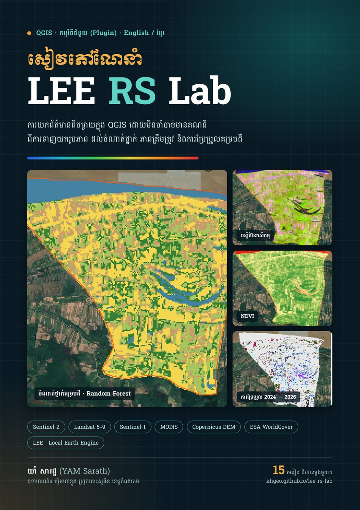

# LEE RS Lab — ការយកព័ត៌មានពីចម្ងាយក្នុង QGIS ដោយមិនចាំបាច់មានគណនី

**A remote sensing lab inside QGIS — no account, no login. English / ខ្មែរ.**

[](https://khgeo.github.io/lee-rs-lab/)
[](https://github.com/khgeo/lee-rs-lab/releases/latest)
[](LICENSE)
[](https://creativecommons.org/licenses/by-sa/4.0/)

LEE (*Local Earth Engine*) RS Lab downloads free imagery (Sentinel-2, Landsat 5–9, Sentinel-1, MODIS, DEM,
land cover, surface water) from Microsoft Planetary Computer and Earth Search, and runs the whole remote sensing
workflow on your own computer: composites, band combinations, indices, filters, PCA, unsupervised and supervised
classification, accuracy assessment (Cochran sampling, Olofsson area-adjusted estimates), from → to change detection
with a Sankey diagram, map layout, a PDF report, and Earth-Engine-style scripts (32 examples).



## 📖 Manual (Khmer, 15 lessons)

Read online: **https://khgeo.github.io/lee-rs-lab/** · PDF: [lee-rs-lab-manual-km.pdf](docs/downloads/lee-rs-lab-manual-km.pdf)

| | |
|---|---|
| 1–4 | Area of interest · search scenes · composite & download · DEM and other datasets |
| 5–7 | Band combinations & stretch · NDVI / MNDWI · filters & PCA |
| 8–11 | K-means · training data · Random Forest and 6 other classifiers · accuracy |
| 12–13 | Clean-up, polygons & map layout · from → to change 2024 → 2026 with Sankey |
| 14–15 | LEE scripts (land surface temperature, Sentinel-1 rice calendar) · PDF report |

Every lesson uses one real example — Moha Khnhoung commune, Kaoh Soutin, Kampong Cham — with annotated screenshots
whose red numbers match the steps.

## Install the plugin

1. QGIS 3.22 – 3.44 → **Plugins › Manage and Install Plugins…**
2. **Settings** tab → tick **Show also experimental plugins** (LEE RS Lab is experimental for now).
3. **All** tab → search **LEE RS Lab** → **Install Plugin**. QGIS then offers updates automatically.
4. Click the LEE RS Lab icon on the toolbar. Optional: *1 Data › Setup › Install scikit-learn* for Random Forest, SVM and kNN.

Offline classroom? Download **lee_rs_lab.zip** from [Releases](https://github.com/khgeo/lee-rs-lab/releases/latest) and use **Install from ZIP** instead.

The **Help** button in the plugin opens a short offline guide with a link to this manual.

## Repository

```
rs_lab/                    QGIS plugin (folder name QGIS installs)
docs/                      Manual (MkDocs Material) → GitHub Pages
  index.md, lessons/       15 lessons
  assets/img/              annotated screenshots and charts
  downloads/               PDF of the manual
mkdocs.yml
.github/workflows/
  deploy.yml               builds the manual on every push to main
  release.yml              push to main → release v<version> with lee_rs_lab.zip + PDF
```

Release a new version: raise `version=` in `rs_lab/metadata.txt` and push to `main` — the workflow creates release v<version> with the zip and the PDF.

## Author and licences

YAM Sarath (យាំ សារដ្ឋ) · Part of the [khgeo](https://khgeo.github.io/) book series.
Plugin code: GPL-2.0-or-later. Manual text and figures: CC BY-SA 4.0. Khmer fonts (Battambang, Siemreap, Moul) by
Danh Hong, SIL Open Font License.
