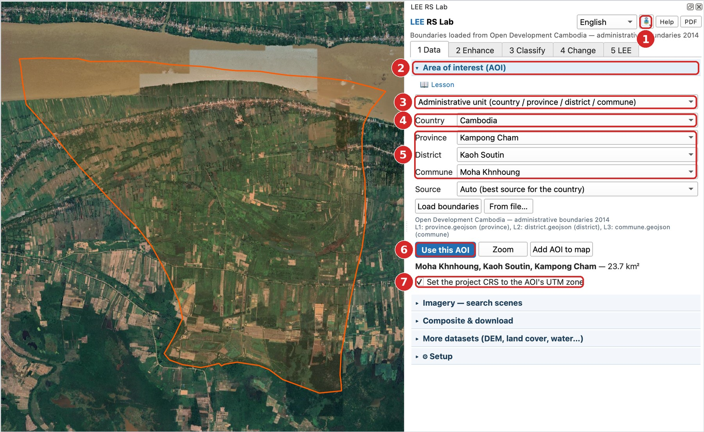
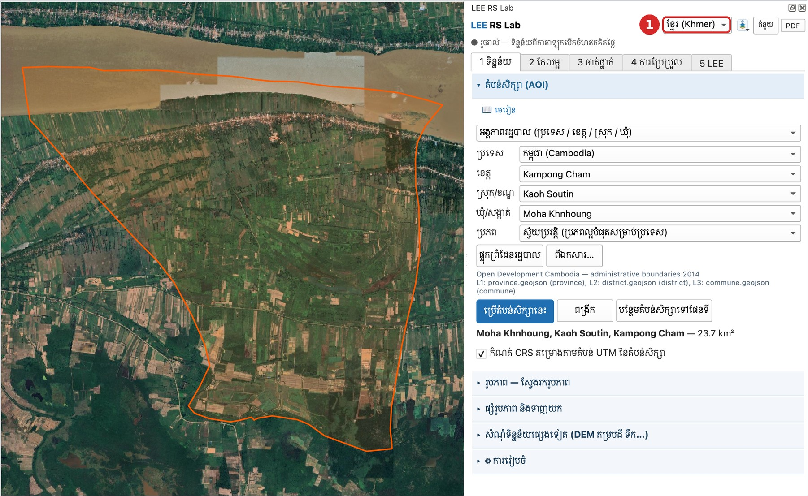

# មេរៀនទី 1 — កំណត់តំបន់សិក្សា (AOI)

តំបន់សិក្សាកំណត់ថា កន្លែងណាដែលត្រូវទាញយក និងវិភាគ។ កម្មវិធីជំនួយ (Plugin) អានតែភីកសែលក្នុងតំបន់នេះប៉ុណ្ណោះ ដូច្នេះតំបន់តូច = ទាញយកលឿន។

## ជំហាន

1. បន្ថែមផែនទីមូលដ្ឋានដោយប៊ូតុងផែនទីមូលដ្ឋាននៅផ្នែកខាងលើ (ឧ. **Google Satellite**) ដើម្បីមើលផែនដី។
2. ក្នុងផ្ទាំង **1 ទិន្នន័យ** បើកផ្នែក **តំបន់សិក្សា (AOI)**។
3. នៅប្រអប់ទីមួយ ជ្រើស **អង្គភាពរដ្ឋបាល (ប្រទេស / ខេត្ត / ស្រុក / ឃុំ)**។ ជម្រើសផ្សេងទៀត៖ វិសាលភាពផែនទី គូសចតុកោណ ឬស្រទាប់ពហុកោណ។
4. ជ្រើស **ប្រទេស** = កម្ពុជា។ ព្រំដែនផ្ទុកដោយខ្លួនឯងពី Open Development Cambodia (ព្រំដែនរដ្ឋបាល 2014)។
5. ជ្រើស **ខេត្ត** កំពង់ចាម → **ស្រុក/ខណ្ឌ** កោះសូទិន → **ឃុំ/សង្កាត់** មហាខ្ញូង។
6. ចុច **ប្រើតំបន់សិក្សានេះ**។ គែមពណ៌ទឹកក្រូចលេចឡើងលើផែនទី និងបង្ហាញផ្ទៃក្រឡា **23.7 គ.ម²**។
7. ទុកធីក **កំណត់ CRS គម្រោងតាមតំបន់ UTM នៃតំបន់សិក្សា**។ គម្រោងប្ដូរទៅ **EPSG:32648** (WGS 84 / UTM 48N) ដែលវាស់ចម្ងាយ និងផ្ទៃក្រឡាជាម៉ែត្រ។

ប៊ូតុងផ្សេងទៀត៖ **ពង្រីក** (ពង្រីកទៅតំបន់) និង **បន្ថែមតំបន់សិក្សាទៅផែនទី** (រក្សាទុកជាស្រទាប់ពហុកោណ)។

{ loading=lazy }

*រូបទី 1 — តំបន់សិក្សាឃុំមហាខ្ញូង (ភាសាអង់គ្លេស) — លេខ 1–7 ក្នុងរូប = លេខជំហាន*

## ប្ដូរភាសា

ជ្រើស **ខ្មែរ (Khmer)** នៅខាងលើ។ ផ្ទាំងទាំងមូលប្ដូរទៅជាភាសាខ្មែរ ដោយរក្សាការជ្រើសរើស និងតំបន់សិក្សាដដែល។ ឈ្មោះស្រទាប់ និងតារាងសម្គាល់ក៏ប្ដូរភាសាដែរ។

{ loading=lazy }

*រូបទី 2 — ផ្ទាំងដដែល ជាភាសាខ្មែរ — ① ប្រអប់ជ្រើសភាសា*

> គន្លឹះ៖ ព្រំដែនផ្ទុកម្ដងហើយរក្សាទុកក្នុងឃ្លាំង (cache)។ លើកក្រោយបើកលឿន និងអាចប្រើគ្មានអ៊ីនធឺណិត។

---

[← ទំព័រដើម](../index.md) · [មេរៀនទី 2 →](lesson-02.md)
