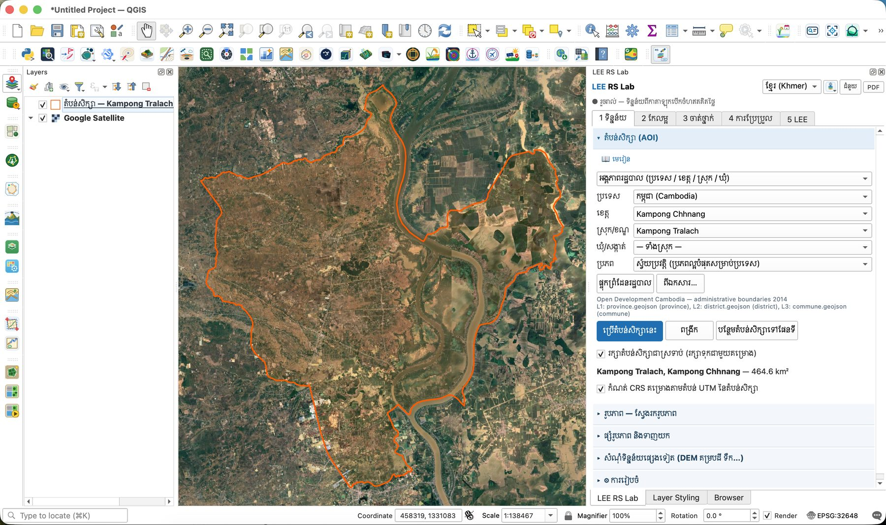

# មេរៀនទី 1 — កំណត់តំបន់សិក្សា (AOI)

តំបន់សិក្សាកំណត់ថា កន្លែងណាដែលត្រូវទាញយក និងវិភាគ។ កម្មវិធីជំនួយ (Plugin) អានតែភីកសែលក្នុងតំបន់នេះប៉ុណ្ណោះ ដូច្នេះតំបន់តូច = ទាញយកលឿន។ ក្នុងសៀវភៅនេះ យើងសិក្សា **ស្រុកកំពង់ត្រឡាច ខេត្តកំពង់ឆ្នាំង** (464.6 គ.ម²) ដែលមានទន្លេសាបហូរកាត់កណ្ដាល។

!!! info "របៀប មូលដ្ឋាន / កម្រិតខ្ពស់ (កំណែ 2.4.0)"
    នៅផ្នែកខាងលើផ្ទាំង ជាប់នឹងប្រអប់ភាសា មានប្រអប់ **មូលដ្ឋាន / កម្រិតខ្ពស់**។ **មូលដ្ឋាន** (លំនាំដើម) បង្ហាញតែជំហានសំខាន់ៗ៖ តំបន់សិក្សា រូបភាព បន្សំប៊ែន សន្ទស្សន៍ K-means ទិន្នន័យហ្វឹកហាត់ (ដំបងវេទមន្ត) ចំណាត់ថ្នាក់ ភាពត្រឹមត្រូវ ប្លង់ផែនទី និងការប្រែប្រួល។ **កម្រិតខ្ពស់** បង្ហាញឧបករណ៍ទាំងអស់បន្ថែម៖ តម្រងលំហ PCA ISODATA ក្បួនដោះស្រាយចំណាត់ថ្នាក់ផ្សេងៗ ហត្ថលេខាវិសាលគម ហ្វឹកហាត់ពី WorldCover ការច្រោះ/នាំចេញពហុកោណ និងផ្ទាំង **5 LEE**។ គ្មានមុខងារណាត្រូវបានលុបទេ — មេរៀនដែលត្រូវការរបៀបកម្រិតខ្ពស់មានសញ្ញាប្រាប់។

## ជំហាន

1. បន្ថែមផែនទីមូលដ្ឋានដោយប៊ូតុងផែនទីមូលដ្ឋាននៅផ្នែកខាងលើ (ឧ. **Google Satellite**) ដើម្បីមើលផែនដី។
2. ក្នុងផ្ទាំង **1 ទិន្នន័យ** បើកផ្នែក **តំបន់សិក្សា (AOI)**។
3. នៅប្រអប់ទីមួយ ជ្រើស **អង្គភាពរដ្ឋបាល (ប្រទេស / ខេត្ត / ស្រុក / ឃុំ)**។ ជម្រើសផ្សេងទៀត៖ វិសាលភាពផែនទី គូសចតុកោណ ឬស្រទាប់ពហុកោណ។
4. **ប្រភពព្រំដែន** ទុក **ស្វ័យប្រវត្តិ**។ សម្រាប់កម្ពុជា ព្រំដែនផ្ទុកពី Open Development Cambodia (ព្រំដែនរដ្ឋបាល 2014) ដែលមានឈ្មោះខ្មែរ។
5. ជ្រើស **ប្រទេស** កម្ពុជា → **ខេត្ត** កំពង់ឆ្នាំង → **ស្រុក/ខណ្ឌ** កំពង់ត្រឡាច → **ឃុំ/សង្កាត់** «— ស្រុកទាំងមូល —»។
6. ចុច **ប្រើតំបន់សិក្សានេះ**។ គែមពណ៌ទឹកក្រូចលេចឡើងលើផែនទី ហើយផ្ទាំងបង្ហាញផ្ទៃក្រឡា **464.6 គ.ម²**។
7. ទុកធីក **កំណត់ CRS គម្រោងតាមតំបន់ UTM នៃតំបន់សិក្សា**។ គម្រោងប្ដូរទៅ **EPSG:32648** (WGS 84 / UTM 48N) ដែលវាស់ចម្ងាយ និងផ្ទៃក្រឡាជាម៉ែត្រ។ ទុកធីក **រក្សាតំបន់សិក្សាជាស្រទាប់** ផងដែរ ដើម្បីឲ្យស្រទាប់ «តំបន់សិក្សា — Kampong Tralach, Kampong Chhnang» នៅក្នុងគម្រោង ហើយត្រឡប់មកវិញដោយស្វ័យប្រវត្តិពេលបើកគម្រោងម្ដងទៀត។

ប៊ូតុងផ្សេងទៀត៖ **ពង្រីក** (ពង្រីកទៅតំបន់) និង **បន្ថែមតំបន់សិក្សាទៅផែនទី** (រក្សាទុកជាស្រទាប់ពហុកោណ)។

{ loading=lazy }

*រូបទី 1 — តំបន់សិក្សាស្រុកកំពង់ត្រឡាច ខេត្តកំពង់ឆ្នាំង (464.6 គ.ម²) លើ Google Satellite*

## ប្ដូរភាសា

ជ្រើស **ខ្មែរ (Khmer)** ឬ **English** នៅខាងលើផ្ទាំង។ ផ្ទាំងទាំងមូលប្ដូរភាសាភ្លាមៗ ដោយរក្សាការជ្រើសរើស និងតំបន់សិក្សាដដែល។ ឈ្មោះស្រទាប់ និងតារាងសម្គាល់ក៏ប្ដូរភាសាដែរ។ រូបថតទាំងអស់ក្នុងសៀវភៅនេះប្រើផ្ទាំងភាសាខ្មែរ។

> គន្លឹះ៖ ព្រំដែនផ្ទុកម្ដងហើយរក្សាទុកក្នុងឃ្លាំង (cache)។ លើកក្រោយបើកលឿន និងអាចប្រើគ្មានអ៊ីនធឺណិត។

> សំណួរសម្រាប់និស្សិត៖ ហេតុអ្វីបានជាយើងត្រូវការ CRS ជាម៉ែត្រ (UTM) ជាជាងដឺក្រេ (EPSG:4326) នៅពេលគណនាផ្ទៃក្រឡាជាហិកតា?

---

[← ទំព័រដើម](../index.md) · [មេរៀនទី 2 →](lesson-02.md)
