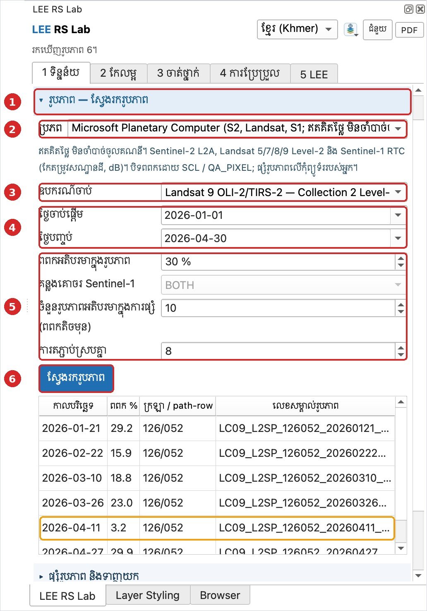

# មេរៀនទី 2 — ស្វែងរករូបភាពផ្កាយរណប

ស្វែងរកមុនទាញយក ដើម្បីមើលថាមានរូបភាពប៉ុន្មាន និងពពកប៉ុន្មាន។ ក្នុងឧទាហរណ៍នេះ យើងរកឃើញ **61 រូបភាព** Landsat 9 ក្នុងរដូវប្រាំង ឆ្នាំ 2026។

## ជំហាន

1. បើកផ្នែក **រូបភាព — ស្វែងរករូបភាព**។
2. **ប្រភព**៖ Microsoft Planetary Computer (ឥតគិតថ្លៃ មិនចាំបាច់ចូលគណនី)។ មាន Sentinel-2 L2A, Landsat 5/7/8/9 Level-2 និង Sentinel-1 RTC។
3. **ឧបករណ៍ចាប់**៖ Landsat 9 OLI-2/TIRS-2 — Collection 2 Level-2 (ការចាំងផ្លាតលើផ្ទៃដី 30 ម៉ែត្រ)។
4. **ថ្ងៃចាប់ផ្តើម** 2026-01-01 · **ថ្ងៃបញ្ចប់** 2026-04-30 (រដូវប្រាំង ពពកតិច)។
5. **ពពកអតិបរមាក្នុងរូបភាព** 30%។ **ចំនួនរូបភាពអតិបរមាក្នុងការផ្សំ** 10 (យករូបភាពដែលមានពពកតិចមុន)។ **ការតភ្ជាប់ស្របគ្នា** 8 (បន្ថយទៅ 2–4 បើអ៊ីនធឺណិតយឺត)។
6. ចុច **ស្វែងរករូបភាព**។ តារាងបង្ហាញកាលបរិច្ឆេទ % ពពក ក្រឡា path/row (126/052) និងលេខសម្គាល់រូបភាព។

មើលតារាង៖ រូបភាព 2026-04-11 មានពពកតែ 3.2% — ល្អបំផុតបើចង់ប្រើរូបភាពតែមួយ។ អ្នកអាចជ្រើសជួរក្នុងតារាង ហើយប្រើរបៀបផ្សំ «រូបភាពដែលបានជ្រើស»។

{ loading=lazy }

*រូបទី 3 — លទ្ធផលស្វែងរក Landsat 9 (61 រូបភាព)*

> សំណួរសម្រាប់និស្សិត៖ ហេតុអ្វីបានជាយើងជ្រើសរដូវប្រាំងសម្រាប់រូបភាពអុបទិកនៅកម្ពុជា?

---

[← មេរៀនទី 1](lesson-01.md) · [មេរៀនទី 3 →](lesson-03.md)
