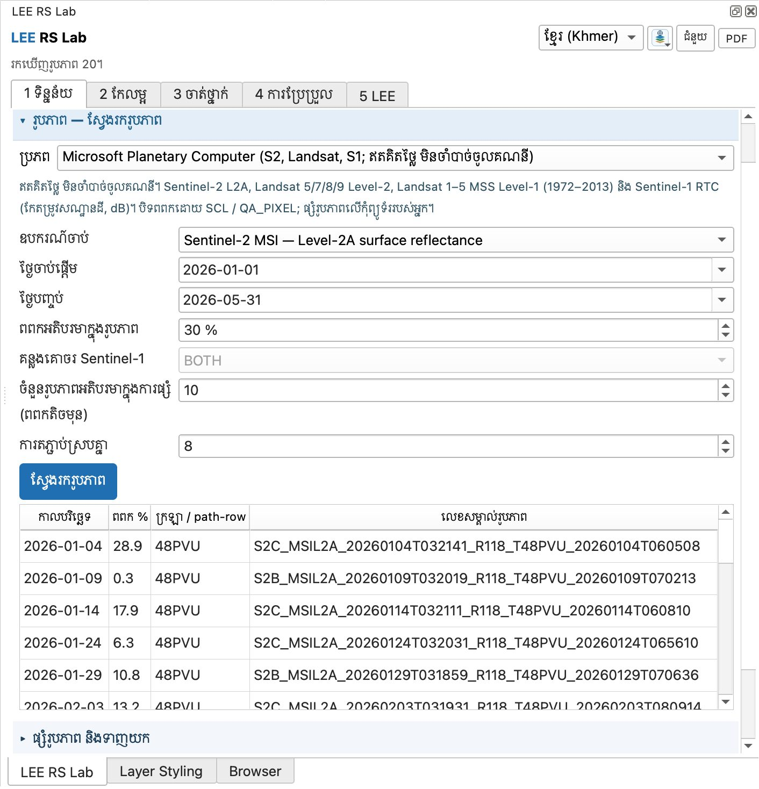
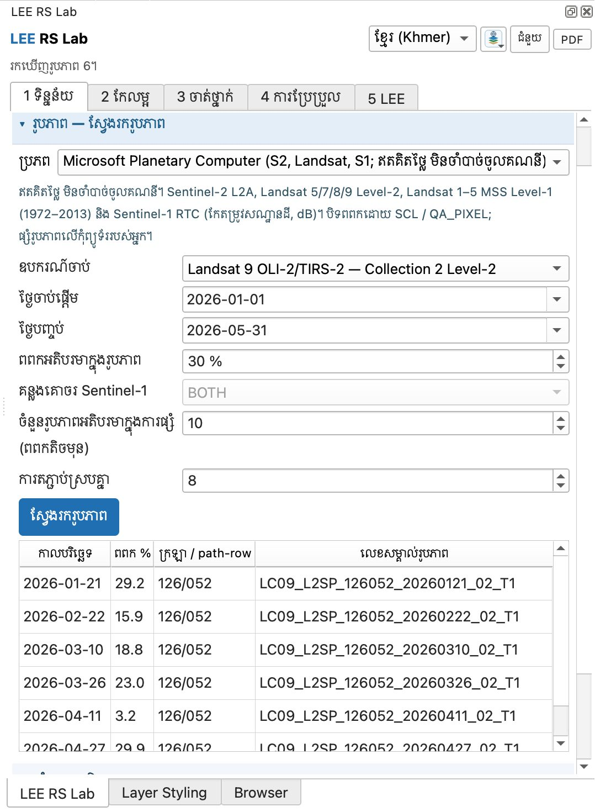

# មេរៀនទី 2 — ស្វែងរករូបភាពផ្កាយរណប

ស្វែងរកមុនទាញយក ដើម្បីមើលថាមានរូបភាពប៉ុន្មាន និងពពកប៉ុន្មាន។ សម្រាប់ស្រុកកំពង់ត្រឡាច ខែមករា–ឧសភា 2026 យើងរកឃើញ **Sentinel-2 ចំនួន 20 រូបភាព** និង **Landsat 9 ចំនួន 6 រូបភាព** ដែលមានពពកតិចជាង 30%។

## ជំហាន

1. បើកផ្នែក **រូបភាព — ស្វែងរករូបភាព**។
2. **ប្រភព**៖ Microsoft Planetary Computer (ឥតគិតថ្លៃ មិនចាំបាច់ចូលគណនី)។ មាន Sentinel-2 L2A, Landsat 5/7/8/9 Level-2, Landsat 1–5 MSS Level-1 (1972–2013) និង Sentinel-1 RTC។
3. **ឧបករណ៍ចាប់**៖ ជ្រើស **Sentinel-2 MSI — Level-2A** ជាមុនសិន ដើម្បីមើលចំនួនរូបភាព។
4. **ថ្ងៃចាប់ផ្តើម** 2026-01-01 · **ថ្ងៃបញ្ចប់** 2026-05-31 (រដូវប្រាំង ពពកតិច)។
5. **ពពកអតិបរមាក្នុងរូបភាព** 30%។ **ចំនួនរូបភាពអតិបរមាក្នុងការផ្សំ** 10 (យករូបភាពដែលមានពពកតិចមុន)។ **ការតភ្ជាប់ស្របគ្នា** 8 (បន្ថយទៅ 2–4 បើអ៊ីនធឺណិតយឺត)។
6. ចុច **ស្វែងរករូបភាព**។ តារាងបង្ហាញកាលបរិច្ឆេទ % ពពក ក្រឡា (48PVU) និងលេខសម្គាល់រូបភាព — **20 រូបភាព**។

{ loading=lazy }

*រូបទី 2 — លទ្ធផលស្វែងរក Sentinel-2 L2A (20 រូបភាព ក្រឡា 48PVU)*

7. ប្ដូរ **ឧបករណ៍ចាប់** ទៅ **Landsat 9 OLI-2/TIRS-2 — Collection 2 Level-2** ហើយស្វែងរកម្ដងទៀត។ បាន **6 រូបភាព** (path/row 126/052) ពពកពី 3.2% ដល់ 29.9%។

{ loading=lazy }

*រូបទី 3 — លទ្ធផលស្វែងរក Landsat 9 (6 រូបភាព)*

Sentinel-2 មករៀងរាល់ 5 ថ្ងៃ (ភីកសែល 10 ម៉ែត្រ) ចំណែក Landsat 9 មករៀងរាល់ 16 ថ្ងៃ (30 ម៉ែត្រ)។ ក្នុងមេរៀនបន្ទាប់ យើងប្រើ **Landsat 9** ព្រោះវាមានប៊ែនដូច Landsat 8 ដែលយើងនឹងប្រើសម្រាប់ឆ្នាំ 2020 ក្នុងមេរៀនទី 13 (ការប្រែប្រួល)។ អ្នកអាចជ្រើសជួរក្នុងតារាង ហើយប្រើរបៀបផ្សំ «រូបភាពដែលបានជ្រើស» ប្រសិនបើចង់ប្រើតែរូបភាពមួយចំនួន។

> សំណួរសម្រាប់និស្សិត៖ ហេតុអ្វីបានជាយើងជ្រើសរដូវប្រាំងសម្រាប់រូបភាពអុបទិកនៅកម្ពុជា? ហេតុអ្វីបានជាការប្រៀបធៀបឆ្នាំពីរ ត្រូវប្រើខែដូចគ្នា?

---

[← មេរៀនទី 1](lesson-01.md) · [មេរៀនទី 3 →](lesson-03.md)
