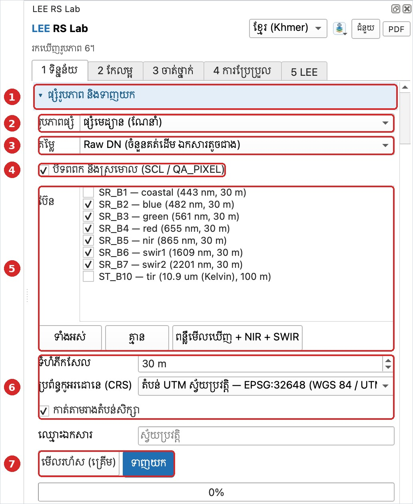
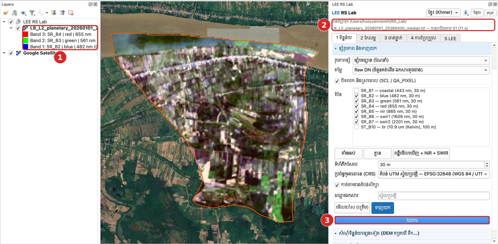

# មេរៀនទី 3 — ផ្សំរូបភាព និងទាញយក

កម្មវិធីជំនួយ (Plugin) ផ្សំរូបភាពច្រើនជារូបភាពតែមួយ (composite) ដោយបិទពពកចេញជាមុន។ ក្នុងឧទាហរណ៍នេះ វាប្រើ **51 រូបភាព** ហើយចំណាយពេលតែ **11 វិនាទី** ព្រោះអានតែភីកសែលក្នុងតំបន់សិក្សា។

## ជំហាន

1. បើកផ្នែក **ផ្សំរូបភាព និងទាញយក**។
2. **រូបភាពផ្សំ**៖ ផ្សំមេដ្យាន (median — ណែនាំ)។ មេដ្យានយកតម្លៃកណ្ដាលនៃភីកសែលនីមួយៗ ដូច្នេះពពក និងស្រមោលដែលនៅសល់ត្រូវបាត់។
3. **តម្លៃ**៖ Raw DN (ចំនួនគត់ដើម ឯកសារតូចជាង)។ នៅមេរៀនទី 6 យើងនឹងបំប្លែងវាទៅជាការចាំផ្លាត 0–1។
4. ទុកធីក **បិទពពក និងស្រមោល (SCL / QA\_PIXEL)**។
5. **ប៊ែន**៖ ជ្រើស SR\_B2 (blue) ដល់ SR\_B7 (swir2)។ ប៊ូតុង **ពន្លឺមើលឃើញ + NIR + SWIR** ជ្រើសឲ្យភ្លាមៗ។ ប៊ែន coastal និងកម្ដៅ (ST\_B10) មិនចាំបាច់សម្រាប់ចំណាត់ថ្នាក់ទេ។
6. **ទំហំភីកសែល** 30 m · **ប្រព័ន្ធកូអរដោនេ (CRS)**៖ តំបន់ UTM ស្វ័យប្រវត្តិ — EPSG:32648។ ទុកធីក **កាត់តាមរាងតំបន់សិក្សា**។
7. ចុច **មើលរហ័ស (គ្រើម)** ដើម្បីមើលរូបភាពកម្រិតទាបជាមុន ឬចុច **ទាញយក** ដើម្បីទាញយកពេញ។

{ loading=lazy }

*រូបទី 4 — ការកំណត់ផ្សំរូបភាព និងប៊ែន*

## លទ្ធផល

ស្រទាប់ថ្មី `L9_L2_planetary_20260101_20260430_median` លេចឡើងក្នុងក្រុម **LEE RS Lab** ហើយឯកសារ GeoTIFF ត្រូវបានរក្សាទុកក្នុងថត `RS_Lab`។ វាបង្ហាញជាពណ៌ពិត (ប៊ែន 4-3-2) ហើយកាត់តាមរាងឃុំយ៉ាងត្រឹមត្រូវ។ ប្រអប់រូបភាពនៅផ្ទាំងផ្សេងៗត្រូវបានបំពេញដោយស្វ័យប្រវត្តិ។

{ loading=lazy }

*រូបទី 5 — រូបភាពផ្សំ Landsat 9 ពណ៌ពិត (51 រូបភាព 11 វិនាទី)៖ ① ស្រទាប់ថ្មីក្នុងក្រុម LEE RS Lab ② ទីតាំងឯកសារដែលបានរក្សាទុក ③ ដំណើរការ 100%*

> ចំណាំ៖ ពណ៌ពិតមើលទៅងងឹត និងមានភីកសែលធំ ព្រោះ Landsat មានភីកសែល 30 ម៉ែត្រ និងការលាតពន្លឺលំនាំដើម។ មេរៀនទី 5 បង្ហាញពីរបៀបធ្វើឲ្យវាច្បាស់ជាង។

---

[← មេរៀនទី 2](lesson-02.md) · [មេរៀនទី 4 →](lesson-04.md)
