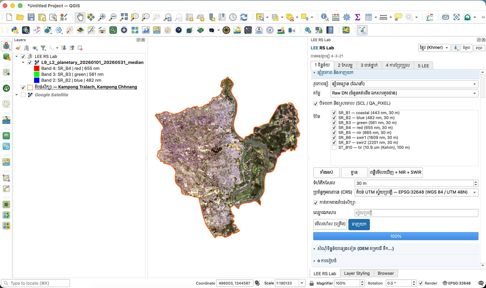

# មេរៀនទី 3 — ផ្សំរូបភាព និងទាញយក

កម្មវិធីជំនួយ (Plugin) ផ្សំរូបភាពច្រើនជារូបភាពតែមួយ (composite) ដោយបិទពពកចេញជាមុន។ វាអានតែភីកសែលក្នុងតំបន់សិក្សា ដូច្នេះសូម្បីតែស្រុកទាំងមូល ក៏ទាញយកបានក្នុងរយៈពេលខ្លី។

## ជំហាន

1. បើកផ្នែក **ផ្សំរូបភាព និងទាញយក** (ឧបករណ៍ចាប់ Landsat 9 ពីមេរៀនទី 2)។
2. **រូបភាពផ្សំ**៖ ផ្សំមេដ្យាន (median — ណែនាំ)។ មេដ្យានយកតម្លៃកណ្ដាលនៃភីកសែលនីមួយៗ ដូច្នេះពពក និងស្រមោលដែលនៅសល់ត្រូវបាត់។
3. **តម្លៃ**៖ Raw DN (ចំនួនគត់ដើម ឯកសារតូចជាង)។ នៅមេរៀនទី 6 យើងនឹងបំប្លែងវាទៅជាការចាំងផ្លាត 0–1។
4. ទុកធីក **បិទពពក និងស្រមោល (SCL / QA\_PIXEL)**។
5. **ប៊ែន**៖ SR\_B1 (coastal) ដល់ SR\_B7 (swir2) — ទុក ST\_B10 (កម្ដៅ 100 ម៉ែត្រ) មិនធីក។ ប៊ូតុង **ពន្លឺមើលឃើញ + NIR + SWIR** ជ្រើសប៊ែនដែលត្រូវការសម្រាប់ចំណាត់ថ្នាក់ភ្លាមៗ។
6. **ទំហំភីកសែល** 30 m · **ប្រព័ន្ធកូអរដោនេ (CRS)**៖ តំបន់ UTM ស្វ័យប្រវត្តិ — EPSG:32648 (WGS 84 / UTM 48N)។ ទុកធីក **កាត់តាមរាងតំបន់សិក្សា**។ **ឈ្មោះឯកសារ** ទុកទទេ = ស្វ័យប្រវត្តិ។
7. ចុច **មើលរហ័ស (គ្រើម)** ដើម្បីមើលរូបភាពកម្រិតទាបជាមុន ឬចុច **ទាញយក** ដើម្បីទាញយកពេញ។ របារដំណើរការឡើងដល់ **100%**។

{ loading=lazy }

*រូបទី 4 — ការកំណត់ផ្សំរូបភាព និងលទ្ធផល Landsat 9 ពណ៌ពិត កាត់តាមរាងស្រុក*

## លទ្ធផល

ស្រទាប់ថ្មី `L9_L2_planetary_20260101_20260531_median` លេចឡើងក្នុងក្រុម **LEE RS Lab** ហើយឯកសារ GeoTIFF ត្រូវបានរក្សាទុកក្នុងថត `RS_Lab`។ វាបង្ហាញជាពណ៌ពិត (ប៊ែន 4-3-2) ហើយកាត់តាមរាងស្រុកយ៉ាងត្រឹមត្រូវ។ ប្រអប់ **រូបភាព** នៅផ្ទាំងផ្សេងៗ (កែលម្អ ចាត់ថ្នាក់) ត្រូវបានបំពេញដោយស្វ័យប្រវត្តិ។

នៅលើរូបភាព ស្រុកចែកជាពីរផ្នែកច្បាស់៖ ខាងលិចទន្លេសាប ជាស្រែប្រាំងទំនេរ (ពណ៌ត្នោត/ប្រផេះ) និងខាងកើតទន្លេ ជាដីលិចទឹកដែលមានរុក្ខជាតិ និងបឹង។

> ចំណាំ៖ ពណ៌ពិតមើលទៅងងឹត និងមានភីកសែលធំ ព្រោះ Landsat មានភីកសែល 30 ម៉ែត្រ និងការលាតពន្លឺលំនាំដើម។ មេរៀនទី 5 បង្ហាញពីរបៀបធ្វើឲ្យវាច្បាស់ជាង។

---

[← មេរៀនទី 2](lesson-02.md) · [មេរៀនទី 4 →](lesson-04.md)
