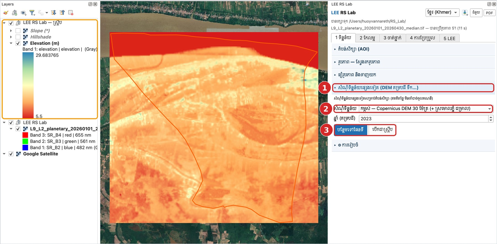
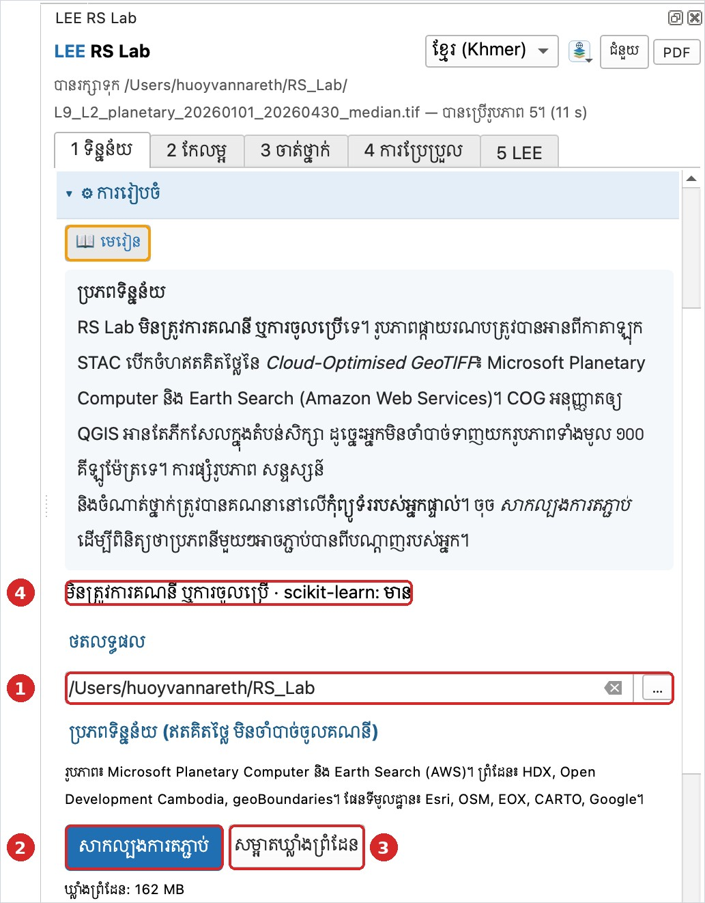

# មេរៀនទី 4 — សំណុំទិន្នន័យផ្សេងទៀត និងការរៀបចំ

ក្រៅពីរូបភាពផ្កាយរណប អ្នកអាចទាញយកទិន្នន័យស្រាប់សម្រាប់តំបន់សិក្សាដោយចុចតែម្ដង៖ កម្ពស់ (Copernicus DEM, NASADEM) គម្របដី (ESA WorldCover, គម្របដីប្រចាំឆ្នាំ) ផ្ទៃទឹក JRC និង MODIS NDVI។

## ជំហាន — កម្ពស់ដី

1. បើកផ្នែក **សំណុំទិន្នន័យផ្សេងទៀត (DEM គម្របដី ទឹក…)**។
2. **សំណុំទិន្នន័យ**៖ កម្ពស់ — Copernicus DEM 30 ម៉ែត្រ (+ ស្រមោលភ្នំ ជម្រាល)។ (**ឆ្នាំ** ប្រើតែសម្រាប់គម្របដីប្រចាំឆ្នាំប៉ុណ្ណោះ។)
3. ចុច **បន្ថែមទៅផែនទី**។ ប៊ូតុង **បើកជាស្គ្រីប** បង្ហាញកូដ LEE ដែលធ្វើការងារដដែល ជាមេរៀនសរសេរកូដ។

លទ្ធផលគឺស្រទាប់បីក្នុងក្រុម **LEE RS Lab — ស្គ្រីប**៖ **Elevation (m)** · **Hillshade** · **Slope (°)**។ ក្នុងឃុំមហាខ្ញូង កម្ពស់មានចន្លោះពី **5.5 ដល់ 29.7 ម៉ែត្រ** — ដីទំនាបលិចទឹកនៃទន្លេមេគង្គ។ ចំណាំថា DEM គ្របដណ្ដប់ចតុកោណផ្ទៃទាំងមូល មិនមែនកាត់តាមរាងឃុំទេ។ មាត់ទន្លេ (ពណ៌ក្រហមនៅខាងលើ) មានតម្លៃទាបបំផុត។

{ loading=lazy }

*រូបទី 6 — កម្ពស់ដី Copernicus DEM នៃឃុំមហាខ្ញូង (5.5–29.7 ម៉ែត្រ) — ប្រអប់លឿង = ស្រទាប់លទ្ធផលទាំងបី*

## ការរៀបចំ (Setup)

ផ្នែក **⚙ ការរៀបចំ** មាន៖

- ① **ថតលទ្ធផល** — កន្លែងរក្សាទុកឯកសារទាំងអស់ (លំនាំដើម `~/RS_Lab`)។
- ② **សាកល្បងការតភ្ជាប់** — ពិនិត្យថា Planetary Computer, Earth Search, HDX, geoBoundaries និង ODC អាចភ្ជាប់បាន។ ប្រើវាមុនម៉ោងសិក្សា។
- ③ **សម្អាតឃ្លាំងព្រំដែន** — ឃ្លាំងព្រំដែនមានទំហំ 162 MB។
- ④ **scikit-learn** — កញ្ចប់ Python សម្រាប់ Random Forest, SVM, kNN។ ប្រសិនបើបង្ហាញ «មាន» មិនចាំបាច់ដំឡើងទេ។

{ loading=lazy }

*រូបទី 7 — ផ្នែកការរៀបចំ (ប្រអប់លឿង = ប៊ូតុង 📖 មេរៀន)*

---

[← មេរៀនទី 3](lesson-03.md) · [មេរៀនទី 5 →](lesson-05.md)
