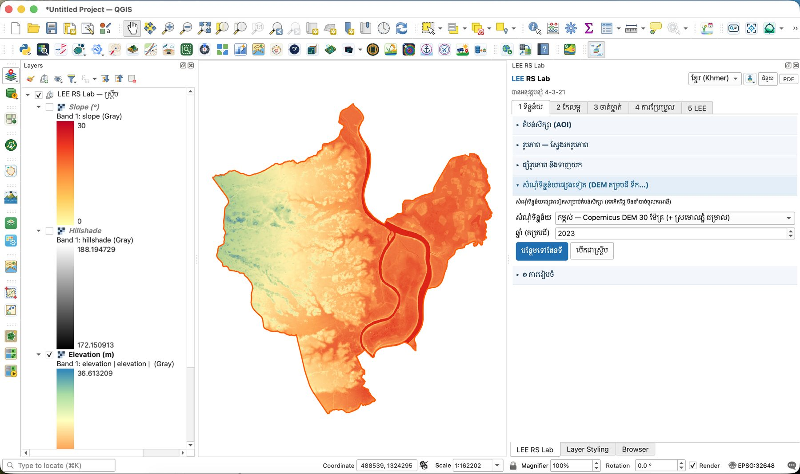
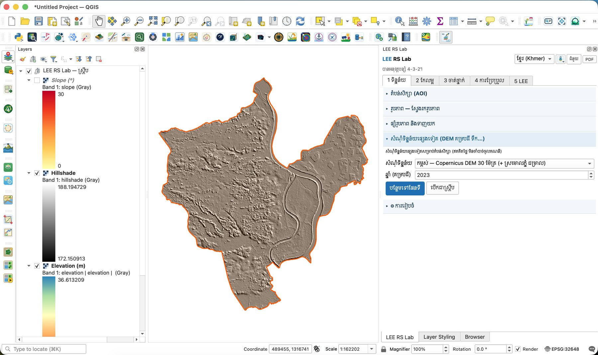
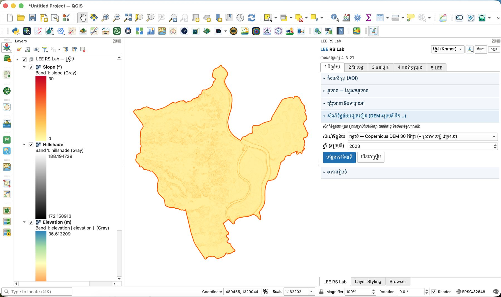
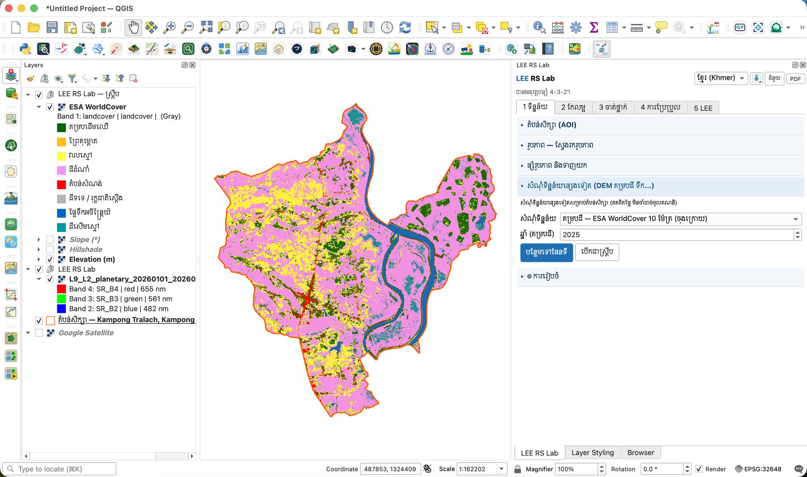
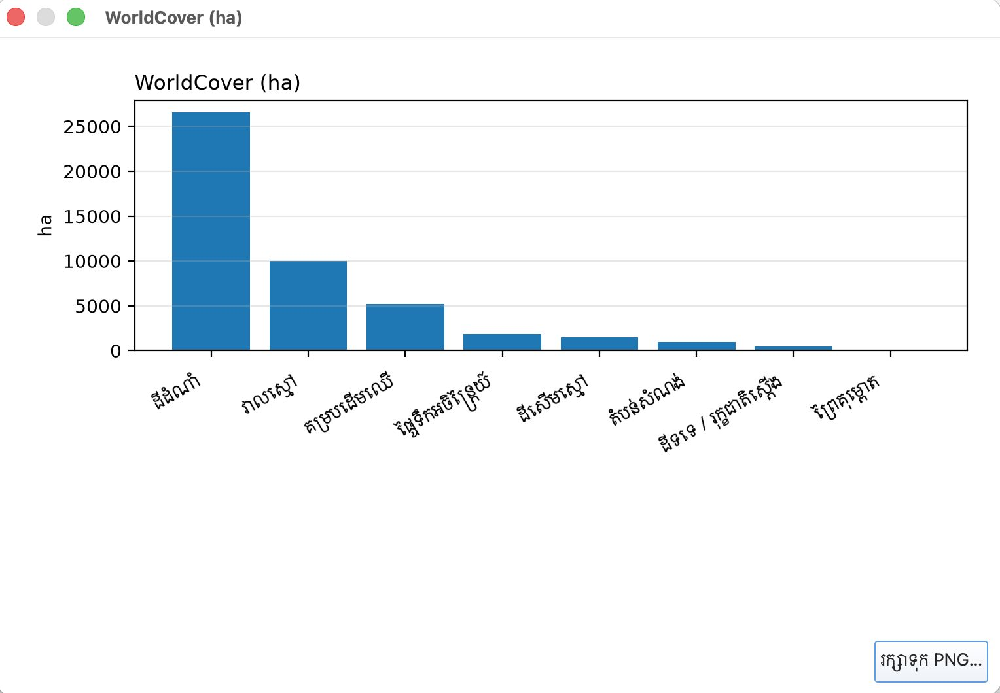
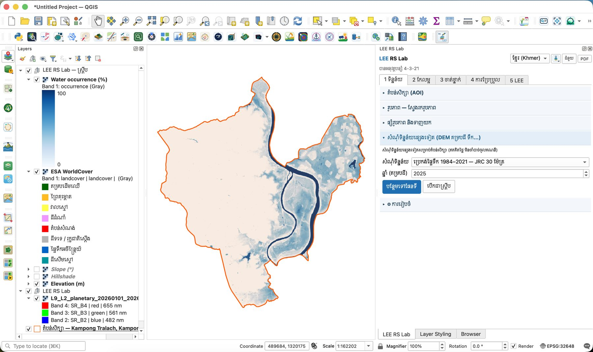
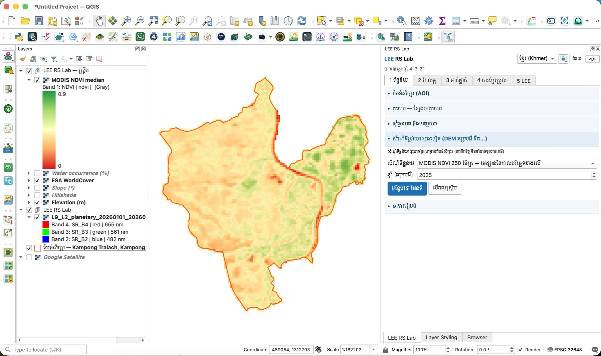

# មេរៀនទី 4 — សំណុំទិន្នន័យផ្សេងទៀត និងការរៀបចំ

ក្រៅពីរូបភាពផ្កាយរណប អ្នកអាចទាញយកទិន្នន័យស្រាប់សម្រាប់តំបន់សិក្សាដោយចុចតែម្ដង៖ កម្ពស់ (Copernicus DEM, NASADEM) គម្របដី (ESA WorldCover, គម្របដីប្រចាំឆ្នាំ) ប្រេកង់ផ្ទៃទឹក JRC និង MODIS NDVI។ ស្រទាប់ទាំងអស់ត្រូវបានកាត់តាមរាងស្រុក ហើយដាក់ក្នុងក្រុម **LEE RS Lab — ស្គ្រីប**។

## ជំហាន

1. បើកផ្នែក **សំណុំទិន្នន័យផ្សេងទៀត (DEM គម្របដី ទឹក…)**។
2. ជ្រើស **សំណុំទិន្នន័យ** មួយ។ **ឆ្នាំ (គម្របដី)** ប្រើសម្រាប់ទិន្នន័យប្រចាំឆ្នាំ (WorldCover គម្របដីប្រចាំឆ្នាំ MODIS)។
3. ចុច **បន្ថែមទៅផែនទី**។ ប៊ូតុង **បើកជាស្គ្រីប** បង្ហាញកូដ LEE ដែលធ្វើការងារដដែល ជាមេរៀនសរសេរកូដ (មេរៀនទី 14)។

## កម្ពស់ដី — Copernicus DEM 30 ម៉ែត្រ

សំណុំទិន្នន័យ **កម្ពស់ — Copernicus DEM 30 ម៉ែត្រ (+ ស្រមោលភ្នំ ជម្រាល)** បង្កើតស្រទាប់បី៖ **Elevation (m)** · **Hillshade** · **Slope (°)**។ ស្រុកកំពង់ត្រឡាចជាដីទំនាប៖ កម្ពស់ខ្ពស់បំផុតប្រហែល **36.6 ម៉ែត្រ** ហើយទន្លេសាប និងដីលិចទឹកខាងកើតទាបបំផុត (ពណ៌ក្រហម)។

{ loading=lazy }

*រូបទី 5 — កម្ពស់ដី Copernicus DEM (អតិបរមា 36.6 ម៉ែត្រ)*

{ loading=lazy }

*រូបទី 6 — ស្រមោលភ្នំ (Hillshade) បង្ហាញភ្លឺស្រែ ផ្លូវ និងមាត់ទន្លេ*

{ loading=lazy }

*រូបទី 7 — ជម្រាល (0–30°)៖ ភាគច្រើនរាបស្មើ ជម្រាលខ្ពស់នៅតែមាត់ទន្លេ និងទំនប់*

## គម្របដី — ESA WorldCover 10 ម៉ែត្រ

ជ្រើស **ESA WorldCover 10 ម៉ែត្រ** ឆ្នាំ 2025។ តារាងសម្គាល់បង្ហាញតែថ្នាក់ដែលមានក្នុងស្រុក (គ្មាន «ព្រិល និងទឹកកក» ទេ)។ ក្រាហ្វ **WorldCover (ហិកតា)** បង្ហាញថាស្រុកនេះភាគច្រើនជាដីដំណាំ។

{ loading=lazy }

*រូបទី 8 — ESA WorldCover ស្រុកកំពង់ត្រឡាច ជាមួយតារាងសម្គាល់ភាសាខ្មែរ*

{ loading=lazy }

*រូបទី 9 — ផ្ទៃក្រឡាតាមថ្នាក់ WorldCover*

| ថ្នាក់ WorldCover | ប្រហែល (ហិកតា) |
| --- | --- |
| ដីដំណាំ | 26,500 |
| វាលស្មៅ | 10,000 |
| គម្របដើមឈើ | 5,200 |
| ផ្ទៃទឹកអចិន្ត្រៃយ៍ | 1,800 |
| ដីសើមស្មៅ | 1,500 |
| តំបន់សំណង់ | 900 |
| ដីទទេ / រុក្ខជាតិស្តើង | 400 |

WorldCover ជាផែនទីសកលដែលមានស្រាប់ — ល្អសម្រាប់ប្រៀបធៀប និងជាប្រភពចំណុចហ្វឹកហាត់ស្វ័យប្រវត្តិ (មេរៀនទី 9) ប៉ុន្តែវាមិនបែងចែកស្រូវពីដំណាំផ្សេងទេ។

## ទឹក — JRC និង MODIS NDVI

- **ប្រេកង់ផ្ទៃទឹក 1984–2021 — JRC 30 ម៉ែត្រ**៖ % នៃពេលដែលភីកសែលមួយមានទឹក។ ទន្លេសាប = 100% (ខៀវចាស់) ហើយដីលិចទឹកខាងកើតមានទឹកតាមរដូវ (ខៀវស្រាល)។
- **MODIS NDVI 250 ម៉ែត្រ — មេដ្យាននៃកាលបរិច្ឆេទខាងលើ**៖ ភាពបៃតងគ្រើម (ភីកសែល 250 ម៉ែត្រ) ប៉ុន្តែមានរៀងរាល់ 16 ថ្ងៃតាំងពីឆ្នាំ 2000 — ល្អសម្រាប់មើលនិន្នាការរយៈពេលវែង។

{ loading=lazy }

*រូបទី 10 — ប្រេកង់ផ្ទៃទឹក JRC (%)៖ ទន្លេសាប និងដីលិចទឹកតាមរដូវ*

{ loading=lazy }

*រូបទី 11 — MODIS NDVI មេដ្យានឆ្នាំ 2025 (250 ម៉ែត្រ)*

## ការរៀបចំ (Setup)

ផ្នែក **⚙ ការរៀបចំ** មាន៖

- **ថតលទ្ធផល** — កន្លែងរក្សាទុកឯកសារទាំងអស់ (លំនាំដើម `~/RS_Lab`)។
- **សាកល្បងការតភ្ជាប់** — ពិនិត្យថា Planetary Computer, Earth Search, HDX, geoBoundaries និង ODC អាចភ្ជាប់បាន។ ប្រើវាមុនម៉ោងសិក្សា។
- **សម្អាតឃ្លាំងព្រំដែន** — លុបព្រំដែនដែលបានរក្សាទុក។
- **scikit-learn** — កញ្ចប់ Python សម្រាប់ Random Forest, SVM, kNN។ ប្រសិនបើបង្ហាញ «មាន» មិនចាំបាច់ដំឡើងទេ។

{ loading=lazy }

*រូបទី 12 — ផ្នែកការរៀបចំ*

> សំណួរសម្រាប់និស្សិត៖ ប្រៀបធៀបផែនទី JRC (រូបទី 10) ជាមួយ WorldCover (រូបទី 8)។ ហេតុអ្វីបានជា WorldCover ហៅដីលិចទឹកខាងកើតភាគច្រើនថា «ដីដំណាំ» ឬ «វាលស្មៅ» ជាជាង «ទឹក»?

---

[← មេរៀនទី 3](lesson-03.md) · [មេរៀនទី 5 →](lesson-05.md)
