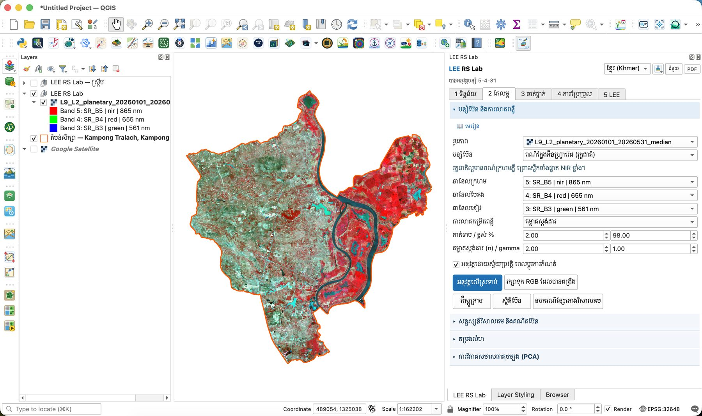
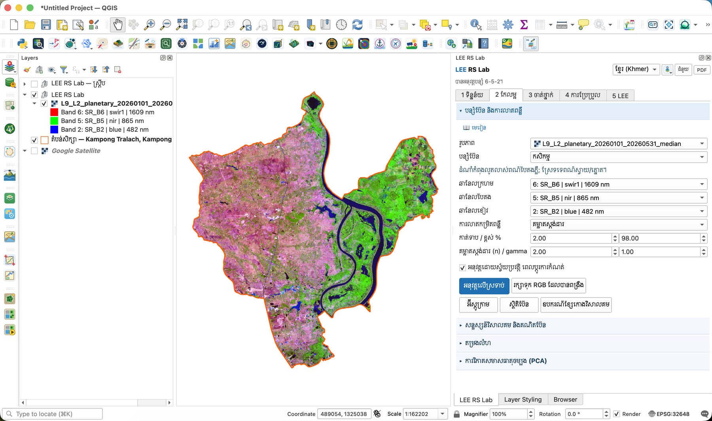
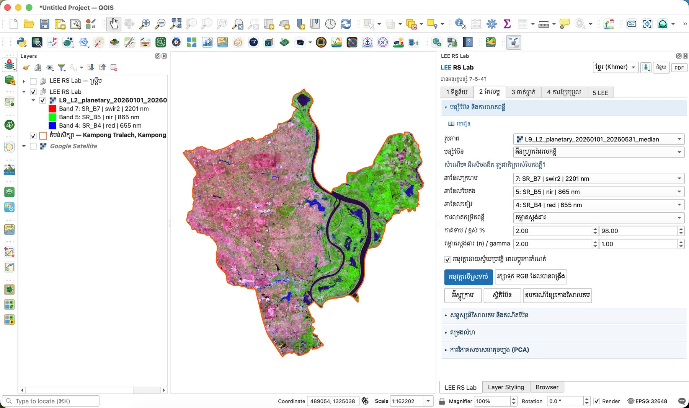
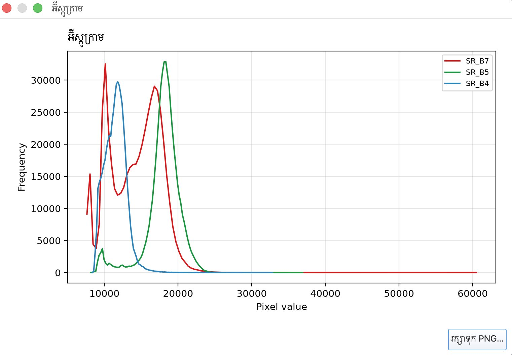
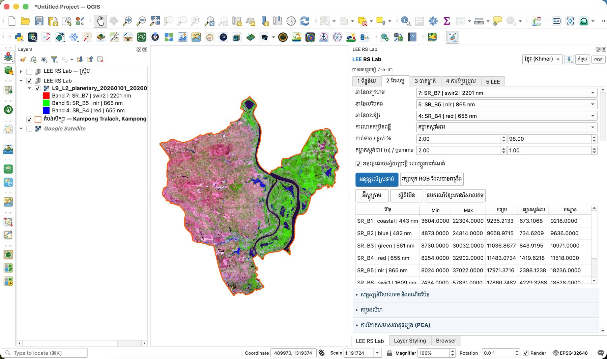

# មេរៀនទី 5 — បន្សំប៊ែន និងការលាតពន្លឺ

បន្សំប៊ែនដាក់ប៊ែនបីទៅឆានែលក្រហម បៃតង ខៀវ។ ប៊ែនមើលមិនឃើញ (NIR, SWIR) បង្ហាញភាពខុសគ្នាដែលភ្នែកមើលមិនឃើញក្នុងរូបភាពពណ៌ពិត។ ក្នុងស្រុកកំពង់ត្រឡាច បន្សំប៊ែនបង្ហាញភ្លាមៗពីភាពខុសគ្នារវាងស្រែប្រាំងទំនេរខាងលិច និងដីលិចទឹកមានរុក្ខជាតិខាងកើតទន្លេសាប។

## ជំហាន

1. ចូលផ្ទាំង **2 កែលម្អ** → ផ្នែក **បន្សំប៊ែន និងការលាតពន្លឺ**។
2. **រូបភាព**៖ `L9_L2_planetary_20260101_20260531_median` (បំពេញស្វ័យប្រវត្តិ)។
3. **បន្សំប៊ែន**៖ ជ្រើសពីបញ្ជី។ ឆានែលក្រហម/បៃតង/ខៀវបំពេញដោយខ្លួនឯង ហើយបង្ហាញការពន្យល់ខ្លីពីក្រោម។
4. **ការលាតកម្រិតពន្លឺ**៖ គម្លាតស្តង់ដារ (n = 2.00) ជាមួយការកាត់ 2 / 98%។ ជម្រើសផ្សេងទៀត៖ កាត់ភាគរយ min–max និងសមភាពអ៊ីស្តូក្រាម។ **gamma** 1.00 = មិនកែ (តូចជាង 1 = ភ្លឺជាង)។
5. ប្រអប់ **អនុវត្តដោយស្វ័យប្រវត្តិ ពេលប្ដូរការកំណត់** (ធីកជាលំនាំដើម) ធ្វើឲ្យផែនទីប្ដូរភ្លាមៗ។ **អនុវត្តលើស្រទាប់** ប្ដូររបៀបបង្ហាញ ហើយ **រក្សាទុក RGB ដែលបានពង្រឹង** បង្កើតឯកសារថ្មី។

## បន្សំប៊ែនបីសម្រាប់ Landsat 8/9

| បន្សំ | ប៊ែន (R-G-B) | អ្វីដែលលេចធ្លោ |
| --- | --- | --- |
| ពណ៌ក្លែងអ៊ីនហ្វ្រារ៉េដ (រុក្ខជាតិ) | 5-4-3 (NIR · Red · Green) | រុក្ខជាតិមានពណ៌ក្រហមភ្លឺ ព្រោះស្លឹកចាំងផ្លាត NIR ខ្លាំង |
| កសិកម្ម | 6-5-2 (SWIR1 · NIR · Blue) | ដំណាំកំពុងលូតលាស់ពណ៌បៃតងភ្លឺ ស្រែទទេពណ៌ស្វាយ/ផ្កាឈូក |
| អ៊ីនហ្វ្រារ៉េដរលកខ្លី | 7-5-4 (SWIR2 · NIR · Red) | សំណើម៖ ដីសើមងងឹត រុក្ខជាតិក្រាស់បៃតងភ្លឺ ទឹកខៀវចាស់ |

{ loading=lazy }

*រូបទី 13 — ពណ៌ក្លែងអ៊ីនហ្វ្រារ៉េដ 5-4-3៖ រុក្ខជាតិនៅដីលិចទឹកខាងកើតពណ៌ក្រហមភ្លឺ*

{ loading=lazy }

*រូបទី 14 — បន្សំកសិកម្ម 6-5-2៖ ស្រែប្រាំងទំនេរខាងលិចពណ៌ផ្កាឈូក រុក្ខជាតិខាងកើតពណ៌បៃតង*

{ loading=lazy }

*រូបទី 15 — អ៊ីនហ្វ្រារ៉េដរលកខ្លី 7-5-4*

## អ៊ីស្តូក្រាម និងស្ថិតិប៊ែន

ចុច **អ៊ីស្តូក្រាម** ដើម្បីមើលការចែកចាយតម្លៃនៃប៊ែនទាំងបី (ជា Raw DN)។ SR\_B5 (NIR ពណ៌បៃតងក្នុងក្រាហ្វ) មានកំពូលធំនៅប្រហែល 18,000 (ដី និងរុក្ខជាតិ) និងកំពូលតូចនៅប្រហែល 9,800 (ទឹក)។ SR\_B7 (SWIR2) មានកំពូលពីរ៖ ប្រហែល 10,200 (ដីសើម ទឹក រុក្ខជាតិ) និង 16,800 (ស្រែស្ងួតទំនេរ)។

{ loading=lazy }

*រូបទី 16 — អ៊ីស្តូក្រាមនៃ SR\_B7, SR\_B5, SR\_B4*

ចុច **ស្ថិតិប៊ែន** ដើម្បីមើល min, max, មធ្យម គម្លាតស្តង់ដារ និងមេដ្យាន។ **ឧបករណ៍ខ្សែកោងវិសាលគម** ឲ្យអ្នកចុចលើភីកសែលដើម្បីគូសខ្សែកោងវិសាលគម (រហូតដល់ 8)។

| ប៊ែន | Min | Max | មធ្យម | គម្លាតស្តង់ដារ | មេដ្យាន |
| --- | --- | --- | --- | --- | --- |
| SR\_B2 (blue) | 4,873 | 24,814 | 9,659 | 735 | 9,636 |
| SR\_B3 (green) | 8,730 | 30,032 | 11,037 | 844 | 10,971 |
| SR\_B4 (red) | 8,254 | 32,902 | 11,483 | 1,420 | 11,518 |
| SR\_B5 (nir) | 8,024 | 37,022 | 17,971 | 2,398 | 18,236 |
| SR\_B6 (swir1) | 7,434 | 57,831 | 17,861 | 4,229 | 18,528 |

{ loading=lazy }

*រូបទី 17 — តារាងស្ថិតិប៊ែន*

> សំណួរសម្រាប់និស្សិត៖ SR\_B6 មានគម្លាតស្តង់ដារធំបំផុត (4,229)។ តើវាប្រាប់អ្វីអំពីភាពខុសគ្នានៃសំណើមដីក្នុងស្រុកនេះ? ហេតុអ្វីបានជា max (57,831) ខ្ពស់ខ្លាំងជាងមេដ្យាន?

---

[← មេរៀនទី 4](lesson-04.md) · [មេរៀនទី 6 →](lesson-06.md)
