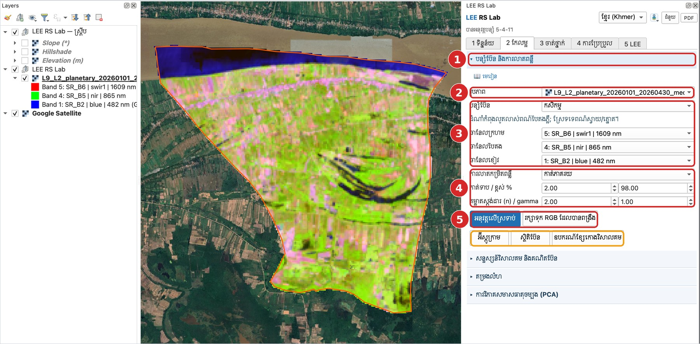
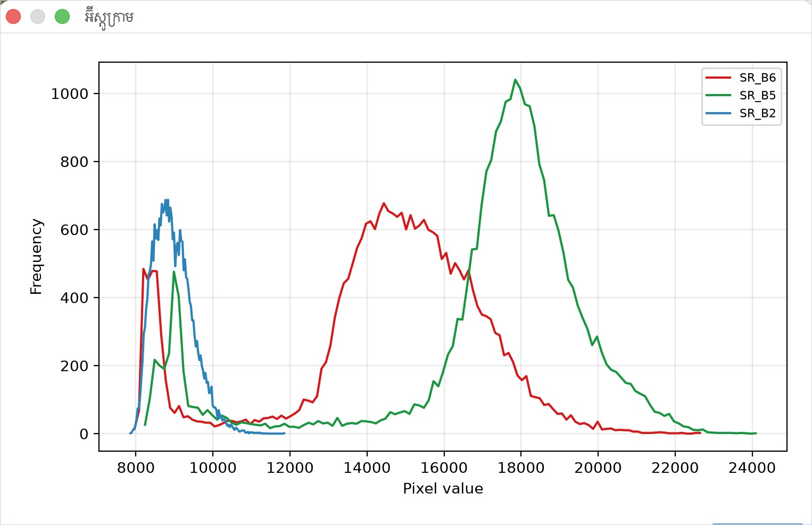

# មេរៀនទី 5 — បន្សំប៊ែន និងការលាតពន្លឺ

បន្សំប៊ែនដាក់ប៊ែនបីទៅឆានែលក្រហម បៃតង ខៀវ។ បន្សំ **កសិកម្ម (SWIR1 · NIR · Blue = 6-5-2 សម្រាប់ Landsat 8/9)** ធ្វើឲ្យដំណាំកំពុងលូតលាស់មានពណ៌បៃតងភ្លឺ និងស្រែទំនេរមានពណ៌ស្វាយ/ផ្កាល្ហុង។ ទឹកមានពណ៌ខៀវចាស់។

## ជំហាន

1. ចូលផ្ទាំង **2 កែលម្អ** → ផ្នែក **បន្សំប៊ែន និងការលាតពន្លឺ**។
2. **រូបភាព**៖ រូបភាពដែលទាញយកក្នុងមេរៀនទី 3 (បំពេញស្វ័យប្រវត្តិ)។
3. **បន្សំប៊ែន**៖ ជ្រើស **កសិកម្ម**។ ឆានែលក្រហម/បៃតង/ខៀវបំពេញដោយខ្លួនឯង ហើយបង្ហាញការពន្យល់ខ្លី។ បន្សំផ្សេងទៀត៖ ពណ៌ពិត ពណ៌ក្លែងក្លាយ រុក្ខជាតិ ទឹក/ដី និងទីក្រុង។
4. **ការលាតកម្រិតពន្លឺ**៖ កាត់ភាគរយ 2 / 98% (បោះចោលភីកសែលងងឹតបំផុត និងភ្លឺបំផុត 2%)។ ជម្រើសផ្សេងទៀត៖ min–max គម្លាតស្តង់ដា និងសមភាពអ៊ីស្តូក្រាម។
5. ចុច **អនុវត្តលើស្រទាប់** ដើម្បីប្ដូររបៀបបង្ហាញ ឬ **រក្សាទុក RGB ដែលបានពង្រឹង** ដើម្បីបង្កើតឯកសារថ្មី។ ប្រអប់ **អនុវត្តដោយស្វ័យប្រវត្តិ ពេលប្ដូរការកំណត់** (ធីករួចជាលំនាំដើម) ធ្វើឲ្យផែនទីប្ដូរភ្លាមៗ ពេលអ្នកប្ដូរបន្សំ ឆានែល ឬការលាតពន្លឺ។

{ loading=lazy }

*រូបទី 8 — បន្សំប៊ែនកសិកម្ម (5: SWIR1 · 4: NIR · 1: Blue) ជាមួយការកាត់ភាគរយ 2–98%*

## អ៊ីស្តូក្រាម និងស្ថិតិប៊ែន

ចុច **អ៊ីស្តូក្រាម** ដើម្បីមើលការចែកចាយតម្លៃនៃប៊ែនទាំងបី។ ក្នុងរូបទី 9 តម្លៃជា Raw DN (ប្រហែល 8,000–24,000)។ NIR (SR\_B5 ពណ៌បៃតង) មានកំពូលធំនៅប្រហែល 18,000 ព្រោះដីភាគច្រើនគឺរុក្ខជាតិ។ កំពូលតូចនៅប្រហែល 8,500 គឺទឹក (ទន្លេ)។ **ស្ថិតិប៊ែន** បង្ហាញ min, max, មធ្យម និងគម្លាតស្តង់ដារ។ **ឧបករណ៍ខ្សែកោងវិសាលគម** ឲ្យអ្នកចុចលើភីកសែលដើម្បីគូសខ្សែកោងវិសាលគម (រហូតដល់ 8)។

{ loading=lazy }

*រូបទី 9 — អ៊ីស្តូក្រាមនៃ SR\_B6, SR\_B5, SR\_B2*

> សំណួរសម្រាប់និស្សិត៖ ហេតុអ្វីបានជាអ៊ីស្តូក្រាម NIR មានកំពូលពីរ? កំពូលនីមួយៗតំណាងឲ្យផ្ទៃដីប្រភេទណា?

---

[← មេរៀនទី 4](lesson-04.md) · [មេរៀនទី 6 →](lesson-06.md)
