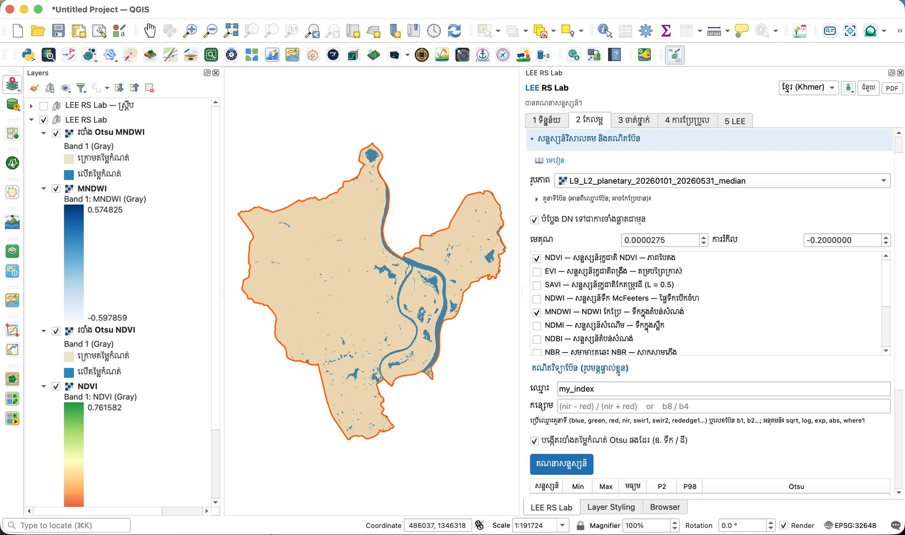
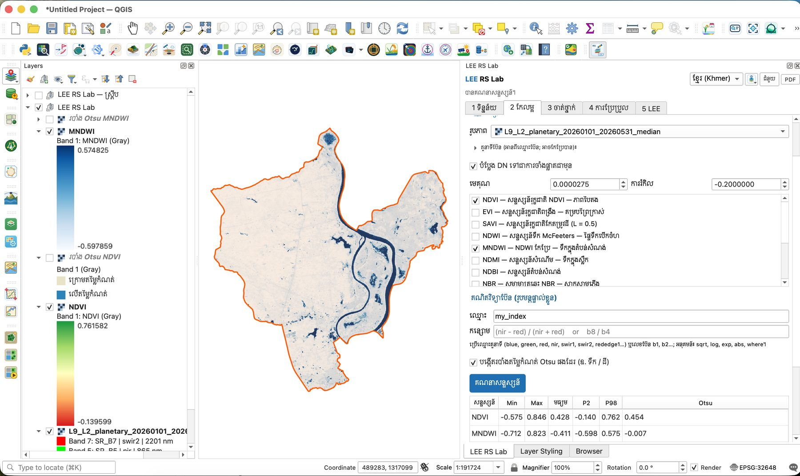
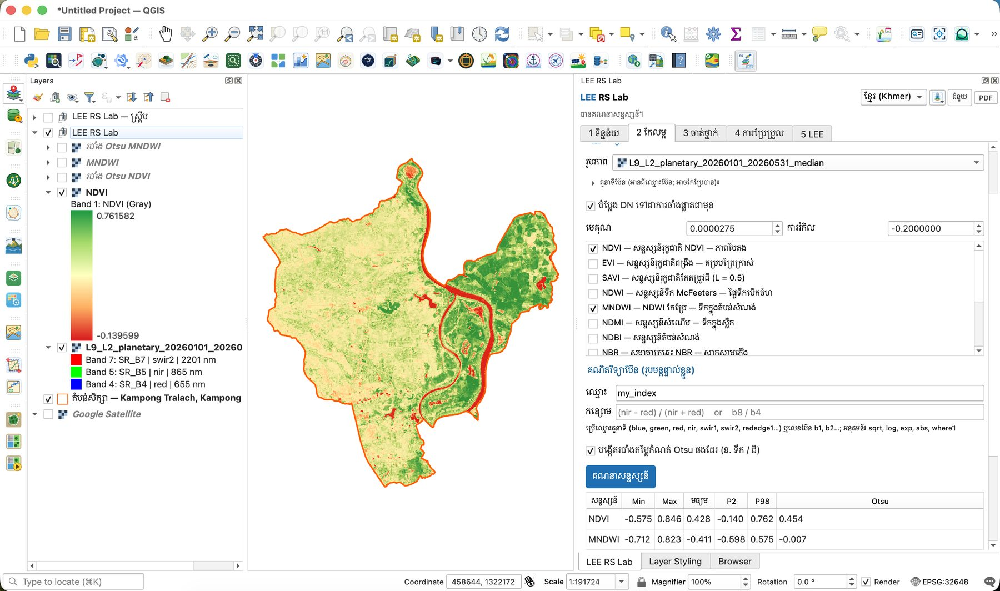

# មេរៀនទី 6 — សន្ទស្សន៍វិសាលគម (NDVI, MNDWI)

សន្ទស្សន៍ផ្សំប៊ែនពីរ ឬច្រើន ដើម្បីបញ្ជាក់លក្ខណៈមួយ។ ក្នុងស្រុកកំពង់ត្រឡាច NDVI មធ្យមគឺ **0.428** (ភាគច្រើនស្ថិតចន្លោះ −0.14 ដល់ 0.76) ហើយតម្លៃកំណត់ Otsu របស់ MNDWI គឺ **−0.007** ដែលបំបែកទឹកពីដីដោយស្វ័យប្រវត្តិ។

## ជំហាន

1. បើកផ្នែក **សន្ទស្សន៍វិសាលគម និងគណិតប៊ែន**។
2. **រូបភាព**៖ រូបភាពផ្សំ Landsat 9។ **តួនាទីប៊ែន** (blue, red, nir…) អានពីឈ្មោះប៊ែនដោយស្វ័យប្រវត្តិ (ចុចលើវាដើម្បីពិនិត្យ ឬកែ)។
3. ទុកធីក **បំប្លែង DN ទៅជាការចាំងផ្លាតជាមុន**។ **មេគុណ** 0.0000275 និង **ការរំកិល** −0.2 បំពេញស្វ័យប្រវត្តិសម្រាប់ Landsat Collection 2។
4. ធីក **NDVI** និង **MNDWI**។ មានសន្ទស្សន៍ផ្សេងទៀត៖ EVI, SAVI, NDWI, NDMI, NDBI, NBR, BSI…
5. (ជម្រើស) សរសេររូបមន្តផ្ទាល់ខ្លួនក្នុង **គណិតវិទ្យាប៊ែន (រូបមន្តផ្ទាល់ខ្លួន)**៖ **ឈ្មោះ** និង **កន្សោម** ឧ. `(nir - red) / (nir + red)` ឬ `b8 / b4`។
6. ធីក **បង្កើតរបាំងតម្លៃកំណត់ Otsu ផងដែរ (ឧ. ទឹក / ដី)**។
7. ចុច **គណនាសន្ទស្សន៍**។ ស្រទាប់បួនលេចឡើង៖ **NDVI** · **របាំង Otsu NDVI** · **MNDWI** · **របាំង Otsu MNDWI**។

{ loading=lazy }

*រូបទី 18 — ផ្នែកសន្ទស្សន៍ និងរបាំង Otsu MNDWI (ខៀវ = ទឹក ត្នោតស្រាល = ដី)*

## ការអានលទ្ធផល

តារាងក្រោមប៊ូតុងបង្ហាញស្ថិតិ៖ P2 និង P98 = ភាគរយទី 2 និង 98 (ប្រើសម្រាប់ពណ៌ផែនទី ដើម្បីកុំឲ្យតម្លៃខ្លាំងៗធ្វើឲ្យផែនទីស្លេក)។

| សន្ទស្សន៍ | Min | Max | មធ្យម | P2 | P98 | Otsu |
| --- | --- | --- | --- | --- | --- | --- |
| NDVI | −0.575 | 0.846 | 0.428 | −0.140 | 0.762 | 0.454 |
| MNDWI | −0.712 | 0.823 | −0.411 | −0.598 | 0.575 | −0.007 |

| សន្ទស្សន៍ | រូបមន្ត | តម្លៃខ្ពស់មានន័យថា | ក្នុងស្រុកកំពង់ត្រឡាច |
| --- | --- | --- | --- |
| NDVI | (NIR − Red) / (NIR + Red) | រុក្ខជាតិខៀវខ្ចី ក្រាស់ | ដីលិចទឹកខាងកើតបៃតងចាស់ ស្រែប្រាំងខាងលិចលឿង ទន្លេក្រហម |
| MNDWI | (Green − SWIR1) / (Green + SWIR1) | ទឹកបើកចំហ | ទន្លេសាប បឹង និងត្រពាំងពណ៌ខៀវចាស់ |

{ loading=lazy }

*រូបទី 19 — MNDWI (ខៀវចាស់ = ទឹក)*

{ loading=lazy }

*រូបទី 20 — NDVI (បៃតង = រុក្ខជាតិក្រាស់ ក្រហម = ទឹក ឬដីទទេ)*

## Otsu ជាអ្វី?

Otsu រកតម្លៃកំណត់មួយដែលបំបែកអ៊ីស្តូក្រាមជាពីរក្រុមឲ្យដាច់ពីគ្នាបំផុត។ សម្រាប់ MNDWI វាគឺ −0.007 (ជិត 0) — ភីកសែលធំជាងនេះជាទឹក។ សម្រាប់ NDVI វាគឺ 0.454 — បំបែករុក្ខជាតិក្រាស់ពីដីស្រែប្រាំង។ Otsu ដំណើរការល្អនៅពេលអ៊ីស្តូក្រាមមានកំពូលពីរច្បាស់ (ដូច MNDWI) ប៉ុន្តែមិនសូវល្អទេប្រសិនបើថ្នាក់មួយតូចពេក។

> ចំណាំ៖ សន្ទស្សន៍ត្រូវគណនាលើការចាំងផ្លាត មិនមែនលើ DN ទេ ជាពិសេស EVI និង SAVI ដែលមានចំនួនថេរក្នុងរូបមន្ត។

> សំណួរសម្រាប់និស្សិត៖ ហេតុអ្វីបានជា NDVI មធ្យម (0.428) ទាប បើទោះបីជាស្រុកនេះជាតំបន់កសិកម្ម? (គិតពីខែដែលរូបភាពត្រូវបានថត)

---

[← មេរៀនទី 5](lesson-05.md) · [មេរៀនទី 7 →](lesson-07.md)
