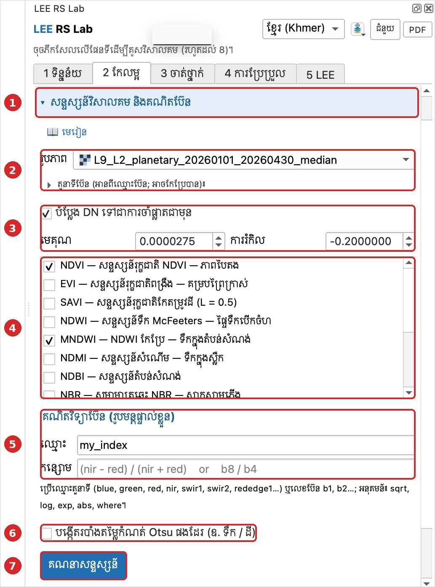
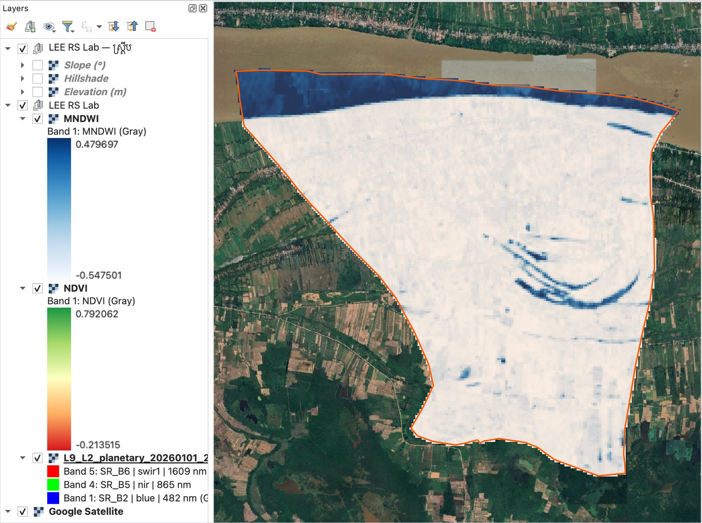
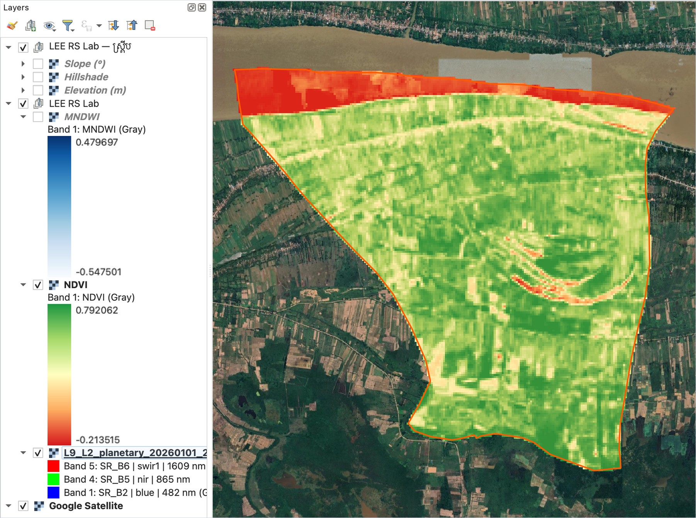

# មេរៀនទី 6 — សន្ទស្សន៍វិសាលគម (NDVI, MNDWI)

សន្ទស្សន៍ផ្សំប៊ែនពីរ ឬច្រើន ដើម្បីបញ្ជាក់លក្ខណៈមួយ។ ក្នុងឃុំមហាខ្ញូង NDVI មានចន្លោះ **−0.21 ដល់ 0.79** ហើយ MNDWI មានចន្លោះ **−0.55 ដល់ 0.48**។

## ជំហាន

1. បើកផ្នែក **សន្ទស្សន៍វិសាលគម និងគណិតប៊ែន**។
2. **រូបភាព**៖ រូបភាពផ្សំ Landsat 9។ តួនាទីប៊ែន (blue, red, nir…) អានពីឈ្មោះប៊ែនដោយស្វ័យប្រវត្តិ (ចុចលើ **តួនាទីប៊ែន** ដើម្បីពិនិត្យ)។
3. ទុកធីក **បំប្លែង DN ទៅជាការចាំងផ្លាតជាមុន**។ មេគុណ 0.0000275 និងការរំកិល −0.2 បំពេញស្វ័យប្រវត្តិសម្រាប់ Landsat Collection 2។
4. ទុកធីក **NDVI** និង **MNDWI**។ មានសន្ទស្សន៍ផ្សេងទៀត៖ EVI, SAVI, NDWI, NDMI, NDBI, NBR, BSI…
5. (ជម្រើស) សរសេររូបមន្តផ្ទាល់ខ្លួនក្នុង **គណិតវិទ្យាប៊ែន**៖ ឧ. `(nir - red) / (nir + red)`។
6. (ជម្រើស) ទុកធីក **បង្កើតរបាំងតម្លៃកំណត់ Otsu** ដើម្បីបំបែកទឹក/ដីដោយស្វ័យប្រវត្តិ។
7. ចុច **គណនាសន្ទស្សន៍**។

{ loading=lazy }

*រូបទី 10 — ផ្នែកសន្ទស្សន៍ ជាមួយការបំប្លែង DN ទៅជាការចាំងផ្លាត*

## ការអានលទ្ធផល

| សន្ទស្សន៍ | រូបមន្ត | តម្លៃខ្ពស់មានន័យថា | ក្នុងឃុំមហាខ្ញូង |
| --- | --- | --- | --- |
| NDVI | (NIR − Red) / (NIR + Red) | រុក្ខជាតិខៀវខ្ចី ក្រាស់ | ដីភាគច្រើនពណ៌បៃតង (ដំណាំ ដើមឈើ) ទន្លេពណ៌ក្រហម (តម្លៃអវិជ្ជមាន) |
| MNDWI | (Green − SWIR1) / (Green + SWIR1) | ទឹកបើកចំហ | ទន្លេមេគង្គ និងបឹងរាងធ្នូរចាស់ (oxbow) ពណ៌ខៀវចាស់ |

{ loading=lazy }

*រូបទី 11 — MNDWI (ទឹក = ខៀវចាស់)*

{ loading=lazy }

*រូបទី 12 — NDVI (បៃតង = រុក្ខជាតិក្រាស់ ក្រហម = ទឹក ឬដីទទេ)*

> ចំណាំ៖ សន្ទស្សន៍ត្រូវគណនាលើការចាំងផ្លាត មិនមែនលើ DN ទេ ជាពិសេស EVI និង SAVI ដែលមានចំនួនថេរក្នុងរូបមន្ត។

---

[← មេរៀនទី 5](lesson-05.md) · [មេរៀនទី 7 →](lesson-07.md)
