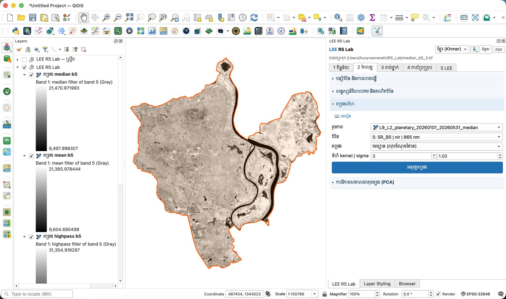
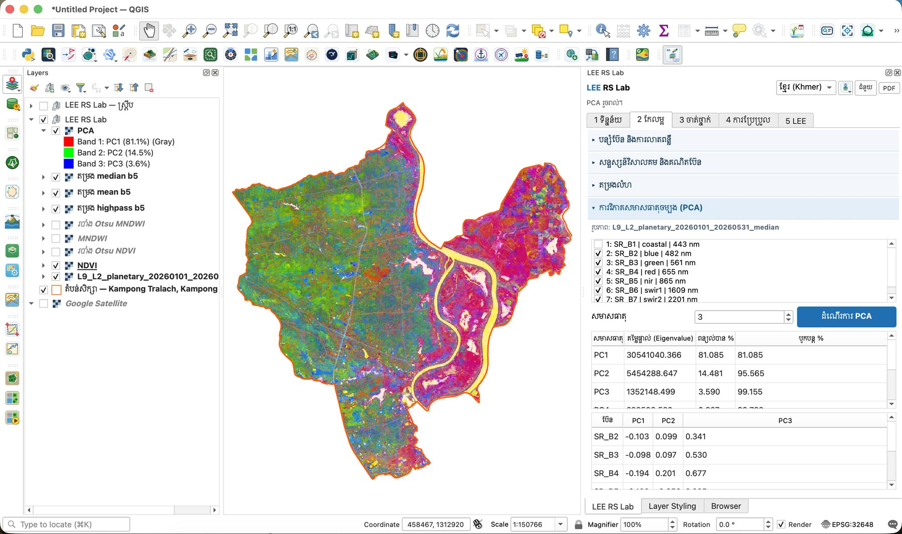

# មេរៀនទី 7 — តម្រងលំហ និង PCA

តម្រងលំហប្រើបង្អួចតូច (kernel) រំកិលលើរូបភាព។ PCA បង្រួមប៊ែនទាំង 6 ជាសមាសធាតុថ្មី — ក្នុងស្រុកកំពង់ត្រឡាច PC1–PC3 រក្សាបម្រែបម្រួលបាន **99.2%**។

!!! info "របៀបកម្រិតខ្ពស់ (កំណែ 2.4.0)"
    ផ្នែក **តម្រងលំហ** និង **PCA** មិនចាំបាច់សម្រាប់ចំណាត់ថ្នាក់ទេ។ ចាប់ពីកំណែ 2.4.0 ឧបករណ៍ទាំងនេះបង្ហាញតែក្នុងរបៀប **កម្រិតខ្ពស់**៖ ប្ដូរប្រអប់ **មូលដ្ឋាន** នៅផ្នែកខាងលើផ្ទាំងទៅ **កម្រិតខ្ពស់** (មើលមេរៀនទី 1)។

## តម្រងលំហ

1. បើកផ្នែក **តម្រងលំហ**។
2. **រូបភាព**៖ រូបភាពផ្សំ Landsat 9 · **ប៊ែន**៖ 5: SR\_B5 (nir)។
3. **តម្រង**៖ មេដ្យាន (លុបចំណុចរំខាន) · **ទំហំ kernel** 3 (sigma ប្រើតែសម្រាប់ Gaussian)។
4. ចុច **អនុវត្តតម្រង**។ ស្រទាប់ **តម្រង median b5** លេចឡើង ហើយឯកសាររក្សាទុកជា `median_b5_3.tif`។
5. សាកល្បងតម្រងផ្សេងទៀតលើប៊ែនដដែល ហើយប្រៀបធៀប៖ **mean b5** (រលោង) និង **highpass b5** (ច្បាស់ គែមលេចធ្លោ)។

| ប្រភេទតម្រង | ប្រើសម្រាប់ |
| --- | --- |
| Mean, Gaussian (low-pass) | ធ្វើឲ្យរលោង កាត់បន្ថយសំឡេងរំខាន |
| Median | លុបសំឡេងចំណុច (speckle) ដោយរក្សាគែម |
| High-pass | ធ្វើឲ្យច្បាស់ |
| Sobel, Laplacian | រកគែម៖ ផ្លូវ ប្រឡាយ គែមស្រែ |

{ loading=lazy }

*រូបទី 21 — តម្រងមេដ្យាន 3×3 លើប៊ែន NIR ជាមួយស្រទាប់ mean និង high-pass*

## ការវិភាគសមាសធាតុចម្បង (PCA)

1. បើកផ្នែក **ការវិភាគសមាសធាតុចម្បង (PCA)**។ វាប្រើរូបភាពដូចផ្នែកតម្រងលំហ។
2. ជ្រើសប៊ែន 2–7 (SR\_B2–SR\_B7) ដោយមិនយក SR\_B1 (coastal) · **សមាសធាតុ** 3។
3. ចុច **ដំណើរការ PCA**។ ស្រទាប់ **PCA** បង្ហាញ PC1-PC2-PC3 ជាក្រហម-បៃតង-ខៀវ។

| សមាសធាតុ | តម្លៃផ្ទាល់ (Eigenvalue) | ពន្យល់បាន % | បូករួម % |
| --- | --- | --- | --- |
| PC1 | 30,541,040 | 81.1 | 81.1 |
| PC2 | 5,454,289 | 14.5 | 95.6 |
| PC3 | 1,352,148 | 3.6 | 99.2 |

PC1 គឺ «ពន្លឺសរុប» ព្រោះប៊ែនទាំងអស់មានទម្ងន់សញ្ញាដូចគ្នា។ PC2 និង PC3 បង្ហាញភាពខុសគ្នារវាងប៊ែន។ មើលតារាង Loadings (eigenvectors)៖ ក្នុង PC3 ប៊ែនមើលឃើញ SR\_B2 (0.341), SR\_B3 (0.530), SR\_B4 (0.677) មានទម្ងន់ខ្ពស់ — PC3 គឺជាព័ត៌មានពណ៌មើលឃើញ ដែលបាត់ក្នុង PC1។

{ loading=lazy }

*រូបទី 22 — រូបភាព PCA (PC1-PC2-PC3) តារាងសមាសធាតុ និង Loadings*

ក្នុងរូបភាព PCA ដីលិចទឹកខាងកើត (ផ្កាឈូក/ក្រហម) និងស្រែខាងលិច (បៃតង/ខៀវ) ដាច់ពីគ្នាយ៉ាងច្បាស់ ហើយទន្លេសាបលេចឡើងពណ៌លឿង។ ក្នុងមេរៀនទី 8 យើងនឹងប្រើ PC1–PC3 ជាការបញ្ចូលមួយសម្រាប់ K-means។

> សំណួរសម្រាប់និស្សិត៖ ប្រសិនបើ PC1–PC2 ពន្យល់បាន 95.6% តើយើងអាចបោះចោល PC3 បានទេ? តើព័ត៌មាន 3.6% នោះអាចសំខាន់សម្រាប់ថ្នាក់ណា?

---

[← មេរៀនទី 6](lesson-06.md) · [មេរៀនទី 8 →](lesson-08.md)
