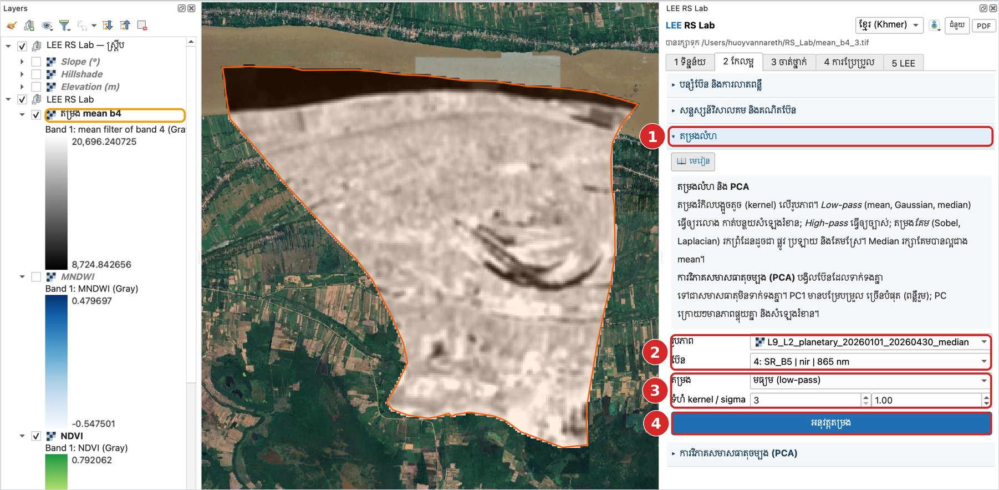
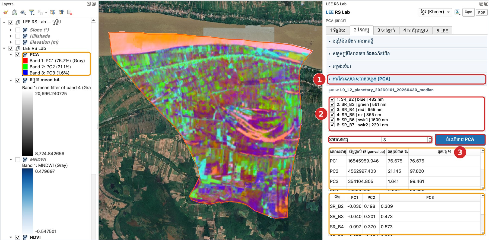

# មេរៀនទី 7 — តម្រងលំហ និង PCA

តម្រងលំហប្រើបង្អួចតូច (kernel) រំកិលលើរូបភាព។ PCA បង្រួមប៊ែនទាំង 6 ជាសមាសធាតុថ្មី ដែលក្នុងឧទាហរណ៍នេះ PC1–PC3 រក្សាបម្រែបម្រួលបាន **99.5%**។

## តម្រងលំហ

1. បើកផ្នែក **តម្រងលំហ**។
2. **រូបភាព**៖ រូបភាពផ្សំ · **ប៊ែន**៖ 4: SR\_B5 (nir)។
3. **តម្រង**៖ មធ្យម (low-pass) · **ទំហំ kernel** 3។
4. ចុច **អនុវត្តតម្រង**។ ស្រទាប់ **តម្រង mean b4** លេចឡើង ហើយឯកសាររក្សាទុកជា `mean_b4_3.tif`។

| ប្រភេទតម្រង | ប្រើសម្រាប់ |
| --- | --- |
| Mean, Gaussian (low-pass) | ធ្វើឲ្យរលោង កាត់បន្ថយសំឡេងរំខាន |
| Median | លុបសំឡេងចំណុច (speckle) ដោយរក្សាគែម |
| High-pass | ធ្វើឲ្យច្បាស់ |
| Sobel, Laplacian | រកគែម៖ ផ្លូវ ប្រឡាយ គែមស្រែ |

{ loading=lazy }

*រូបទី 13 — តម្រងមធ្យម 3×3 លើប៊ែន NIR ជាមួយមេរៀនបើក*

## ការវិភាគសមាសធាតុចម្បង (PCA)

1. បើកផ្នែក **ការវិភាគសមាសធាតុចម្បង (PCA)**។ វាប្រើរូបភាពដូចផ្នែកតម្រងលំហ។
2. ជ្រើសប៊ែនទាំង 6 (SR\_B2–SR\_B7) · **សមាសធាតុ** 3។
3. ចុច **ដំណើរការ PCA**។

| សមាសធាតុ | ពន្យល់បាន % | បូករួម % |
| --- | --- | --- |
| PC1 | 76.7 | 76.7 |
| PC2 | 21.1 | 97.8 |
| PC3 | 1.6 | 99.5 |

PC1 គឺ «ពន្លឺសរុប» ព្រោះប៊ែនទាំងអស់មានទម្ងន់ស្រដៀងគ្នា។ PC2 និង PC3 បង្ហាញភាពខុសគ្នារវាងប៊ែន (ឧ. រវាងប៊ែនមើលឃើញ និង NIR/SWIR) — ព័ត៌មានតិច ប៉ុន្តែជួនកាលបង្ហាញលក្ខណៈដែលមើលមិនឃើញក្នុងរូបភាពពណ៌ពិត។ មើលតារាង Loadings (eigenvectors) ដើម្បីដឹងថាប៊ែនណាមានទម្ងន់នៅក្នុងសមាសធាតុនីមួយៗ។

{ loading=lazy }

*រូបទី 14 — រូបភាព PCA (PC1-PC2-PC3) និងតារាងសមាសធាតុ*

---

[← មេរៀនទី 6](lesson-06.md) · [មេរៀនទី 8 →](lesson-08.md)
