# មេរៀនទី 8 — ថ្នាក់ និងចំណាត់ថ្នាក់មិនណែនាំ (K-means)

ចំណាត់ថ្នាក់មិនណែនាំចែកភីកសែលជាក្រុមតាមភាពស្រដៀងគ្នា ដោយមិនចាំបាច់មានទិន្នន័យហ្វឹកហាត់។ បន្ទាប់មក អ្នកដាក់ឈ្មោះក្រុមនីមួយៗជាថ្នាក់។ មេរៀននេះដំណើរការ K-means **15 ក្រុម** លើការបញ្ចូលបីប្រភេទ — រូបភាព Landsat, PCA និង **Stack ពហុរដូវ** — ដើម្បីបង្ហាញថា *អ្វីដែលអ្នកបញ្ចូល* សំខាន់ដូចក្បួនដោះស្រាយដែរ។

## ជំហានទី 1 — ពិនិត្យថ្នាក់ (តារាងសម្គាល់)

ចូលផ្ទាំង **3 ចាត់ថ្នាក់** → **🎨 ថ្នាក់ (តារាងសម្គាល់)**។ បញ្ជីនេះប្រើរួមគ្នាសម្រាប់គ្រប់ជំហាន៖ ការដាក់ឈ្មោះក្រុម ការហ្វឹកហាត់ ភាពត្រឹមត្រូវ ការប្រែប្រួល និងពហុកោណ។

- គ្រោងលំនាំដើម **RS Lab (៦ ថ្នាក់)**៖ 1 ទឹក · 2 តំបន់សំណង់ · 3 ស្រូវ / ដីដំណាំ · 4 ព្រៃឈើ · 5 ព្រៃគុម្ពោត / វាលស្មៅ · 6 ដីទទេ។
- គ្រោងផ្សេងទៀត៖ **LULC កម្រិត 1 (៨ ថ្នាក់)** · **Auto 7 (ពី ESA WorldCover)** · **ESA WorldCover (១១ ថ្នាក់)**។ ជ្រើស រួចចុច **ប្រើគ្រោងនេះ**។ ខាងលើផ្ទាំងបង្ហាញគ្រោងដែលកំពុងប្រើ។
- ចុចពីរដងលើឈ្មោះដើម្បីកែ ឬលើពណ៌ដើម្បីប្ដូរពណ៌។ **បន្ថែម / លុប** ថ្នាក់ · **រក្សាទុក… / បើក…** រក្សាបញ្ជីថ្នាក់ជា CSV។

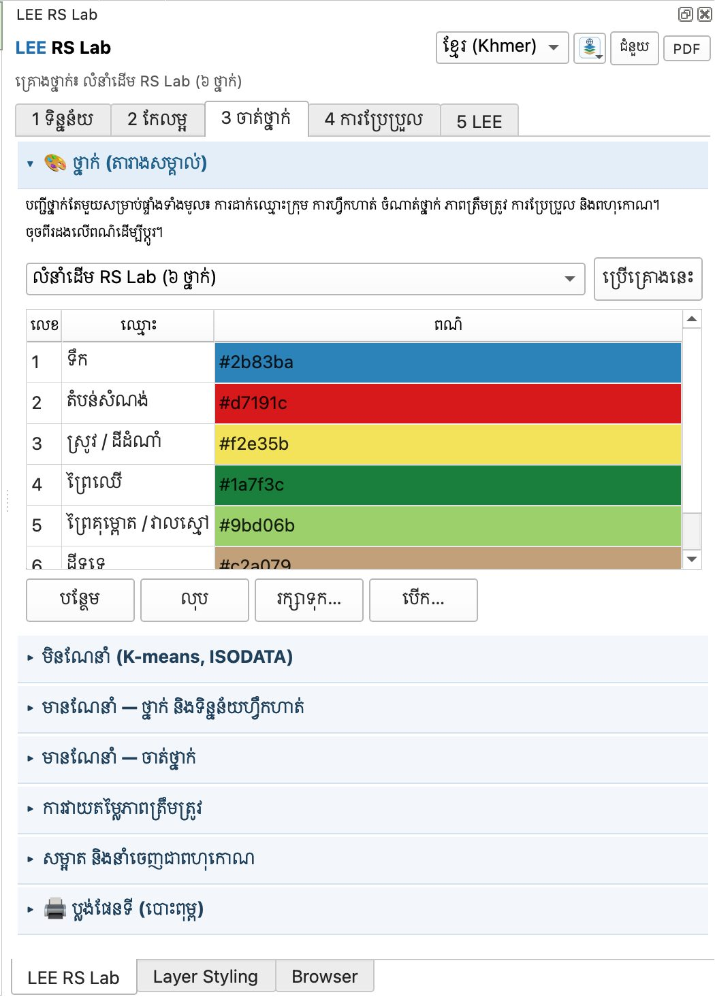{ loading=lazy }

*រូបទី 23 — គ្រោងលំនាំដើម RS Lab (៦ ថ្នាក់) — សៀវភៅនេះប្រើគ្រោងនេះ*

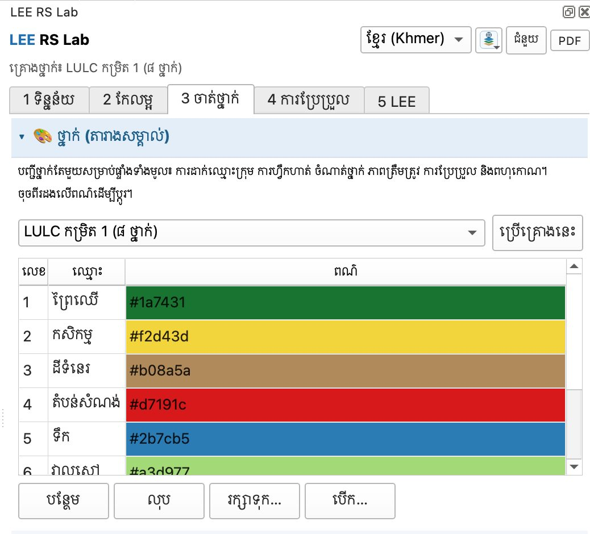{ loading=lazy }

*រូបទី 24 — គ្រោង LULC កម្រិត 1 (៨ ថ្នាក់)*

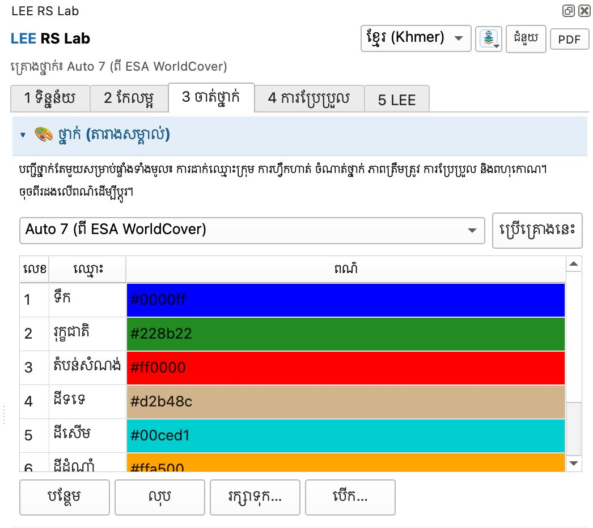{ loading=lazy }

*រូបទី 25 — គ្រោង Auto 7 (ពី ESA WorldCover)*

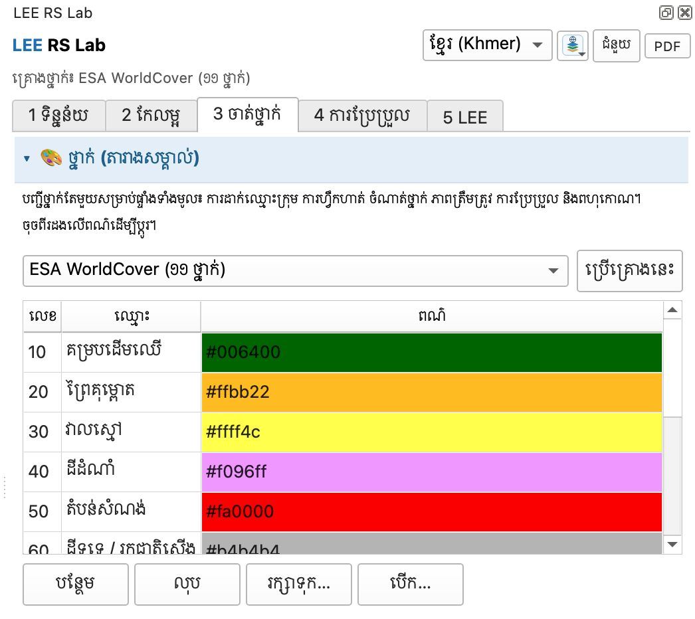{ loading=lazy }

*រូបទី 26 — គ្រោង ESA WorldCover (១១ ថ្នាក់ លេខកូដ 10–100)*

## ជំហានទី 2 — K-means លើរូបភាព Landsat

1. បើកផ្នែក **មិនណែនាំ (K-means, ISODATA)**។
2. **រូបភាព**៖ `L9_L2_planetary_20260101_20260531_median` · **ប៊ែន**៖ SR\_B2–SR\_B7 (មិនយក SR\_B1)។
3. **វិធីសាស្ត្រ** K-means · **ចំនួនក្រុម (k)** 15 · **ចំនួនដង** 20 · **គំរូហ្វឹកហាត់** 60,000 ភីកសែល · **តម្រងភាគច្រើន** 0 (បិទ)។ ប្រអប់ ISODATA ក្រុមអប្បបរមា/អតិបរមា បិទពេលជ្រើស K-means។ (ក្នុងរបៀប **មូលដ្ឋាន** មានតែ **ចំនួនក្រុម (k)** ប៉ុណ្ណោះ — K-means 20 ដង គំរូ 60,000 ភីកសែល ត្រូវបានប្រើដោយស្វ័យប្រវត្តិ។ ប្ដូរទៅ **កម្រិតខ្ពស់** ដើម្បីប្ដូរវិធីសាស្ត្រ ចំនួនដង គំរូ ឬតម្រងភាគច្រើន។)
4. ចុច **ដំណើរការចាត់ក្រុម**។ ស្រទាប់ **ក្រុម (K-means)** មាន 15 ពណ៌។

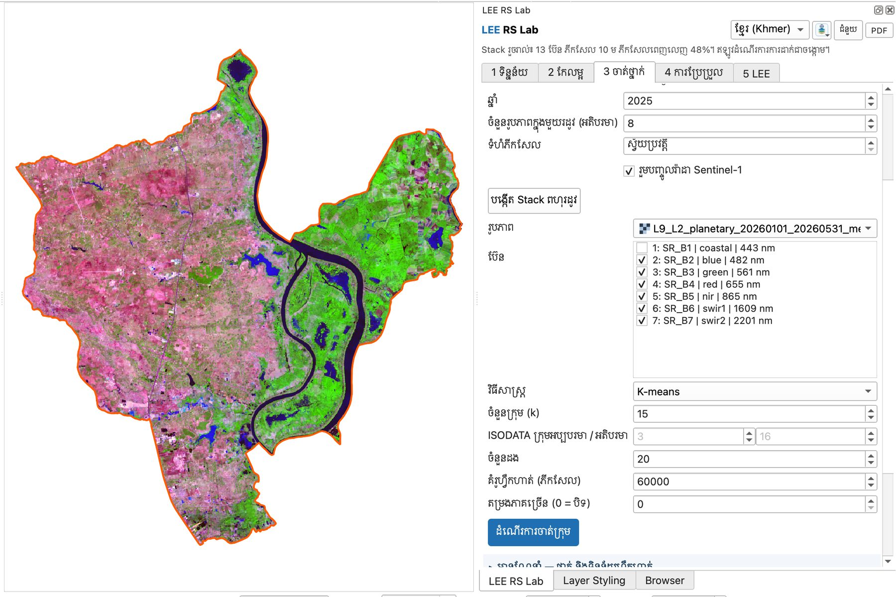{ loading=lazy }

*រូបទី 27 — ការកំណត់ K-means លើរូបភាព Landsat (15 ក្រុម)*

តារាងក្រុមបង្ហាញ ផ្ទៃក្រឡា (ហិកតា) % **ការណែនាំ** (ការស្មានពីតម្លៃមធ្យម) ប្រអប់ **→ ថ្នាក់** និងវិសាលគមមធ្យម។ ក្នុងរូបទី 28 ក្រុម 1 (1,881.5 ហិកតា) និងក្រុម 4 (441.0 ហិកតា) ទាំងពីរត្រូវបានណែនាំថា «ទឹក (បើកចំហ ពេញឆ្នាំ)» — ទឹកជ្រៅ និងទឹកល្អក់អាចបែកជាក្រុមពីរ។

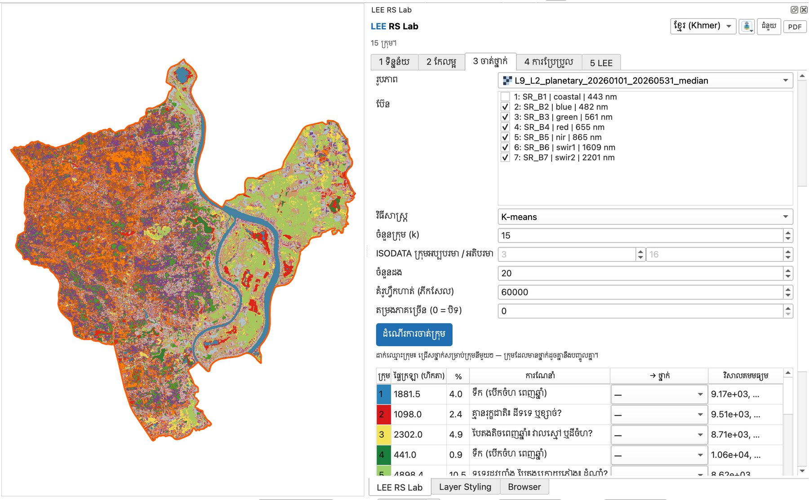{ loading=lazy }

*រូបទី 28 — លទ្ធផល K-means 15 ក្រុមលើ Landsat ជាមួយជួរឈរការណែនាំ*

ចុច **គូសវិសាលគមក្រុម** ដើម្បីមើលខ្សែកោងមធ្យមនៃក្រុមនីមួយៗ។ គន្លឹះអាន៖ **ទឹក** — ខ្សែទាប ហើយធ្លាក់ចុះនៅ NIR និង SWIR · **រុក្ខជាតិ** — កំពូលនៅ SR\_B5 (NIR) · **ស្រែស្ងួត ដីទទេ ឬសំណង់** — SWIR (SR\_B6) ខ្ពស់ជាង NIR · ខ្សែដែលភ្លឺខ្ពស់គ្រប់ប៊ែន = ខ្សាច់ ឬដំបូល។

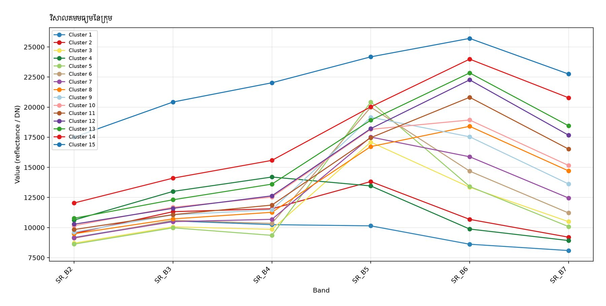{ loading=lazy }

*រូបទី 29 — វិសាលគមមធ្យមនៃក្រុមទាំង 15 (Landsat, DN)*

## ជំហានទី 3 — K-means លើ PCA

ប្ដូរ **រូបភាព** ទៅ **PCA** (មេរៀនទី 7) ជ្រើស PC1–PC3 ហើយដំណើរការម្ដងទៀត។ ផ្ទៃក្រឡាក្រុមខុសគ្នាច្រើនពី Landsat (ឧ. ក្រុម 2 = 7,154.3 ហិកតា 15.3%)។ ជួរ **ការណែនាំ** ទទេ ព្រោះ PC មិនមែនជាប៊ែនដែលមានអត្ថន័យផ្ទាល់ (មិនអាចដឹងថាជា NDVI ឬទឹក)។ អ្នកត្រូវដាក់ឈ្មោះដោយមើលផែនទីផ្ទាល់។

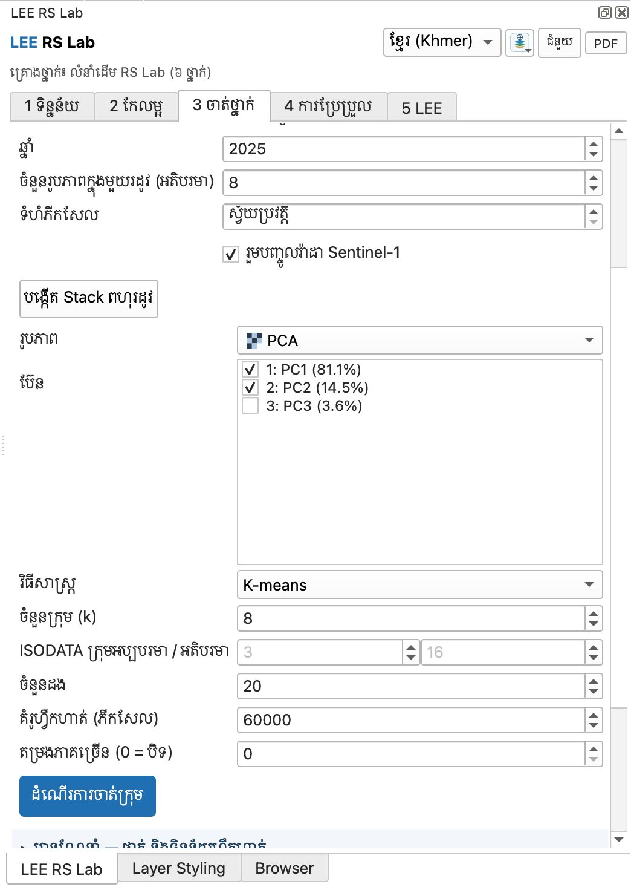{ loading=lazy }

*រូបទី 30 — ការជ្រើស PCA ជាការបញ្ចូល (ក្នុងរូបនេះ PC3 មិនទាន់ធីក — សូមធីក PC1–PC3)*

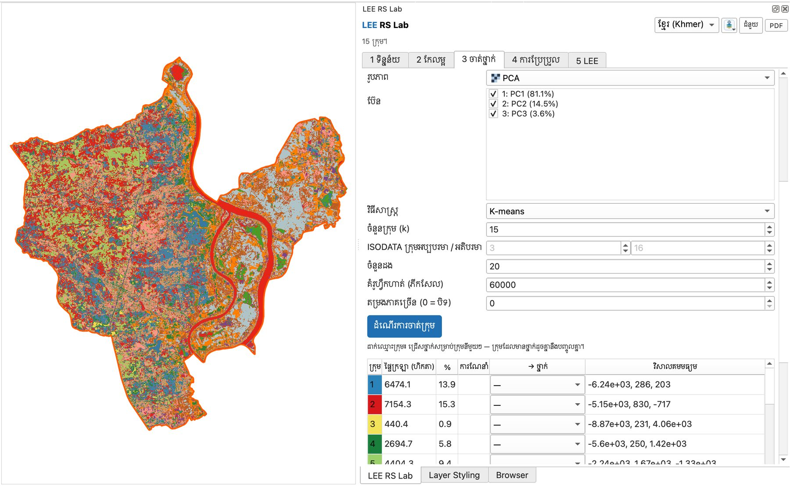{ loading=lazy }

*រូបទី 31 — លទ្ធផល K-means លើ PC1–PC3 (គ្មានការណែនាំ)*

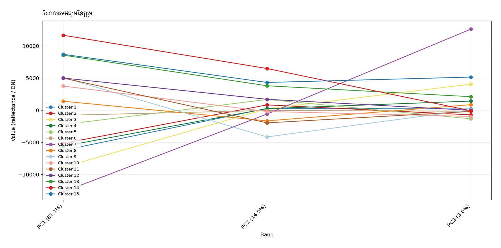{ loading=lazy }

*រូបទី 32 — តម្លៃមធ្យមនៃក្រុមលើ PC1–PC3*

## ជំហានទី 4 — Stack ពហុរដូវ (ថ្មីក្នុងកំណែ 2.3.0)

រូបភាពតែមួយ (ឧ. Landsat រដូវប្រាំង) ពិបាកបែងចែក ព្រៃស្រោង ពីចម្ការដើមឈើ ឬស្រែ ពីដំណាំចម្ការ ព្រោះវិសាលគមស្រដៀងគ្នានៅថ្ងៃតែមួយ។ ប៉ុន្តែ **ប្រតិទិនជីវិត** របស់វាខុសគ្នា៖ ព្រៃរបោះជ្រុះស្លឹកក្នុងរដូវប្រាំង ស្រែទទេក្នុងរដូវប្រាំង ហើយលិចទឹកក្នុងរដូវវស្សា ចំណែកព្រៃស្រោងបៃតងពេញឆ្នាំ។

1. នៅខាងលើផ្នែក **មិនណែនាំ** ក្នុងប្រអប់ **Stack ពហុរដូវ** ជ្រើស **ឆ្នាំ** 2025 · **ចំនួនរូបភាពក្នុងមួយរដូវ (អតិបរមា)** 8 · **ទំហំភីកសែល** ស្វ័យប្រវត្តិ · ធីក **រួមបញ្ចូលរ៉ាដា Sentinel-1**។
2. ចុច **បង្កើត Stack ពហុរដូវ**។ LEE ទាញយកតែតំបន់សិក្សា (Sentinel-2 រដូវប្រាំង កុម្ភៈ–មេសា និងរដូវបៃតង កញ្ញា–វិច្ឆិកា ព្រមទាំង Sentinel-1) ហើយបង្កើតរូបភាព 13 ប៊ែន៖

    | ប៊ែន | អត្ថន័យ |
    | --- | --- |
    | NDVI\_dry · NDVI\_green · NDVI\_amp | ភាពបៃតង កុម្ភៈ–មេសា · កញ្ញា–វិច្ឆិកា · ការប្រែប្រួលតាមរដូវ |
    | NDMI\_dry · NDRE\_green | សំណើមស្លឹករដូវប្រាំង · Red-edge (ក្លរ៉ូភីល) |
    | MNDWI\_dry · MNDWI\_green | ទឹករដូវប្រាំង · ទឹកក្រោយរដូវភ្លៀង (ទឹកជំនន់តាមរដូវ) |
    | NDBI\_dry · SWIR\_dry · bright\_dry | តំបន់សំណង់ · ដីទទេ · ពន្លឺ (ខ្សាច់ ដំបូល) |
    | VH\_dry · VH\_wet · VV\_dry | រ៉ាដា Sentinel-1៖ រចនាសម្ព័ន្ធដើមឈើ ទឹកលិចស្រែ អគារ |

3. សារស្ថានភាពបង្ហាញ «Stack រួចរាល់៖ 13 ប៊ែន ភីកសែល 10 ម ភីកសែលពេញលេញ 48%»។ ស្រទាប់ **Stack ពហុរដូវ 2025** បង្ហាញជាពណ៌ក្លែងតាមរដូវ (ក្រហម = NDVI\_green បៃតង = NDVI\_dry ខៀវ = MNDWI\_green)៖ ដីលិចទឹកក្រោយភ្លៀងខាងកើតពណ៌ខៀវ ស្រែខាងលិចពណ៌ក្រហម/ទឹកក្រូច។
4. Stack ត្រូវបានជ្រើសសម្រាប់ចាត់ក្រុមដោយស្វ័យប្រវត្តិ ហើយ **k** ប្ដូរទៅ 15។ ចុច **ដំណើរការចាត់ក្រុម**។

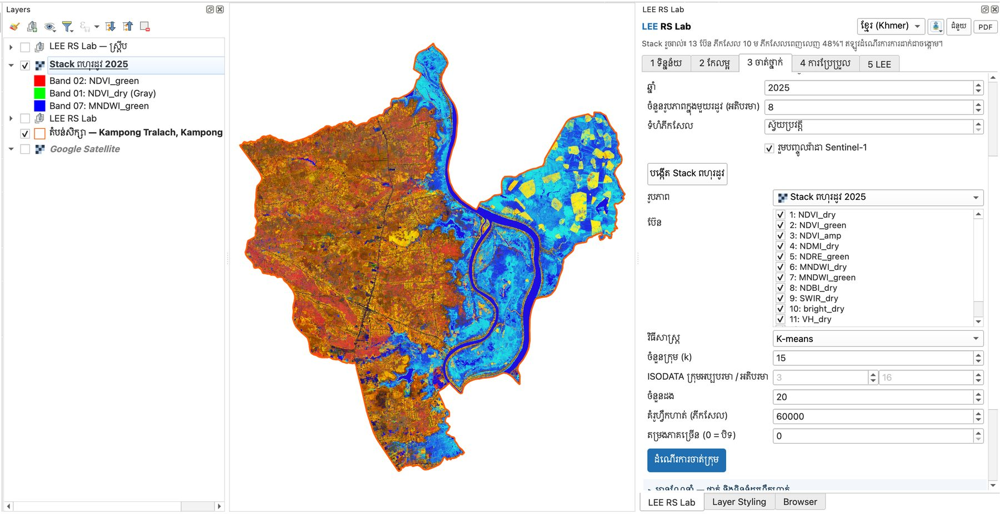{ loading=lazy }

*រូបទី 33 — Stack ពហុរដូវ 2025 (13 ប៊ែន) ជាពណ៌ក្លែងតាមរដូវ*

!!! note "ភីកសែលពេញលេញ 48% មានន័យអ្វី?"
    ភីកសែលមួយ «ពេញលេញ» ពេលប៊ែនទាំង 13 មានតម្លៃ។ ក្នុងរដូវភ្លៀង (កញ្ញា–វិច្ឆិកា) ពពកច្រើន ដូច្នេះភីកសែលខ្លះគ្មានរូបភាព Sentinel-2 ស្រឡះ។ K-means ប្រើតែភីកសែលពេញលេញ។ ដើម្បីបង្កើនភាគរយ៖ ដំឡើង **ចំនួនរូបភាពក្នុងមួយរដូវ** ទៅ 12–15 ឬប្ដូរឆ្នាំ។

តារាងក្រុមពី Stack មានការណែនាំលម្អិតជាង ព្រោះវាដឹងពីរដូវ៖ ក្រុម 3 (6,659.6 ហិកតា 14.3%) = «ទទេរដូវប្រាំង លិចទឹករដូវវស្សា៖ ស្រែ?» ហើយក្រុម 1, 2, 4 = ទឹក។

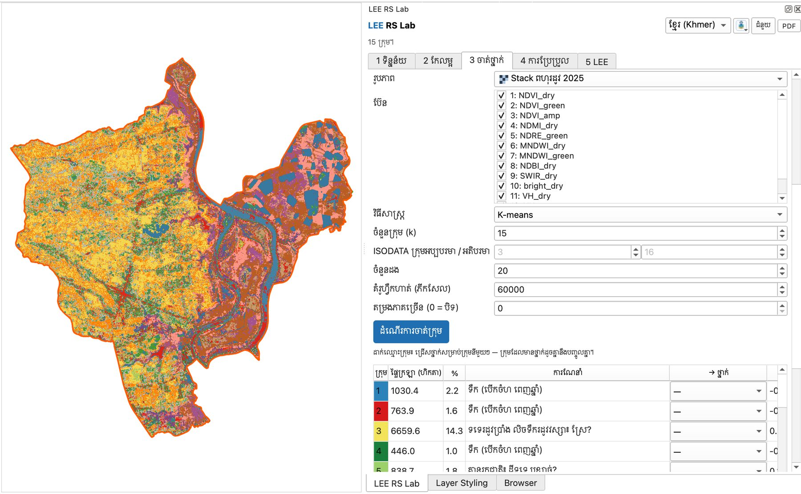{ loading=lazy }

*រូបទី 34 — លទ្ធផល K-means លើ Stack ពហុរដូវ ជាមួយការណែនាំតាមរដូវ*

## ជំហានទី 5 — មើលគំរូ ស្នើថ្នាក់ និងដាក់ឈ្មោះក្រុម

- **ចុចលើជួរក្រុម** ដើម្បីទៅកាន់ភីកសែលគំរូមួយនៃក្រុមនោះ (ចំណុចភ្លឹបភ្លែតៗ)។ ចុចម្ដងទៀតសម្រាប់គំរូបន្ទាប់ — ស្ថានភាពបង្ហាញ «ចង្កោម 10៖ គំរូទី 2 នៃ 10»។ បើក Google Satellite ឬ Esri World Imagery ដើម្បីមើលឲ្យច្បាស់។
- **ស្នើថ្នាក់ពីការណែនាំ** បំពេញប្រអប់ **→ ថ្នាក់** ដែលនៅទំនេរ តាមគ្រោងថ្នាក់ដែលកំពុងប្រើ។ សូមពិនិត្យគ្រប់ជួរ — ឧ. ក្នុងរូបទី 35 ក្រុម 9 «ជ្រុះស្លឹករដូវប្រាំង៖ ព្រៃរបោះ?» ត្រូវបានដាក់ជា **ស្រូវ / ដីដំណាំ** ព្រោះគំរូលើផែនទីបង្ហាញស្រែ។
- ក្រុមណាដែលចម្រុះ ជ្រើសជួរនោះ រួចចុច **បំបែកចង្កោមដែលបានជ្រើសជា** 2–6 ក្រុមរង។
- ក្រុមដែលមានថ្នាក់ដូចគ្នានឹងបញ្ចូលគ្នា (ឧ. ក្រុម 1 និង 2 → ទឹក)។

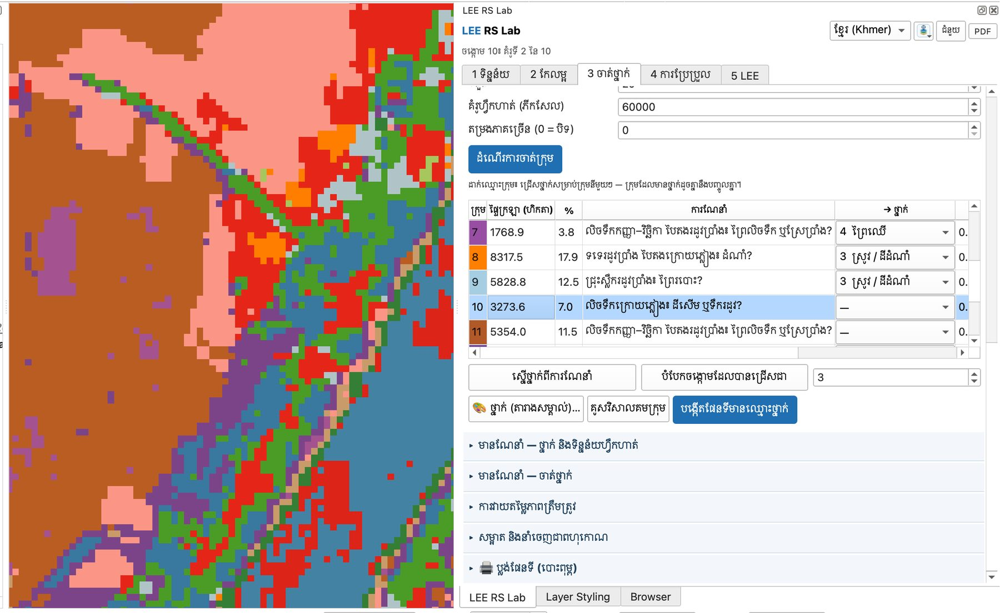{ loading=lazy }

*រូបទី 35 — ចុចលើក្រុម 10 ដើម្បីមើលគំរូ៖ ប៊ូតុងស្នើថ្នាក់ បំបែកក្រុម គូសវិសាលគម និងបង្កើតផែនទី*

**គូសវិសាលគមក្រុម** សម្រាប់ Stack បង្ហាញប៊ែនទាំង 13។ ប៊ែនរ៉ាដាជា dB (ប្រហែល −25 ដល់ −7) ចំណែកសន្ទស្សន៍នៅចន្លោះ −1 ដល់ 1 ដូច្នេះក្នុងរូបទី 36 (កំណែ 2.3.0) ខ្សែសន្ទស្សន៍មើលទៅរាបស្មើ។ ចាប់ពីកំណែ **2.3.1** ប៊ែនរ៉ាដាត្រូវបានគូសក្នុងផ្ទាំងទីពីរ ដែលមានអ័ក្ស dB ផ្ទាល់ខ្លួន។ មើលផ្នែករ៉ាដា៖ VH ទាបខ្លាំង (−22 dB) = ទឹករលោង VH ខ្ពស់ (−13 dB) = ដើមឈើ (ការខ្ចាត់ខ្ចាយក្នុងមកុដ)។ សម្រាប់សន្ទស្សន៍ សូមដាក់កណ្ដុរលើជួរការណែនាំ ដើម្បីមើលតម្លៃមធ្យម។

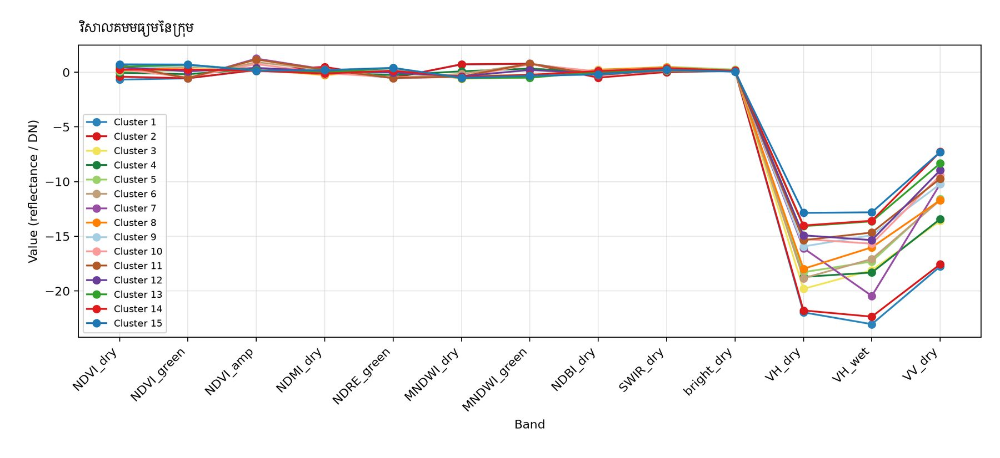{ loading=lazy }

*រូបទី 36 — តម្លៃមធ្យមនៃក្រុមលើ Stack ពហុរដូវ (13 ប៊ែន)*

ចុច **បង្កើតផែនទីមានឈ្មោះថ្នាក់**។ ស្រទាប់ **ក្រុមដែលបានដាក់ឈ្មោះ** លេចឡើងជាមួយតារាងសម្គាល់ ហើយរក្សាទុកជា `kmeans_3_labelled.tif`។

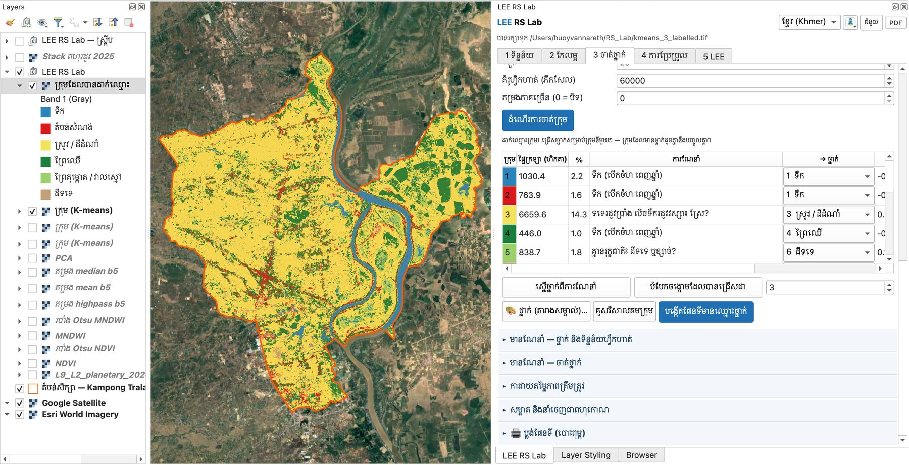{ loading=lazy }

*រូបទី 37 — ផែនទីក្រុមដែលបានដាក់ឈ្មោះថ្នាក់ (ពី Stack ពហុរដូវ) លើ Google Satellite*

## ប្រៀបធៀបការបញ្ចូលទាំងបី

| ការបញ្ចូល | ចំនួនប៊ែន | ការណែនាំ | ចំណុចខ្លាំង | ចំណុចខ្សោយ |
| --- | --- | --- | --- | --- |
| Landsat រដូវប្រាំង | 6 | មាន (ពី NDVI, MNDWI, NDBI) | សាមញ្ញ ភីកសែលពេញ 100% | មើលឃើញតែថ្ងៃតែមួយ |
| PCA | 3 | គ្មាន | បង្រួមព័ត៌មាន លឿន | PC គ្មានអត្ថន័យរូបវន្ត |
| Stack ពហុរដូវ | 13 | មាន (តាមរដូវ) | បែងចែកស្រែ ដីលិចទឹក ព្រៃរបោះ | ភីកសែលពេញតែ 48% (ពពករដូវភ្លៀង) |

> សំណួរសម្រាប់និស្សិត៖ មើលផែនទីលទ្ធផល — តើមានតំបន់សំណង់ទេ? ហេតុអ្វីបានជាភូមិតាមផ្លូវជាតិងាយច្រឡំជាមួយដីទទេ ឬស្រែស្ងួត? នេះជាមូលហេតុដែលយើងត្រូវការចំណាត់ថ្នាក់មានណែនាំ (មេរៀនទី 9–10)។

---

[← មេរៀនទី 7](lesson-07.md) · [មេរៀនទី 9 →](lesson-09.md)
