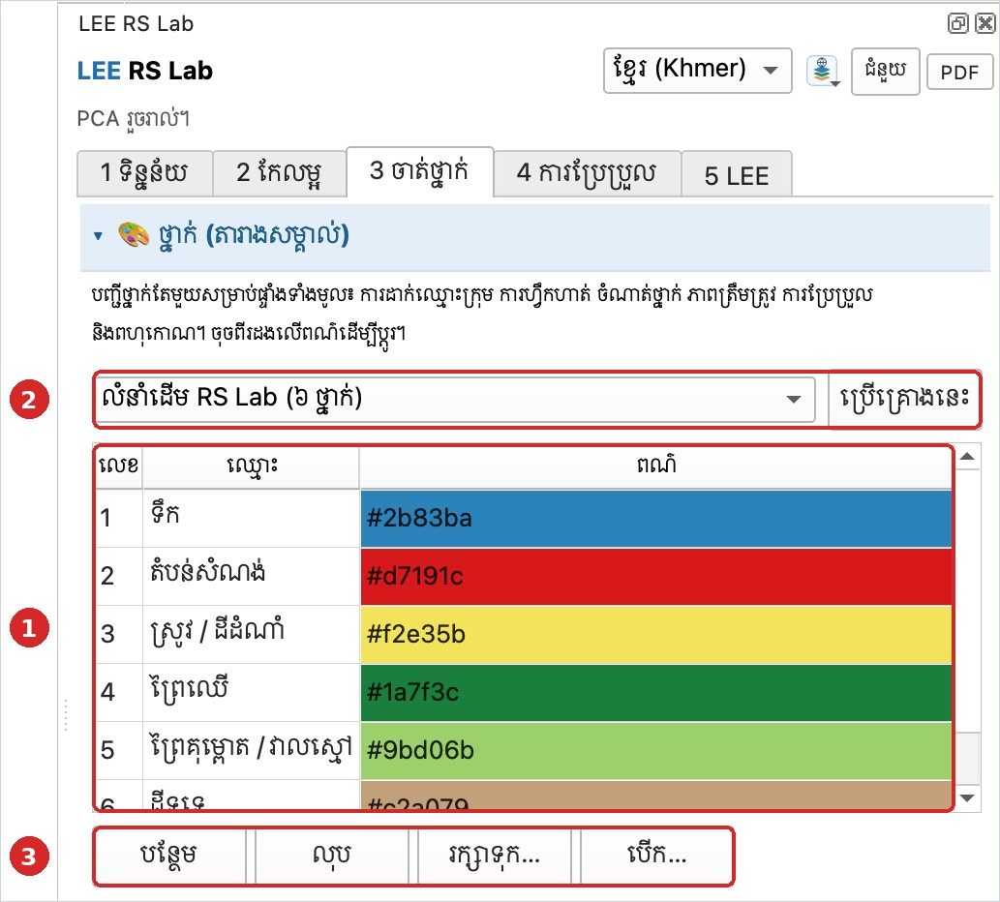
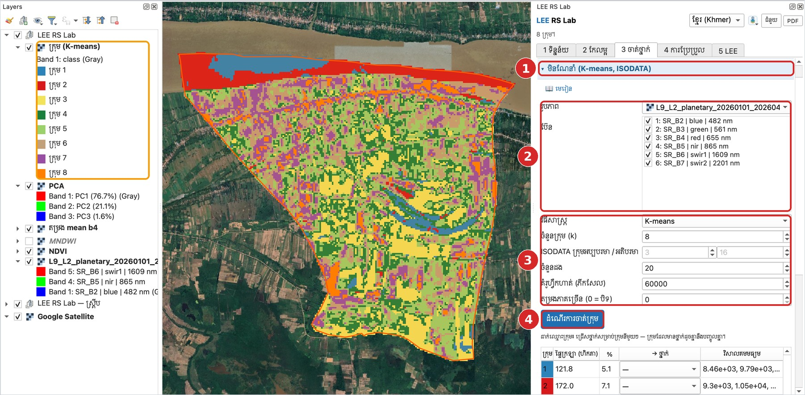
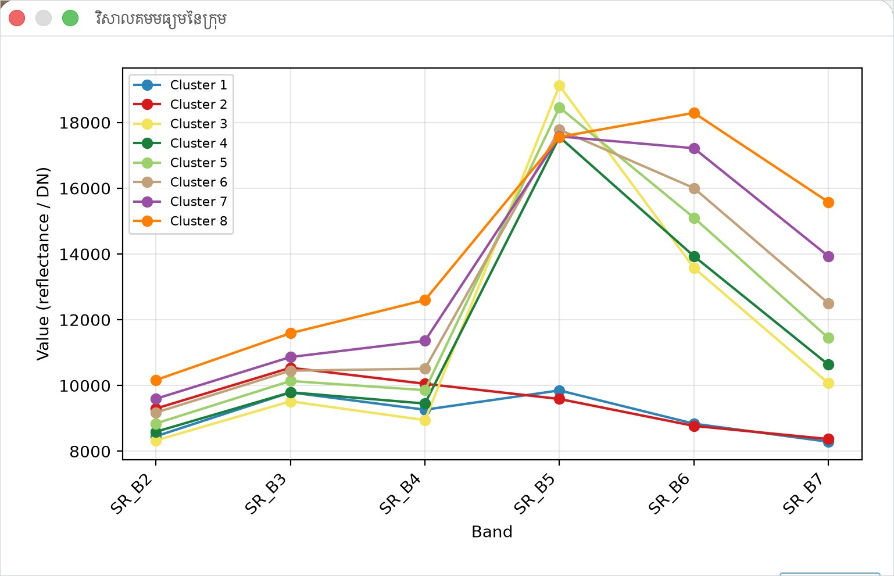
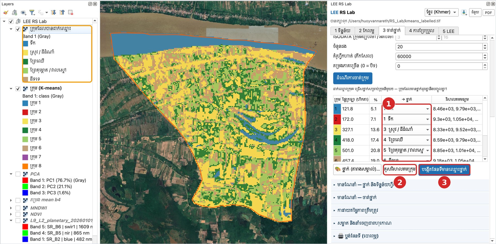
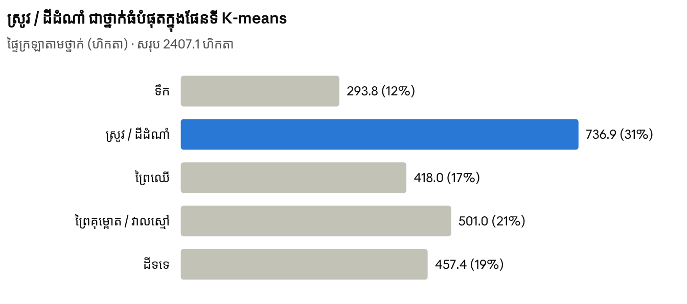

# មេរៀនទី 8 — ថ្នាក់ និងចំណាត់ថ្នាក់មិនណែនាំ (K-means)

ចំណាត់ថ្នាក់មិនណែនាំចែកភីកសែលជាក្រុមតាមភាពស្រដៀងគ្នានៃវិសាលគម ដោយមិនចាំបាច់មានទិន្នន័យហ្វឹកហាត់។ បន្ទាប់មក អ្នកដាក់ឈ្មោះក្រុមនីមួយៗជាថ្នាក់។ ចំណាត់ថ្នាក់នៃឃុំមហាខ្ញូងចំណាយពេលតិចជាង 1 នាទី។

## ជំហានទី 1 — ពិនិត្យថ្នាក់ (តារាងសម្គាល់)

ចូលផ្ទាំង **3 ចាត់ថ្នាក់** → **🎨 ថ្នាក់ (តារាងសម្គាល់)**។ បញ្ជីនេះប្រើរួមគ្នាសម្រាប់គ្រប់ជំហាន៖ ការដាក់ឈ្មោះក្រុម ការហ្វឹកហាត់ ភាពត្រឹមត្រូវ និងការប្រែប្រួល។

- ① គ្រោងលំនាំដើម **RS Lab (៦ ថ្នាក់)**៖ 1 ទឹក · 2 តំបន់សំណង់ · 3 ស្រូវ/ដីដំណាំ · 4 ព្រៃឈើ · 5 ព្រៃគុម្ពោត/វាលស្មៅ · 6 ដីទទេ។
- ② គ្រោងផ្សេងទៀត៖ LULC កម្រិត 1 (៨ ថ្នាក់) · Auto 7 (ពី ESA WorldCover) · ESA WorldCover (១១ ថ្នាក់)។ ជ្រើស រួចចុច **ប្រើគ្រោងនេះ**។
- ③ ចុចពីរដងលើឈ្មោះដើម្បីកែ ក្នុងពណ៌ដើម្បីប្ដូរពណ៌។ **រក្សាទុក… / បើក…** រក្សាបញ្ជីថ្នាក់ជា CSV។

{ loading=lazy }

*រូបទី 15 — ថ្នាក់ (តារាងសម្គាល់) គ្រោងលំនាំដើម ៦ ថ្នាក់*

## ជំហានទី 2 — ដំណើរការ K-means

1. បើកផ្នែក **មិនណែនាំ (K-means, ISODATA)**។
2. **រូបភាព**៖ រូបភាពផ្សំ Landsat 9 · **ប៊ែន**៖ ទាំង 6។
3. **វិធីសាស្ត្រ** K-means · **ចំនួនក្រុម (k)** 8 · **ចំនួនដង** 20 · **គំរូហ្វឹកហាត់** 60,000 ភីកសែល។ (ពេលជ្រើស K-means ប្រអប់ ISODATA ក្រុមអប្បបរមា/អតិបរមា ត្រូវបានបិទ។)
4. ចុច **ដំណើរការចាត់ក្រុម**។ ស្រទាប់ **ក្រុម (K-means)** មាន 8 ពណ៌។

{ loading=lazy }

*រូបទី 16 — លទ្ធផល K-means 8 ក្រុម*

## ជំហានទី 3 — អានវិសាលគម និងដាក់ឈ្មោះក្រុម

ចុច **គូសវិសាលគមក្រុម** ដើម្បីមើលតម្លៃមធ្យមនៃក្រុមនីមួយៗ។ គន្លឹះអាន៖

- **ទឹក**៖ NIR (SR\_B5) ទាបខ្លាំង ប្រហែលស្មើប៊ែនមើលឃើញ (ក្រុម 1 និង 2)។
- **រុក្ខជាតិខៀវខ្ចី**៖ NIR ខ្ពស់បំផុត និង SWIR ទាប (ក្រុម 3)។
- **ស្រែស្ងួត ឬដីទទេ**៖ SWIR (SR\_B6, SR\_B7) ខ្ពស់ (ក្រុម 7 និង 8) — ក្នុងឧទាហរណ៍នេះ ដាក់ជា ស្រូវ / ដីដំណាំ (ស្រែក្រោយច្រូត)។

{ loading=lazy }

*រូបទី 17 — វិសាលគមមធ្យមនៃក្រុមទាំង 8*

នៅតារាងក្រុម ជ្រើសថ្នាក់សម្រាប់ក្រុមនីមួយៗក្នុងជួរឈរ **→ ថ្នាក់**។ ក្រុមដែលមានថ្នាក់ដូចគ្នានឹងបញ្ចូលគ្នា (ឧ. ក្រុម 1 និង 2 → ទឹក)។ បន្ទាប់មកចុច **បង្កើតផែនទីមានឈ្មោះថ្នាក់**។

| ក្រុម | ផ្ទៃក្រឡា (ហិកតា) | % | → ថ្នាក់ |
| --- | --- | --- | --- |
| 1 | 121.8 | 5.1 | 1 ទឹក |
| 2 | 172.0 | 7.1 | 1 ទឹក |
| 3 | 327.1 | 13.6 | 3 ស្រូវ / ដីដំណាំ |
| 4 | 418.0 | 17.4 | 4 ព្រៃឈើ |
| 5 | 501.0 | 20.8 | 5 ព្រៃគុម្ពោត / វាលស្មៅ |
| 6 | 457.4 | 19.0 | 6 ដីទទេ |

{ loading=lazy }

*រូបទី 18 — ផែនទីក្រុមដែលបានដាក់ឈ្មោះថ្នាក់៖ ① ជួរឈរ → ថ្នាក់ ② គូសវិសាលគមក្រុម ③ បង្កើតផែនទីមានឈ្មោះថ្នាក់*

ក្រុម 7 និង 8 ក៏ដាក់ជា **3 ស្រូវ / ដីដំណាំ** ដែរ។ ចុច **គំនូសតាងផ្ទៃក្រឡា** (ក្នុងផ្នែក មានណែនាំ — ចាត់ថ្នាក់) ដើម្បីមើលផ្ទៃក្រឡាតាមថ្នាក់។ មុនមានចំណាត់ថ្នាក់មានណែនាំ វាប្រើលទ្ធផល K-means (ក្រាហ្វខាងក្រោម)។

{ loading=lazy }

*រូបទី 18ក — ផ្ទៃក្រឡាតាមថ្នាក់ (ហិកតា) ពីចំណាត់ថ្នាក់ K-means*

## ជំហានទី 4 — Stack ពហុរដូវ និងឧបករណ៍ដាក់ឈ្មោះក្រុម (ថ្មីក្នុងកំណែ 2.3.0)

រូបភាពតែមួយ (ឧ. Landsat 9 រដូវប្រាំង) ពិបាកបែងចែក ព្រៃស្រោង ពីចម្ការដើមឈើ ឬស្រែ ពីដំណាំចម្ការ ព្រោះវិសាលគមរបស់វាស្រដៀងគ្នានៅថ្ងៃតែមួយ។ ប៉ុន្តែ **ប្រតិទិនជីវិត** របស់វាខុសគ្នា៖ ព្រៃរបោះជ្រុះស្លឹកក្នុងរដូវប្រាំង ស្រែទទេក្នុងរដូវប្រាំង ហើយលិចទឹកក្នុងរដូវវស្សា ចំណែកព្រៃស្រោងបៃតងពេញឆ្នាំ។

1. នៅខាងលើផ្នែក **មិនណែនាំ (K-means, ISODATA)** ក្នុងប្រអប់ **Stack ពហុរដូវ (ក្នុងម៉ាស៊ីន មិនចាំបាច់ចូលគណនី)** ជ្រើស **ឆ្នាំ** · **ចំនួនរូបភាពក្នុងមួយរដូវ** (8) · **ទំហំភីកសែល** (ស្វ័យប្រវត្តិ) · ធីក **រួមបញ្ចូលរ៉ាដា Sentinel-1**។
2. ចុច **បង្កើត Stack ពហុរដូវ**។ LEE ទាញយកតែតំបន់សិក្សា ហើយបង្កើតរូបភាព 13 ប៊ែន៖

    | ប៊ែន | អត្ថន័យ |
    | --- | --- |
    | NDVI\_dry · NDVI\_green · NDVI\_amp | ភាពបៃតង កុម្ភៈ–មេសា · កញ្ញា–វិច្ឆិកា · ការប្រែប្រួលតាមរដូវ |
    | NDMI\_dry · NDRE\_green | សំណើមស្លឹករដូវប្រាំង · Red-edge (ក្លរ៉ូភីល) |
    | MNDWI\_dry · MNDWI\_green | ទឹករដូវប្រាំង · ទឹកក្រោយរដូវភ្លៀង (ទឹកជំនន់តាមរដូវ) |
    | NDBI\_dry · SWIR\_dry · bright\_dry | តំបន់សំណង់ · ដីទទេ · ពន្លឺ (ខ្សាច់ ដំបូល) |
    | VH\_dry · VH\_wet · VV\_dry | រ៉ាដា Sentinel-1៖ រចនាសម្ព័ន្ធដើមឈើ ទឹកលិចស្រែ អគារ |

3. Stack ត្រូវបានជ្រើសសម្រាប់ចាត់ក្រុមដោយស្វ័យប្រវត្តិ ហើយ **k** ប្ដូរទៅ 15។ ចុច **ដំណើរការចាត់ក្រុម**។ សូមប្រើក្រុមច្រើនជាងចំនួនថ្នាក់ (15–25) ព្រោះថ្នាក់មួយច្រើនតែបែកជាក្រុមច្រើន។
4. តារាងក្រុមមានជួរឈរថ្មី **ការណែនាំ** (ឧ. «ជ្រុះស្លឹករដូវប្រាំង៖ ព្រៃរបោះ?»)។ ដាក់កណ្ដុរលើវា ដើម្បីមើលតម្លៃមធ្យមនៃប៊ែនទាំងអស់។
5. **ចុចលើជួរក្រុម** ដើម្បីទៅកាន់ភីកសែលគំរូមួយនៃក្រុមនោះលើរូបភាព Esri។ ចុចម្ដងទៀតសម្រាប់គំរូបន្ទាប់ (រហូតដល់ 10)។
6. **ស្នើថ្នាក់ពីការណែនាំ** បំពេញប្រអប់ **→ ថ្នាក់** ដែលនៅទំនេរ តាមគ្រោងថ្នាក់ដែលកំពុងប្រើ។ សូមពិនិត្យ និងកែលើផែនទីផ្ទៃខាងក្រោយ។
7. ក្រុមណាដែលចម្រុះ (ឧ. ចម្ការ និងព្រៃលាយគ្នា) ជ្រើសជួរនោះ រួចចុច **បំបែកក្រុមដែលបានជ្រើសជា** 2–6 ក្រុមរង។
8. ចុច **បង្កើតផែនទីមានឈ្មោះថ្នាក់** ដូចជំហានទី 3។

!!! note "ពេលវេលា"
    ឃុំ ឬស្រុកមួយចំណាយពេលពីរបីនាទី។ សម្រាប់ខេត្តទាំងមូល ទំហំភីកសែលប្ដូរទៅប្រហែល 30–40 ម៉ែត្រដោយស្វ័យប្រវត្តិ ហើយការទាញយកអាចចំណាយពេលច្រើននាទី។ ការណែនាំគ្រាន់តែជាការស្មានពីតួលេខប៉ុណ្ណោះ — ការសម្រេចចិត្តចុងក្រោយគឺពីការមើលរូបភាពរបស់អ្នក។

> សំណួរសម្រាប់និស្សិត៖ មើលផែនទីលទ្ធផល — តើមានតំបន់សំណង់ទេ? ហេតុអ្វីបានជាភូមិតាមមាត់ទន្លេងាយច្រឡំជាមួយដីទទេ ឬព្រៃគុម្ពោត? នេះជាមូលហេតុដែលយើងត្រូវការចំណាត់ថ្នាក់មានណែនាំ។

---

[← មេរៀនទី 7](lesson-07.md) · [មេរៀនទី 9 →](lesson-09.md)
