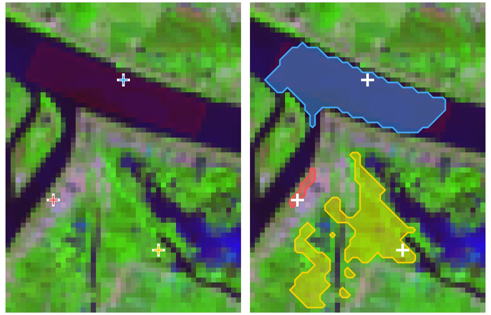
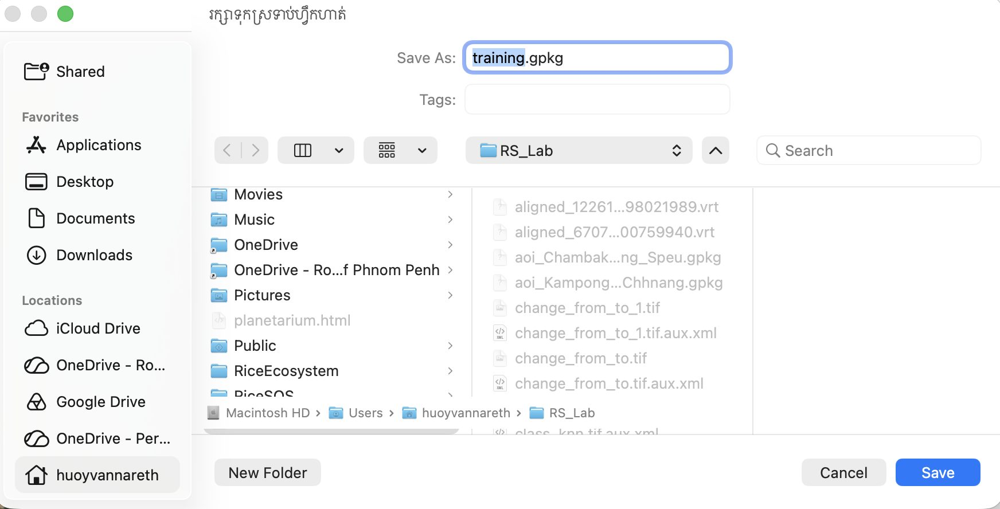
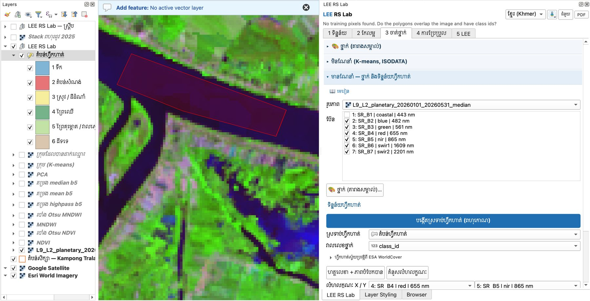
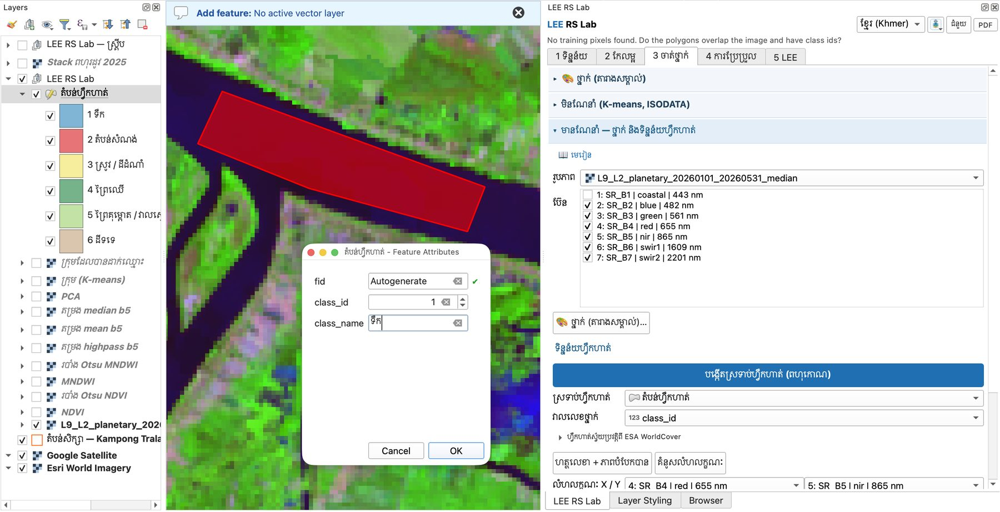
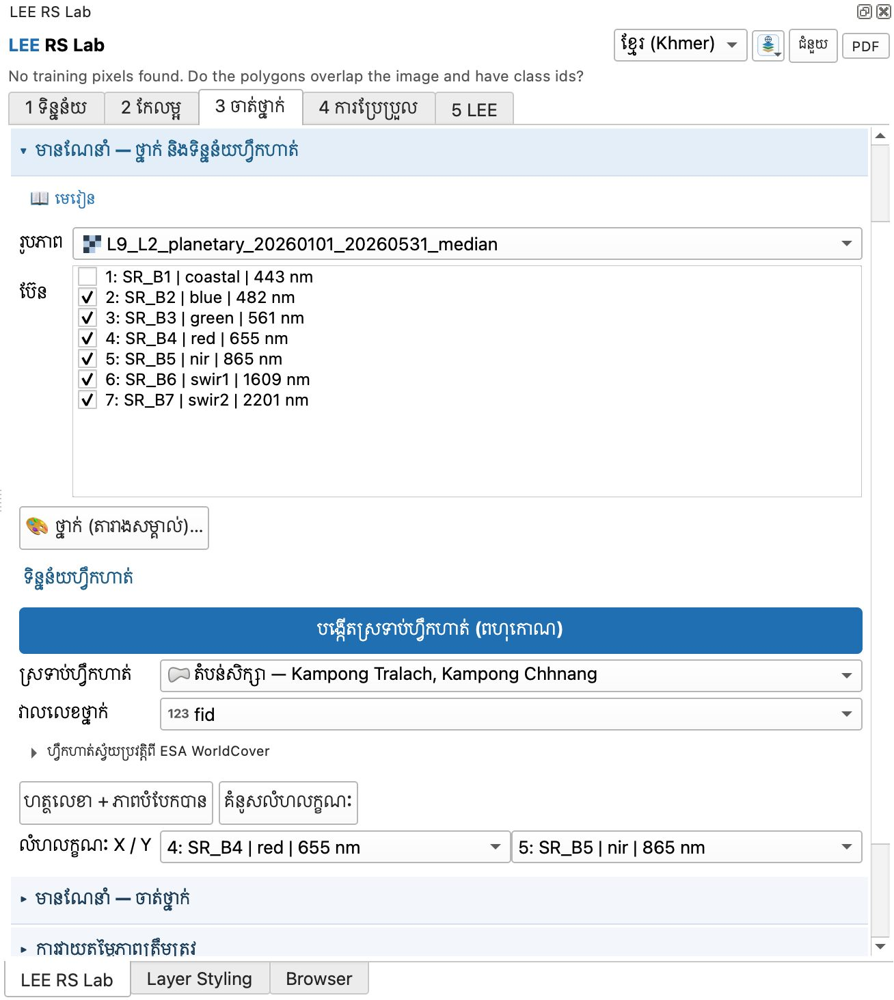

# មេរៀនទី 9 — ចំណាត់ថ្នាក់មានណែនាំ៖ បង្កើតទិន្នន័យហ្វឹកហាត់

ចំណាត់ថ្នាក់មានណែនាំរៀនពីទីតាំងដែលអ្នកស្គាល់ថ្នាក់ច្បាស់ (តំបន់ហ្វឹកហាត់)។ ចាប់ពីកំណែ **2.4.0** មានវិធីពីរ៖ **🪄 ដំបងវេទមន្ត** (ចុចតែម្ដង កម្មវិធីជំនួយ (Plugin) បង្កើតពហុកោណឲ្យ) ឬ **គូសពហុកោណដោយដៃ**។ ប្រើបន្សំប៊ែន ឬផែនទីមូលដ្ឋាន Google Satellite ដើម្បីសម្រេចចិត្តថាកន្លែងណាជាថ្នាក់អ្វី។

## វិធីទី 1 — ដំបងវេទមន្ត (ចុចឲ្យរីក) · ណែនាំ

ដំបងវេទមន្តចាប់ផ្ដើមពីភីកសែលដែលអ្នកចុច ហើយរីកទៅភីកសែលជិតខាងដែល **ស្រដៀងគ្នាលើប៊ែនទាំងអស់ដែលបានធីក** និង **នៅជាប់គ្នា**។ ភីកសែលដែលខុសគ្នា (ផ្លូវ ទំនប់ ដើមឈើ) បញ្ឈប់ការរីក ដូច្នេះពហុកោណស្ថិតនៅខាងក្នុងស្រែ ស្រះ ឬព្រៃតែមួយ។ ជួរភីកសែលនៅគែមត្រូវបានកាត់ចេញ ព្រោះភីកសែលគែមច្រើនតែលាយ (ពាក់កណ្ដាលស្រែ ពាក់កណ្ដាលផ្លូវ)។

1. បើកផ្នែក **មានណែនាំ — ថ្នាក់ និងទិន្នន័យហ្វឹកហាត់**។ ជ្រើស **រូបភាព** រូបភាពផ្សំ Landsat 9 និង **ប៊ែន** SR\_B2–SR\_B7។ ប្ដូរបន្សំប៊ែនទៅ 7-5-4 (មេរៀនទី 5) ដើម្បីមើលថ្នាក់ឲ្យច្បាស់។
2. ក្នុងប្រអប់ **🪄 ដំបងវេទមន្ត (ចុចឲ្យរីក)** ចុចប៊ូតុងពណ៌នៃថ្នាក់ ឧ. **1 ទឹក**។ ដំបងវេទមន្តបើកដោយស្វ័យប្រវត្តិ (ប៊ូតុង **ឈប់ចុច** ប្ដូរជាពណ៌ក្រហម)។
3. ចុចនៅកណ្ដាលទន្លេសាប។ ពហុកោណពណ៌ទឹកលេចឡើង ហើយរបារស្ថានភាពបង្ហាញចំនួនភីកសែល និងផ្ទៃក្រឡា («ទឹក៖ … ភីកសែល (… ha)»)។ ប្រសិនបើឃើញ «ដល់ផ្ទៃអតិបរមា» មានន័យថាតំបន់ធំជាង **ផ្ទៃអតិបរមាក្នុងមួយចុច** ហើយត្រូវបានកាត់ត្រឹមភីកសែលដែលស្រដៀងបំផុត។ ប្រសិនបើមិនទាន់មានស្រទាប់ហ្វឹកហាត់ទេ កម្មវិធីជំនួយបង្កើត `training.gpkg` ក្នុងថតលទ្ធផលដោយស្វ័យប្រវត្តិ ហើយជ្រើសវាជា **ស្រទាប់ហ្វឹកហាត់** និង **class\_id** ជា **វាលលេខថ្នាក់** — មិនចាំបាច់វាយលេខថ្នាក់ទេ។
4. ចុចថ្នាក់បន្ទាប់ (ឧ. **3 ស្រូវ / ដីដំណាំ**) ហើយចុចនៅក្នុងស្រែច្រើនកន្លែង។ ធ្វើសម្រាប់ **ថ្នាក់ទាំង 6** ចែកចាយពេញស្រុក។ បន្ទាត់ **ចំនួនពហុកោណតាមថ្នាក់** រាប់ឲ្យអ្នក ដើម្បីដឹងថាថ្នាក់ណានៅខ្វះ (យ៉ាងតិច 5–10 ពហុកោណក្នុងមួយថ្នាក់)។
5. ចុចខុស? ចុច **មិនធ្វើវិញ (ចុងក្រោយ)**។ ចុច **ឈប់ចុច** ពេលបញ្ចប់ — ពហុកោណត្រូវបានរក្សាទុករួចហើយ។

| ការកំណត់ | លំនាំដើម | ពេលណាត្រូវប្ដូរ |
|---|---|---|
| **កម្រិតភាពស្រដៀង** | 1.0 | ពហុកោណរីកចូលថ្នាក់ផ្សេង → បន្ថយ (0.6–0.8)។ បានតែភីកសែលពីរបី → បង្កើន (1.2–1.5)។ |
| **ផ្ទៃអតិបរមាក្នុងមួយចុច** | 5 ha | ពហុកោណតូចៗច្រើនកន្លែងល្អជាងពហុកោណធំមួយ — ទុក 2–5 ha សម្រាប់ Landsat។ |

{ loading=lazy }

*រូបទី 38 — គោលការណ៍ដំបងវេទមន្ត៖ ចុចមួយ (ឆ្វេង) → ពហុកោណនៃភីកសែលស្រដៀងគ្នាដែលនៅជាប់គ្នា (ស្ដាំ)៖ ទឹកទន្លេសាប (ខៀវ) ស្រែ (លឿង) និងដីទទេ (ក្រហម) លើបន្សំ 7-5-4 ស្រុកកំពង់ត្រឡាច (រូបពន្យល់ ដែលគណនាដោយក្បួនដោះស្រាយដូចគ្នាលើរូបភាពក្នុងរូបទី 40)*

!!! tip "ដំបងវេទមន្ត ឬគូសដោយដៃ?"
    ដំបងវេទមន្តលឿន ហើយពហុកោណមិនដែលឆ្លងគែមស្រែ ឬទន្លេ។ ប៉ុន្តែវាមិនដឹងថាថ្នាក់ពិតជាអ្វីទេ — **អ្នក** ជាអ្នកសម្រេចតាមរយៈប៊ូតុងថ្នាក់។ សម្រាប់ថ្នាក់ដែលចម្រុះ (ភូមិ = ផ្ទះ + ដើមឈើ + ផ្លូវ) ការរីកឈប់លឿន ឬរីកចូលថ្នាក់ផ្សេង — គូសដោយដៃ (វិធីទី 2) ល្អជាង។ ពហុកោណទាំងពីរវិធីអាចនៅក្នុងស្រទាប់ហ្វឹកហាត់តែមួយ។

## វិធីទី 2 — គូសពហុកោណដោយដៃ
1. បើកផ្នែក **មានណែនាំ — ថ្នាក់ និងទិន្នន័យហ្វឹកហាត់**។ ជ្រើស **រូបភាព** រូបភាពផ្សំ Landsat 9 និង **ប៊ែន** SR\_B2–SR\_B7។
2. ចុច **បង្កើតស្រទាប់ហ្វឹកហាត់ (ពហុកោណ)** ហើយរក្សាទុកជា `training.gpkg` ក្នុងថត `RS_Lab`។

    { loading=lazy }

    *រូបទី 39 — រក្សាទុកស្រទាប់ហ្វឹកហាត់ជា training.gpkg*

3. ស្រទាប់ **តំបន់ហ្វឹកហាត់** លេចឡើងក្នុងបញ្ជីស្រទាប់ ជាមួយពណ៌នៃថ្នាក់ទាំង 6 ហើយចូលរបៀបកែសម្រួលដោយស្វ័យប្រវត្តិ។ **ស្រទាប់ហ្វឹកហាត់** = តំបន់ហ្វឹកហាត់ និង **វាលលេខថ្នាក់** = class\_id បំពេញស្វ័យប្រវត្តិ។
4. ប្ដូរបន្សំប៊ែនទៅ 7-5-4 (មេរៀនទី 5) ដើម្បីឲ្យទឹក រុក្ខជាតិ និងដីស្ងួតខុសពណ៌គ្នាច្បាស់។ គូសពហុកោណលើផែនទី (ចុចឆ្វេងដើម្បីដាក់ចំណុច ចុចស្តាំដើម្បីបញ្ចប់) — ឧ. នៅកណ្ដាលទន្លេសាប។

    { loading=lazy }

    *រូបទី 40 — គូសពហុកោណហ្វឹកហាត់ទីមួយលើទន្លេសាប (បន្សំ 7-5-4)*

5. នៅប្រអប់ **Feature Attributes** វាយ **class\_id** = 1 និង **class\_name** = ទឹក រួចចុច **OK**។ (**fid** ទុក Autogenerate)

    { loading=lazy }

    *រូបទី 41 — វាយ class\_id 1 និង class\_name ទឹក*

6. ធ្វើម្ដងទៀតសម្រាប់ **ថ្នាក់ទាំង 6**។ គូសពហុកោណ 5–10 ក្នុងមួយថ្នាក់ ចែកចាយពេញស្រុក (ខាងលិច និងខាងកើតទន្លេ)។
7. រក្សាទុកការកែប្រែ (Save Layer Edits) ពេលបញ្ចប់។

!!! warning "កំហុសញឹកញាប់៖ «No training pixels found»"
    ប្រសិនបើ **ស្រទាប់ហ្វឹកហាត់** ជាស្រទាប់តំបន់សិក្សា ហើយ **វាលលេខថ្នាក់** ជា `fid` (រូបទី 42) កម្មវិធីជំនួយ (Plugin) មិនរកឃើញភីកសែលហ្វឹកហាត់ទេ ព្រោះតំបន់សិក្សាមិនមែនជាតំបន់ហ្វឹកហាត់ ហើយ fid មិនមែនជាលេខថ្នាក់។ ជ្រើស **តំបន់ហ្វឹកហាត់** និង **class\_id** វិញ។ ពិនិត្យផងដែរថាពហុកោណស្ថិតនៅលើរូបភាព ហើយមាន class\_id ពី 1 ដល់ 6។

{ loading=lazy }

*រូបទី 42 — កំហុស៖ ជ្រើសស្រទាប់តំបន់សិក្សា និង fid ជាទិន្នន័យហ្វឹកហាត់*

## គន្លឹះគូសតំបន់ហ្វឹកហាត់

- គូសនៅកណ្ដាលផ្ទៃដីដូចគ្នា ជៀសវាងគែម និងភីកសែលលាយ។
- ប្រើបន្សំប៊ែនកសិកម្ម 6-5-2 ឬ 7-5-4 ដើម្បីបំបែកស្រូវ ព្រៃ និងដីទទេងាយស្រួល។
- កុំគូសតែនៅកន្លែងតែមួយ — ស្រែខាងលិចទន្លេ និងដីលិចទឹកខាងកើតមើលទៅខុសគ្នាខ្លាំង។
- ថ្នាក់តូច (តំបន់សំណង់ ដីទទេ) ត្រូវការពហុកោណច្រើនកន្លែង — ភូមិតាមផ្លូវជាតិលេខ 5 និងទីប្រជុំជន។
- ជម្រើសផ្សេង (របៀប **កម្រិតខ្ពស់**)៖ **ហ្វឹកហាត់ស្វ័យប្រវត្តិពី ESA WorldCover** បង្កើតចំណុចហ្វឹកហាត់ដោយមិនចាំបាច់គូស (គ្រោង Auto 7)។

---

[← មេរៀនទី 8](lesson-08.md) · [មេរៀនទី 10 →](lesson-10.md)
