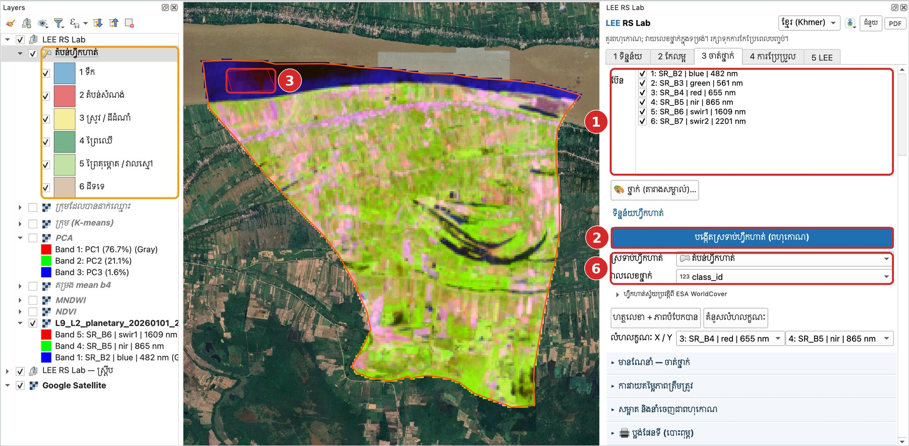
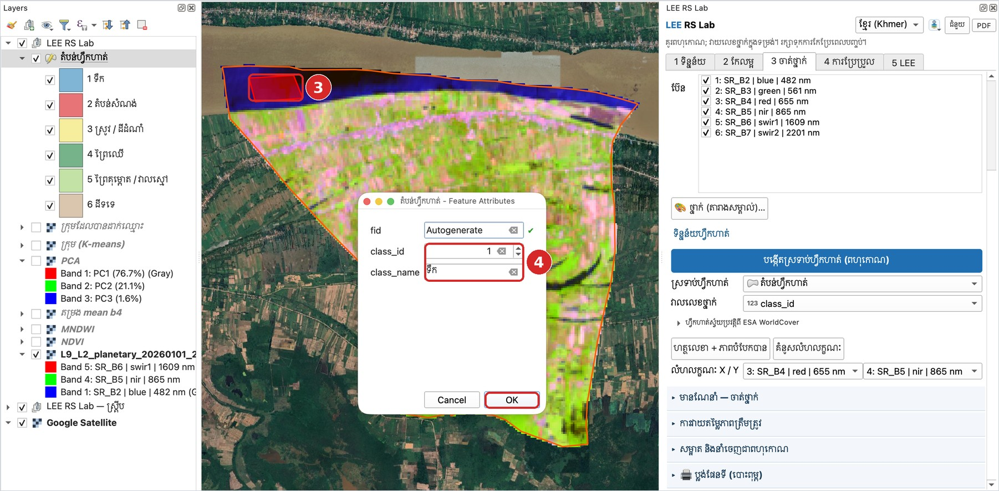

# មេរៀនទី 9 — ចំណាត់ថ្នាក់មានណែនាំ៖ បង្កើតទិន្នន័យហ្វឹកហាត់

ចំណាត់ថ្នាក់មានណែនាំរៀនពីទីតាំងដែលអ្នកស្គាល់ថ្នាក់ច្បាស់ (តំបន់ហ្វឹកហាត់)។ គូសពហុកោណតូចៗលើផ្ទៃដីដែលដូចគ្នា (តំបន់ «សុទ្ធ») ហើយអាចមើលផែនទីមូលដ្ឋាន Google Satellite ដើម្បីធ្វើការសម្រេចចិត្ត។

## ជំហាន

1. បើកផ្នែក **មានណែនាំ — ថ្នាក់ និងទិន្នន័យហ្វឹកហាត់**។ ជ្រើស **រូបភាព** និង **ប៊ែន**ទាំង 6។
2. ចុច **បង្កើតស្រទាប់ហ្វឹកហាត់ (ពហុកោណ)** ហើយរក្សាទុកជា `training.gpkg`។ ស្រទាប់ **តំបន់ហ្វឹកហាត់** លេចឡើងជាមួយពណ៌នៃថ្នាក់ទាំង 6 ហើយចូលរបៀបកែសម្រួលដោយស្វ័យប្រវត្តិ។
3. គូសពហុកោណលើផែនទី (ចុចឆ្វេងដើម្បីដាក់ចំណុច ចុចស្តាំដើម្បីបញ្ចប់)។ ឧទាហរណ៍៖ ពហុកោណនៅកណ្ដាលទន្លេមេគង្គ។
4. នៅប្រអប់ **Feature Attributes** វាយ **class\_id** = 1 និង **class\_name** = ទឹក រួចចុច **OK**។
5. ធ្វើម្ដងទៀតសម្រាប់ថ្នាក់នីមួយៗ។ គូសពហុកោណ 5–10 ក្នុងមួយថ្នាក់ ចែកចាយពេញតំបន់សិក្សា។
6. រក្សាទុកការកែប្រែ (Save Layer Edits) ពេលបញ្ចប់។ **ស្រទាប់ហ្វឹកហាត់** និង **វាលលេខថ្នាក់** (class\_id) បំពេញស្វ័យប្រវត្តិ។

{ loading=lazy }

*រូបទី 19 — ស្រទាប់តំបន់ហ្វឹកហាត់ថ្មី និងពហុកោណដំបូងនៅលើទន្លេ (លេខក្នុងរូប = លេខជំហាន)*

{ loading=lazy }

*រូបទី 20 — ③ ពហុកោណលើទន្លេ ④ វាយលេខថ្នាក់ 1 (ទឹក) ក្នុងប្រអប់ Feature Attributes រួចចុច OK*

## គន្លឹះគូសតំបន់ហ្វឹកហាត់

- គូសនៅកណ្ដាលផ្ទៃដីដូចគ្នា ជៀសវាងគែម និងភីកសែលលាយ។
- ប្រើបន្សំប៊ែនកសិកម្ម (មេរៀនទី 5) ដើម្បីបំបែកស្រូវ ព្រៃ និងដីទទេងាយស្រួល។
- កុំគូសតែនៅកន្លែងតែមួយ — ស្រូវនៅខាងជើង និងខាងត្បូងអាចមើលទៅខុសគ្នា។
- ជម្រើសផ្សេង៖ **ហ្វឹកហាត់ស្វ័យប្រវត្តិពី ESA WorldCover** បង្កើតចំណុចហ្វឹកហាត់ដោយមិនចាំបាច់គូស។

---

[← មេរៀនទី 8](lesson-08.md) · [មេរៀនទី 10 →](lesson-10.md)
