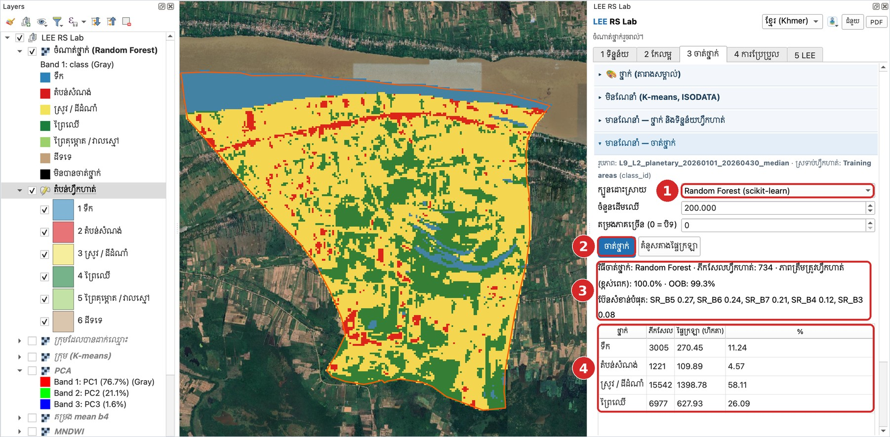

# មេរៀនទី 10 — ហត្ថលេខាវិសាលគម និងចំណាត់ថ្នាក់ Random Forest

Random Forest ចាត់ថ្នាក់ឃុំមហាខ្ញូងជា **ស្រូវ / ដីដំណាំ 58.1%** ព្រៃឈើ 26.1% ទឹក 11.2% និងតំបន់សំណង់ 4.6%។ ប៉ុន្តែតំបន់ហ្វឹកហាត់មានតែ 4 ថ្នាក់ — គ្មានព្រៃគុម្ពោត/វាលស្មៅ និងដីទទេ។ មេរៀនទី 11 បង្ហាញពីផលវិបាកនៃការខ្វះថ្នាក់ទាំងនេះ។

## ជំហានទី 1 — ពិនិត្យហត្ថលេខាវិសាលគម

នៅផ្នែក **មានណែនាំ — ថ្នាក់ និងទិន្នន័យហ្វឹកហាត់** ចុច **ហត្ថលេខា + ភាពបំបែកបាន**។ ក្រាបបង្ហាញតម្លៃមធ្យម ± 1 គម្លាតស្តង់ដារនៃថ្នាក់នីមួយៗ និងចំនួនភីកសែលហ្វឹកហាត់ (n)។ តារាង J–M បង្ហាញភាពបំបែកបាន (ជិត 2 = បំបែកបានល្អ)។

| ថ្នាក់ | ភីកសែលហ្វឹកហាត់ |
| --- | --- |
| ទឹក | 447 |
| ស្រូវ / ដីដំណាំ | 160 |
| ព្រៃឈើ | 74 |
| តំបន់សំណង់ | 53 |

មើលប្រអប់ ① នៅប៊ែន SR\_B5 (NIR)៖ ព្រៃឈើ និងស្រូវខ្ពស់ (រុក្ខជាតិ) ទឹកទាប។ នៅ SWIR (SR\_B6, SR\_B7) ព្រៃឈើធ្លាក់ចុះ ប៉ុន្តែស្រូវ និងតំបន់សំណង់នៅខ្ពស់ — ប៊ែន SWIR ជួយបំបែកព្រៃជាមួយស្រូវ។

{ loading=lazy }

*រូបទី 21 — ហត្ថលេខាហ្វឹកហាត់ (មធ្យម ± 1 std)*

## ជំហានទី 2 — លំហលក្ខណៈ (Feature space)

ជ្រើស **លំហលក្ខណៈ X / Y** = 3: SR\_B4 (red) / 4: SR\_B5 (NIR) រួចចុច **គំនូសលំហលក្ខណៈ**។ ចំណុចនីមួយៗគឺភីកសែលហ្វឹកហាត់មួយ។ ទឹក (ខាងក្រោម) និងព្រៃឈើ (ខាងឆ្វេងលើ) នៅដាច់ដោយឡែក។ ប្រអប់ ① បង្ហាញតំបន់ដែល **ស្រូវ និងតំបន់សំណង់ជាន់គ្នា** — រំពឹងថានឹងមានការច្រឡំរវាងថ្នាក់ទាំងពីរនេះ។

{ loading=lazy }

*រូបទី 22 — លំហលក្ខណៈ Red × NIR៖ ស្រូវ និងតំបន់សំណង់ជាន់គ្នា*

## ជំហានទី 3 — ចាត់ថ្នាក់

1. បើកផ្នែក **មានណែនាំ — ចាត់ថ្នាក់**។ បន្ទាត់ខាងលើបង្ហាញរូបភាព និងស្រទាប់ហ្វឹកហាត់ដែលនឹងប្រើ។
2. ① **ក្បួនដោះស្រាយ**៖ Random Forest (scikit-learn) · **ចំនួនដើមឈើ** 200។
3. ② ចុច **ចាត់ថ្នាក់**។ ស្រទាប់ **ចំណាត់ថ្នាក់ (Random Forest)** លេចឡើង។
4. ③ អានលទ្ធផល៖ ភីកសែលហ្វឹកហាត់ 734 · ភាពត្រឹមត្រូវហ្វឹកហាត់ 100% · OOB 99.3% · ប៊ែនសំខាន់បំផុត SR\_B5 (0.27) SR\_B6 (0.24) SR\_B7 (0.21)។
5. ④ តារាងផ្ទៃក្រឡាតាមថ្នាក់ (តារាងខាងក្រោម)។

{ loading=lazy }

*រូបទី 23 — លទ្ធផលចំណាត់ថ្នាក់ Random Forest*

| ថ្នាក់ | ភីកសែល | ផ្ទៃក្រឡា (ហិកតា) | % |
| --- | --- | --- | --- |
| ស្រូវ / ដីដំណាំ | 15,542 | 1,398.78 | 58.11 |
| ព្រៃឈើ | 6,977 | 627.93 | 26.09 |
| ទឹក | 3,005 | 270.45 | 11.24 |
| តំបន់សំណង់ | 1,221 | 109.89 | 4.57 |

> ភាពត្រឹមត្រូវហ្វឹកហាត់ 100% មិនមែនមានន័យថាផែនទីត្រឹមត្រូវ 100% ទេ។ វាគ្រាន់តែប្រាប់ថាម៉ូដែលចាំភីកសែលដែលវាបានរៀន។ ត្រូវវាយតម្លៃដោយចំណុចឯករាជ្យ (មេរៀនទី 11)។

| ក្បួនដោះស្រាយ | ចំណាំ |
| --- | --- |
| Maximum Likelihood | ប្រើមធ្យម និង covariance នៃថ្នាក់នីមួយៗ — បុរាណ ហើយល្អបើទិន្នន័យហ្វឹកហាត់គ្រប់គ្រាន់ |
| Minimum Distance | ជិតមធ្យមណា ជាថ្នាក់នោះ — សាមញ្ញ លឿន |
| Spectral Angle Mapper | ប្រៀបធៀបរាងវិសាលគម មិនអាស្រ័យពន្លឺ |
| Parallelepiped | ប្រអប់ ± n std — ភីកសែលក្រៅប្រអប់មិនត្រូវបានចាត់ថ្នាក់ |
| Random Forest, SVM, kNN | រៀនម៉ាស៊ីន (ត្រូវការ scikit-learn) |

## ប្រៀបធៀបក្បួនដោះស្រាយទាំង 7

ក្បួនដោះស្រាយរៀនម៉ាស៊ីន (SVM, kNN) យល់ស្របជាមួយ Random Forest លើស 90% ប៉ុន្តែក្បួនបុរាណឲ្យផ្ទៃក្រឡាខុសគ្នាខ្លាំង — ឧ. Minimum Distance ឲ្យព្រៃឈើ 1,094 ហិកតា (ព្រោះវាចូលស្រែ និងព្រៃគុម្ពោតជាព្រៃ)។ ផ្ទៃក្រឡាគិតជាហិកតា (ភីកសែល 30 ម៉ែត្រ)។

| ក្បួនដោះស្រាយ | ទឹក | តំបន់សំណង់ | ស្រូវ / ដីដំណាំ | ព្រៃឈើ | យល់ស្របជាមួយ RF |
| --- | --- | --- | --- | --- | --- |
| Random Forest | 270 | 110 | 1,399 | 628 | — |
| SVM | 292 | 140 | 1,354 | 620 | 93.5% |
| kNN | 278 | 156 | 1,366 | 608 | 91.6% |
| Minimum Distance | 281 | 147 | 885 | 1,095 | 76.7% |
| Spectral Angle Mapper | 277 | 170 | 941 | 1,020 | 76.4% |
| Maximum Likelihood | 232 | 536 | 1,281 | 359 | 73.3% |
| Parallelepiped | 161 | 94 | 866 | 82 | 48.7% (ភីកសែល 13,378 មិនបានចាត់ថ្នាក់) |

ការយល់ស្របគ្នាមិនមែនជាភាពត្រឹមត្រូវទេ — វាគ្រាន់តែប្រាប់ថាផែនទីពីរដូចគ្នាប៉ុណ្ណា។ ប្រើចំណុចផ្ទៀងផ្ទាត់ដដែល (មេរៀនទី 11) ដើម្បីវាយតម្លៃក្បួននីមួយៗ។

---

[← មេរៀនទី 9](lesson-09.md) · [មេរៀនទី 11 →](lesson-11.md)
