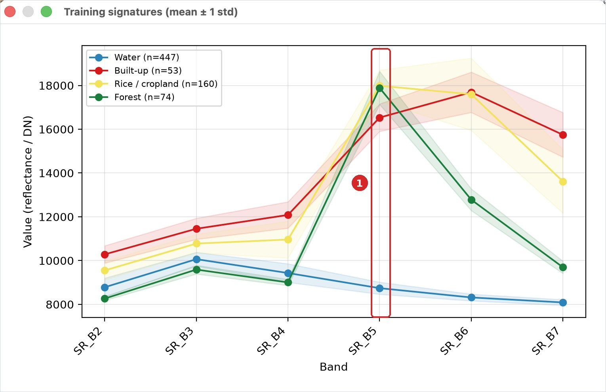
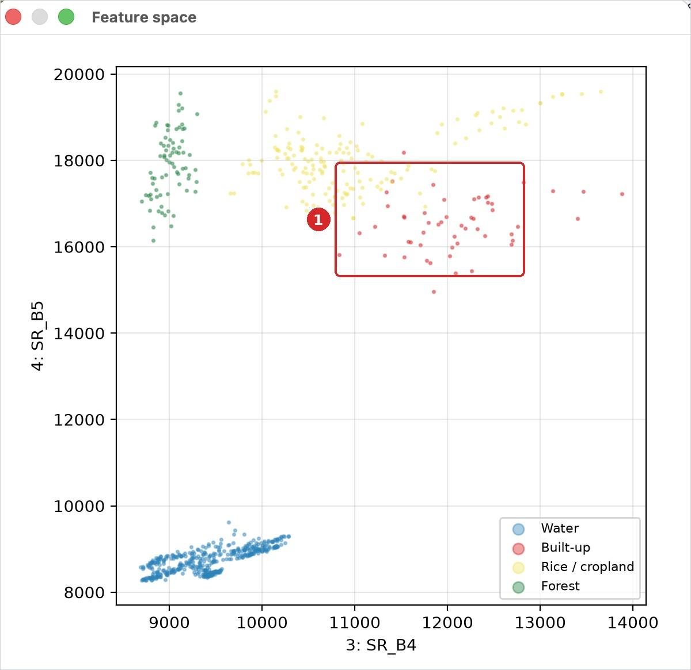

# មេរៀនទី 10 — ហត្ថលេខាវិសាលគម និងចំណាត់ថ្នាក់ Random Forest

Random Forest ចាត់ថ្នាក់ស្រុកកំពង់ត្រឡាចជា **ស្រូវ / ដីដំណាំ 64.9%** ព្រៃឈើ 23.0% ទឹក 6.7% តំបន់សំណង់ 2.6% ព្រៃគុម្ពោត / វាលស្មៅ 1.9% និងដីទទេ 0.9%។ ភាពត្រឹមត្រូវហ្វឹកហាត់គឺ 100% ប៉ុន្តែមេរៀនទី 11 នឹងបង្ហាញថាផែនទីពិតត្រឹមត្រូវតិចជាងនេះច្រើន។

!!! info "របៀបកម្រិតខ្ពស់ (កំណែ 2.4.0)"
    ជំហានទី 1 (ហត្ថលេខា ភាពបំបែក J–M និងប្លង់លំហលក្ខណៈ) និងប្រអប់ **ក្បួនដោះស្រាយ** ជាផ្នែកកម្រិតខ្ពស់។ ក្នុងរបៀប **មូលដ្ឋាន** កម្មវិធីជំនួយ (Plugin) ប្រើ Random Forest ដោយស្វ័យប្រវត្តិ (ឬ Maximum Likelihood ប្រសិនបើមិនទាន់ដំឡើង scikit-learn) ហើយអ្នកគ្រាន់តែចុច **ចាត់ថ្នាក់**។ ចាប់ពីកំណែ 2.4.0 ឧបករណ៍ទាំងនេះបង្ហាញតែក្នុងរបៀប **កម្រិតខ្ពស់**៖ ប្ដូរប្រអប់ **មូលដ្ឋាន** នៅផ្នែកខាងលើផ្ទាំងទៅ **កម្រិតខ្ពស់** (មើលមេរៀនទី 1)។

## ជំហានទី 1 — ពិនិត្យហត្ថលេខាវិសាលគម

នៅផ្នែក **មានណែនាំ — ថ្នាក់ និងទិន្នន័យហ្វឹកហាត់** ចុច **ហត្ថលេខា + ភាពបំបែកបាន**។ ក្រាហ្វបង្ហាញតម្លៃមធ្យម ± 1 គម្លាតស្តង់ដារនៃថ្នាក់នីមួយៗ និងចំនួនភីកសែលហ្វឹកហាត់ (n)។ តារាង Jeffries–Matusita (J–M) បង្ហាញភាពបំបែកបាន៖ ជិត 2 = បំបែកបានល្អ តិចជាង 1.8 = ងាយច្រឡំ។

គន្លឹះអាន៖ នៅ SR\_B5 (NIR) ព្រៃឈើ និងស្រូវខ្ពស់ (រុក្ខជាតិ) ទឹកទាប។ នៅ SWIR (SR\_B6, SR\_B7) ព្រៃឈើធ្លាក់ចុះ ប៉ុន្តែស្រែស្ងួត និងតំបន់សំណង់នៅខ្ពស់ — ប៊ែន SWIR ជួយបំបែកព្រៃពីស្រូវ។

{ loading=lazy }

*រូបទី 43 — ឧទាហរណ៍ហត្ថលេខាហ្វឹកហាត់ (មធ្យម ± 1 std) — រូបពីឧទាហរណ៍ឃុំមហាខ្ញូងក្នុងកំណែមុន*

## ជំហានទី 2 — លំហលក្ខណៈ (Feature space)

ជ្រើស **លំហលក្ខណៈ X / Y** = 4: SR\_B4 (red) / 5: SR\_B5 (nir) រួចចុច **គំនូសលំហលក្ខណៈ**។ ចំណុចនីមួយៗគឺភីកសែលហ្វឹកហាត់មួយ។ ទឹក (ខាងក្រោម) និងព្រៃឈើ (ខាងឆ្វេងលើ) ច្រើនតែនៅដាច់ដោយឡែក ចំណែកស្រូវ តំបន់សំណង់ និងដីទទេច្រើនតែជាន់គ្នា — រំពឹងថានឹងមានការច្រឡំរវាងថ្នាក់ទាំងនេះ។

{ loading=lazy }

*រូបទី 44 — ឧទាហរណ៍លំហលក្ខណៈ Red × NIR — រូបពីឧទាហរណ៍ឃុំមហាខ្ញូងក្នុងកំណែមុន*

## ជំហានទី 3 — ចាត់ថ្នាក់

1. បើកផ្នែក **មានណែនាំ — ចាត់ថ្នាក់**។ បន្ទាត់ខាងលើបង្ហាញរូបភាព និងស្រទាប់ហ្វឹកហាត់ដែលនឹងប្រើ (តំបន់ហ្វឹកហាត់ class\_id)។
2. **ក្បួនដោះស្រាយ**៖ Random Forest (scikit-learn) · **ចំនួនដើមឈើ** 200 · **តម្រងភាគច្រើន** 0។
3. **ចាត់ថ្នាក់កាលបរិច្ឆេទផ្សេងទៀតផង** — ទុកទទេឥឡូវនេះ (ប្រើក្នុងមេរៀនទី 13)។
4. ចុច **ចាត់ថ្នាក់**។ ស្រទាប់ **ចំណាត់ថ្នាក់ (Random Forest)** លេចឡើង។
5. អានលទ្ធផល៖ ភីកសែលហ្វឹកហាត់ **2,395** · ភាពត្រឹមត្រូវហ្វឹកហាត់ (ខ្ពស់ពេក) **100.0%** · OOB **99.5%** · ប៊ែនសំខាន់បំផុត SR\_B7 (0.29) SR\_B5 (0.25) SR\_B6 (0.21) SR\_B4 (0.12) SR\_B3 (0.06)។
6. ចុច **គំនូសតាងផ្ទៃក្រឡា** ដើម្បីមើលក្រាហ្វរបារ។

{ loading=lazy }

*រូបទី 45 — លទ្ធផលចំណាត់ថ្នាក់ Random Forest ស្រុកកំពង់ត្រឡាច លើ Google Satellite*

| ថ្នាក់ | ភីកសែល | ផ្ទៃក្រឡា (ហិកតា) | % |
| --- | --- | --- | --- |
| ស្រូវ / ដីដំណាំ | 336,774 | 30,309.66 | 64.93 |
| ព្រៃឈើ | 119,258 | 10,733.22 | 22.99 |
| ទឹក | 34,818 | 3,133.62 | 6.71 |
| តំបន់សំណង់ | 13,460 | 1,211.40 | 2.60 |
| ព្រៃគុម្ពោត / វាលស្មៅ | 9,654 | 868.86 | 1.86 |
| ដីទទេ | 4,671 | 420.39 | 0.90 |

ផ្ទៃក្រឡា = ភីកសែល × 0.09 ហិកតា (ភីកសែល 30 × 30 ម៉ែត្រ)។ ប៊ែនសំខាន់បំផុតគឺ SWIR2 និង NIR — ស្របនឹងការអានហត្ថលេខាខាងលើ។ មើលផែនទី៖ ផ្លូវជាតិលេខ 5 លេចឡើងជាខ្សែក្រហម (តំបន់សំណង់) ហើយដីលិចទឹកខាងកើតភាគច្រើនជា «ព្រៃឈើ» — តើពិតឬ? មេរៀនទី 11 នឹងឆ្លើយ។

> ភាពត្រឹមត្រូវហ្វឹកហាត់ 100% មិនមែនមានន័យថាផែនទីត្រឹមត្រូវ 100% ទេ។ វាគ្រាន់តែប្រាប់ថាម៉ូដែលចាំភីកសែលដែលវាបានរៀន។ OOB (out-of-bag) ក៏ខ្ពស់ពេកដែរ ព្រោះភីកសែលក្នុងពហុកោណតែមួយស្រដៀងគ្នាខ្លាំង។ ត្រូវវាយតម្លៃដោយចំណុចឯករាជ្យ (មេរៀនទី 11)។

## ក្បួនដោះស្រាយផ្សេងទៀត

| ក្បួនដោះស្រាយ | ចំណាំ |
| --- | --- |
| Maximum Likelihood | ប្រើមធ្យម និង covariance នៃថ្នាក់នីមួយៗ — បុរាណ ហើយល្អបើទិន្នន័យហ្វឹកហាត់គ្រប់គ្រាន់ |
| Minimum Distance | ជិតមធ្យមណា ជាថ្នាក់នោះ — សាមញ្ញ លឿន |
| Spectral Angle Mapper | ប្រៀបធៀបរាងវិសាលគម មិនអាស្រ័យពន្លឺ |
| Parallelepiped | ប្រអប់ ± n std — ភីកសែលក្រៅប្រអប់មិនត្រូវបានចាត់ថ្នាក់ |
| Random Forest, SVM, kNN | រៀនម៉ាស៊ីន (ត្រូវការ scikit-learn) |

សាកល្បងក្បួនផ្សេងៗជាមួយតំបន់ហ្វឹកហាត់ដដែល ហើយប្រៀបធៀបផ្ទៃក្រឡា។ ក្នុងឧទាហរណ៍ឃុំមហាខ្ញូង (កំណែមុន) SVM និង kNN យល់ស្របជាមួយ Random Forest លើស 90% ប៉ុន្តែក្បួនបុរាណ (Minimum Distance, Maximum Likelihood) ខុសគ្នា 25–30% ហើយ Parallelepiped ទុកភីកសែលច្រើនមិនបានចាត់ថ្នាក់។ ការយល់ស្របគ្នាមិនមែនជាភាពត្រឹមត្រូវទេ — វាគ្រាន់តែប្រាប់ថាផែនទីពីរដូចគ្នាប៉ុណ្ណា។ ប្រើចំណុចផ្ទៀងផ្ទាត់ដដែល (មេរៀនទី 11) ដើម្បីវាយតម្លៃក្បួននីមួយៗ។

---

[← មេរៀនទី 9](lesson-09.md) · [មេរៀនទី 11 →](lesson-11.md)
