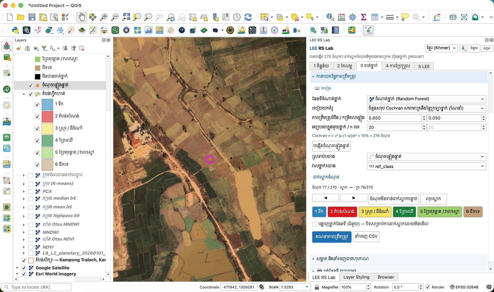
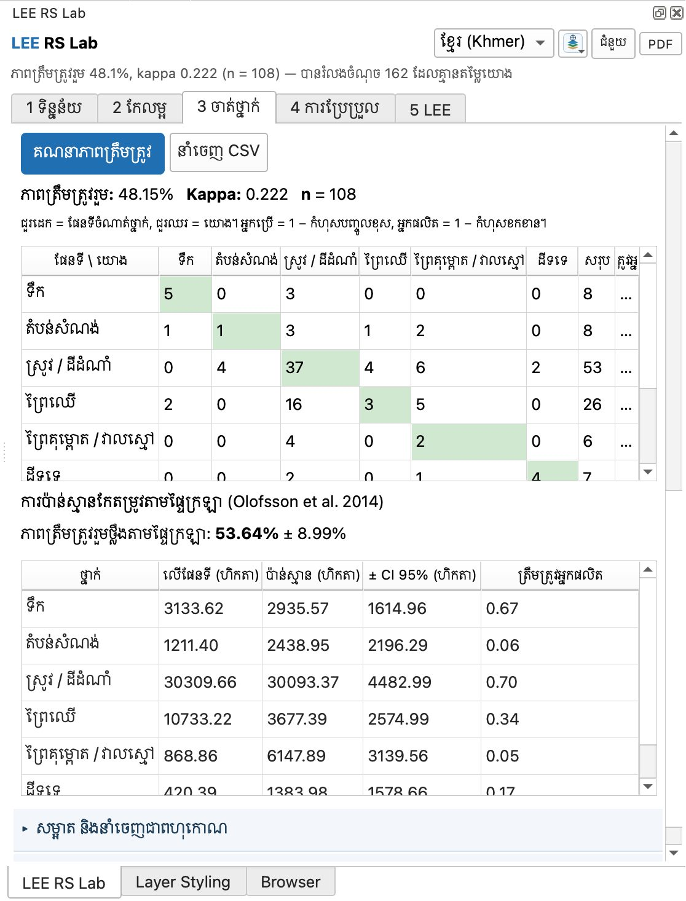

# មេរៀនទី 11 — ការវាយតម្លៃភាពត្រឹមត្រូវ

ភាពត្រឹមត្រូវរួមមានតែ **48.1% (kappa 0.222)** ហើយភាពត្រឹមត្រូវថ្លឹងតាមផ្ទៃក្រឡា **53.6% ± 9.0%** — ឆ្ងាយពី OOB 99.5% ក្នុងមេរៀនទី 10។ មូលហេតុចម្បង៖ ផែនទីហៅស្រែជាច្រើនថា «ព្រៃឈើ» ហើយព្រៃគុម្ពោត / វាលស្មៅ ស្ទើរតែមិនត្រូវបានរកឃើញ។ នេះជាមេរៀនល្អបំផុត៖ ផែនទីដែលមើលទៅស្អាត អាចខុសច្រើន។

## ជំហានទី 1 — បង្កើតចំណុចផ្ទៀងផ្ទាត់

1. បើកផ្នែក **ការវាយតម្លៃភាពត្រឹមត្រូវ**។
2. **ផែនទីចំណាត់ថ្នាក់**៖ ចំណាត់ថ្នាក់ (Random Forest)។
3. **របៀបយកគំរូ**៖ ចំនួនសរុប Cochran សមាមាត្រនឹងផ្ទៃក្រឡាថ្នាក់ (ណែនាំ)។
4. **ភាពត្រឹមត្រូវរំពឹង / កម្រិតលម្អៀង** 0.850 / 0.050 · **អប្បបរមាក្នុងមួយថ្នាក់** 20។
5. កម្មវិធីជំនួយ (Plugin) គណនា n = z²·p·(1−p)/e² + 10% = **216 ចំណុច**។
6. ចុច **បង្កើតចំណុចផ្ទៀងផ្ទាត់**។ បាន **270 ចំណុច** — ច្រើនជាង 216 ព្រោះថ្នាក់តូចៗ (តំបន់សំណង់ ព្រៃគុម្ពោត ដីទទេ) ត្រូវបានដំឡើងដល់ 20 ចំណុចក្នុងមួយថ្នាក់។

n = z² · p · (1 − p) / e² = 1.96² × 0.85 × 0.15 / 0.05² ≈ 196 &nbsp;(+10 % = 216)

## ជំហានទី 2 — ដាក់ស្លាកចំណុច

បន្ទាប់ពីបង្កើតចំណុច ផែនទីពង្រីកទៅចំណុចទី 1 ដោយស្វ័យប្រវត្តិ (រង្វង់ពណ៌ស្វាយ)។ បិទស្រទាប់ចំណាត់ថ្នាក់ ហើយមើលផែនទីមូលដ្ឋាន Google Satellite ឬ Esri World Imagery។

1. **ស្រទាប់យោង** = ចំណុចផ្ទៀងផ្ទាត់ · **វាលថ្នាក់យោង** = ref\_class (បំពេញស្វ័យប្រវត្តិ)។
2. បន្ទាត់ស្ថានភាពបង្ហាញឧ. «ចំណុច 77 / 270 · ស្លាក៖ — · រួច 76/270»។
3. ចុចប៊ូតុងថ្នាក់ (**1 ទឹក** … **6 ដីទទេ**) ដែលត្រូវនឹងអ្វីដែលអ្នកឃើញលើរូបភាព។ កម្មវិធីជំនួយ (Plugin) រក្សាទុក **ref\_class** ហើយលោតទៅចំណុចមិនទាន់ដាក់ស្លាកបន្ទាប់។
4. ប៊ូតុង ◀ ▶ ផ្លាស់ទីមុខ/ក្រោយ · **ចំណុចមិនទាន់ដាក់ស្លាកបន្ទាប់** · **លុបស្លាក** កែកំហុស។
5. ទុក **បង្ហាញថ្នាក់ផែនទី (ជំនួយ)** ឲ្យនៅបិទ ដើម្បីដាក់ស្លាកដោយមិនមើល (blind) — ចៀសវាងការចម្លងផែនទី។

{ loading=lazy }

*រូបទី 46 — ដាក់ស្លាកចំណុចទី 77៖ ចំណុចនៅលើស្រែលើ Google Satellite (មាត្រដ្ឋាន 1:3,293)*

## ជំហានទី 3 — គណនាភាពត្រឹមត្រូវ

ចុច **គណនាភាពត្រឹមត្រូវ**។ ក្នុងឧទាហរណ៍នេះ បានដាក់ស្លាក **108 ចំណុច** ហើយកម្មវិធីជំនួយ (Plugin) រំលង 162 ចំណុចដែលគ្មានតម្លៃយោង។ ចុច **នាំចេញ CSV** ដើម្បីរក្សាទុកតារាងទាំងអស់។

**ភាពត្រឹមត្រូវរួម 48.15% · Kappa 0.222 · n = 108**។ ជួរដេក = ផែនទី ជួរឈរ = យោង។ ក្រឡាអង្កត់ទ្រូង = ត្រឹមត្រូវ។ អ្នកប្រើ = 1 − កំហុសបញ្ចូលខុស (ផែនទីនិយាយត្រូវប៉ុណ្ណា) អ្នកផលិត = 1 − កំហុសខកខាន (ថ្នាក់ពិតត្រូវបានរកឃើញប៉ុណ្ណា)។

| ផែនទី \\ យោង | ទឹក | តំបន់សំណង់ | ស្រូវ / ដីដំណាំ | ព្រៃឈើ | ព្រៃគុម្ពោត / វាលស្មៅ | ដីទទេ | សរុប | អ្នកប្រើ |
| --- | --- | --- | --- | --- | --- | --- | --- | --- |
| ទឹក | **5** | 0 | 3 | 0 | 0 | 0 | 8 | 0.63 |
| តំបន់សំណង់ | 1 | **1** | 3 | 1 | 2 | 0 | 8 | 0.13 |
| ស្រូវ / ដីដំណាំ | 0 | 4 | **37** | 4 | 6 | 2 | 53 | 0.70 |
| ព្រៃឈើ | 2 | 0 | 16 | **3** | 5 | 0 | 26 | 0.12 |
| ព្រៃគុម្ពោត / វាលស្មៅ | 0 | 0 | 4 | 0 | **2** | 0 | 6 | 0.33 |
| ដីទទេ | 0 | 0 | 2 | 0 | 1 | **4** | 7 | 0.57 |
| អ្នកផលិត | 0.63 | 0.20 | 0.57 | 0.38 | 0.13 | 0.67 | | |

អានជួរ **ព្រៃឈើ**៖ ក្នុង 26 ចំណុចដែលផែនទីហៅថាព្រៃឈើ មាន 16 ជាស្រូវ 5 ជាព្រៃគុម្ពោត ហើយមានតែ 3 ជាព្រៃពិតប្រាកដ → ត្រឹមត្រូវអ្នកប្រើ 0.12។ អានជួរឈរ **ព្រៃគុម្ពោត / វាលស្មៅ**៖ ក្នុង 16 ចំណុចយោង ផែនទីរកឃើញតែ 2 → អ្នកផលិត 0.13។ ស្រូវជាថ្នាក់ល្អបំផុត (អ្នកប្រើ 0.70)។

{ loading=lazy }

*រូបទី 47 — ម៉ាទ្រីសកំហុស និងការប៉ាន់ស្មានកែតម្រូវតាមផ្ទៃក្រឡា*

## ជំហានទី 4 — ផ្ទៃក្រឡាកែតម្រូវ (Olofsson et al. 2014)

ផ្ទៃក្រឡាដែលរាប់ពីផែនទីមានកំហុស។ វិធីសាស្ត្រ Olofsson ប្រើចំណុចយោងដើម្បីប៉ាន់ស្មានផ្ទៃក្រឡាពិត ជាមួយចន្លោះជឿជាក់ 95%។ **ភាពត្រឹមត្រូវរួមថ្លឹងតាមផ្ទៃក្រឡា 53.64% ± 8.99%**។

| ថ្នាក់ | លើផែនទី (ហិកតា) | ប៉ាន់ស្មាន (ហិកតា) | ± CI 95% (ហិកតា) | អ្នកផលិតកែតម្រូវ |
| --- | --- | --- | --- | --- |
| ទឹក | 3,133.62 | 2,935.57 | 1,614.96 | 0.67 |
| តំបន់សំណង់ | 1,211.40 | 2,438.95 | 2,196.29 | 0.06 |
| ស្រូវ / ដីដំណាំ | 30,309.66 | 30,093.37 | 4,482.99 | 0.70 |
| ព្រៃឈើ | 10,733.22 | 3,677.39 | 2,574.99 | 0.34 |
| ព្រៃគុម្ពោត / វាលស្មៅ | 868.86 | 6,147.89 | 3,139.56 | 0.05 |
| ដីទទេ | 420.39 | 1,383.98 | 1,578.66 | 0.17 |

ព្រៃឈើនៅលើផែនទី 10,733 ហិកតា ប៉ុន្តែប៉ាន់ស្មានតែ **3,677 ± 2,575 ហិកតា**។ ព្រៃគុម្ពោត / វាលស្មៅនៅលើផែនទី 869 ហិកតា ប៉ុន្តែប៉ាន់ស្មាន **6,148 ± 3,140 ហិកតា**។ ចន្លោះជឿជាក់ធំខ្លាំង (ឧ. ដីទទេ ± 1,579 ធំជាងផ្ទៃប៉ាន់ស្មាន) ព្រោះដាក់ស្លាកតែ 108 ក្នុង 270 ចំណុច។

## ធ្វើឲ្យប្រសើរឡើង

- [ ] គូសតំបន់ហ្វឹកហាត់ **ព្រៃគុម្ពោត / វាលស្មៅ** បន្ថែមនៅដីលិចទឹកខាងកើត និងបំបែកវាពីព្រៃឈើពិត (មេរៀនទី 9)។
- [ ] បន្ថែមតំបន់ហ្វឹកហាត់ **ស្រូវ** នៅក្នុងតំបន់ដែលផែនទីហៅថាព្រៃឈើ ប៉ុន្តែរូបភាពបង្ហាញស្រែ។
- [ ] ប្រើ **Stack ពហុរដូវ** (មេរៀនទី 8) ជារូបភាពចាត់ថ្នាក់ — ស្រែ និងរុក្ខជាតិលិចទឹកខុសគ្នាខ្លាំងតាមរដូវ។
- [ ] ដាក់ស្លាកចំណុចទាំង 270 — ចំណុចកាន់តែច្រើន ចន្លោះជឿជាក់កាន់តែតូច។

> សំណួរសម្រាប់និស្សិត៖ ហេតុអ្វីបានជា OOB 99.5% (មេរៀនទី 10) ខុសឆ្ងាយពីភាពត្រឹមត្រូវ 48.1% នៅទីនេះ? តើលេខមួយណាដែលត្រូវរាយការណ៍ក្នុងរបាយការណ៍?

---

[← មេរៀនទី 10](lesson-10.md) · [មេរៀនទី 12 →](lesson-12.md)
