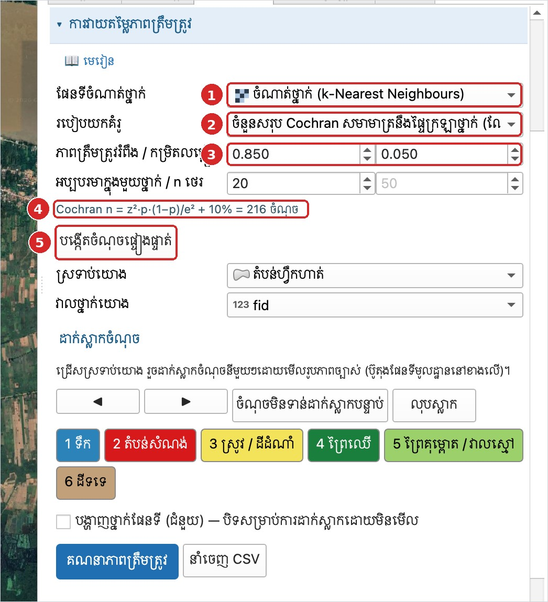
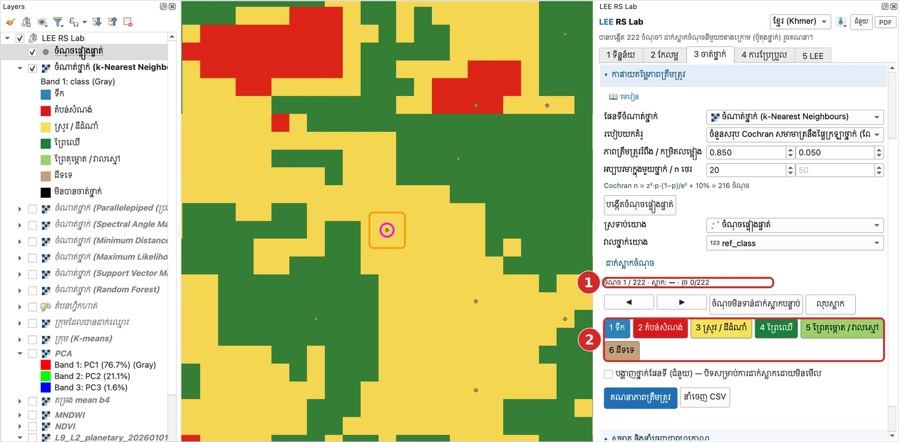
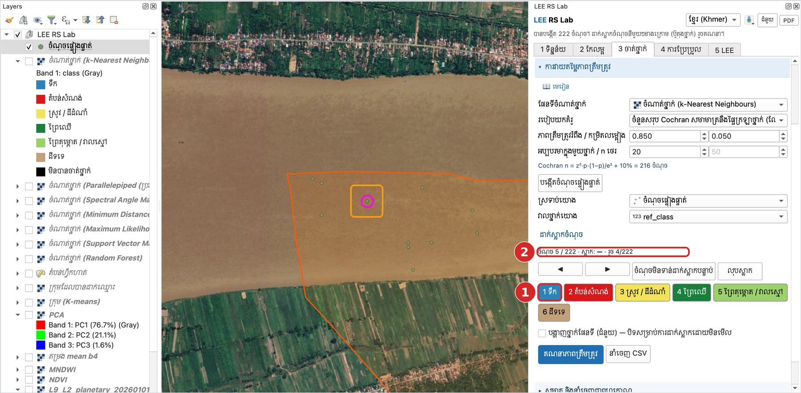
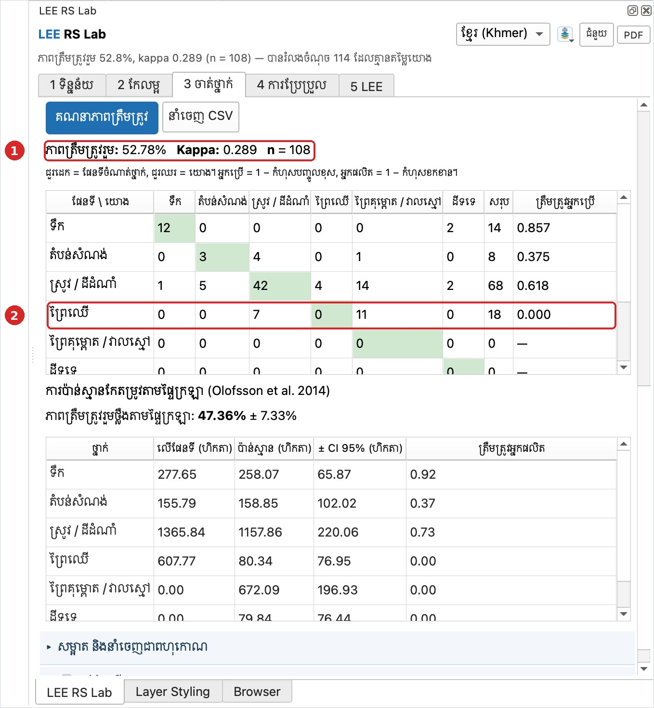
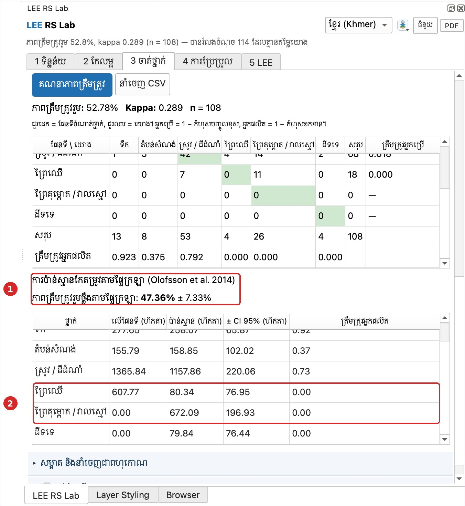

# មេរៀនទី 11 — ការវាយតម្លៃភាពត្រឹមត្រូវ

ភាពត្រឹមត្រូវរួមមានតែ **52.8% (kappa 0.289)** ហើយភាពត្រឹមត្រូវថ្លឹងតាមផ្ទៃក្រឡា **47.4% ± 7.3%**។ មូលហេតុចម្បង៖ ម៉ូដែលមិនមានថ្នាក់ព្រៃគុម្ពោត/វាលស្មៅ ដូច្នេះវាបេះតំបន់ទាំងនោះទៅជាព្រៃឈើ ឬស្រូវ។ នេះជាមេរៀនល្អបំផុត៖ ផែនទីដែលមើលទៅស្អាត អាចខុសច្រើន។

## ជំហានទី 1 — បង្កើតចំណុចផ្ទៀងផ្ទាត់

1. បើកផ្នែក **ការវាយតម្លៃភាពត្រឹមត្រូវ**។
2. ① **ផែនទីចំណាត់ថ្នាក់**៖ ជ្រើសផែនទីដែលត្រូវវាយតម្លៃ (ក្នុងឧទាហរណ៍នេះ k-Nearest Neighbours)។
3. ② **របៀបយកគំរូ**៖ ចំនួនសរុប Cochran សមាមាត្រនឹងផ្ទៃក្រឡាថ្នាក់ (ណែនាំ)។
4. ③ **ភាពត្រឹមត្រូវរំពឹង / កម្រិតលម្អៀង** 0.85 / 0.05 · **អប្បបរមាក្នុងមួយថ្នាក់** 20។
5. ④ កម្មវិធីជំនួយ (Plugin) គណនា n = z²·p·(1−p)/e² + 10% = **216 ចំណុច**។
6. ⑤ ចុច **បង្កើតចំណុចផ្ទៀងផ្ទាត់**។ បាន **222 ចំណុច** — ច្រើនជាង 216 ព្រោះថ្នាក់តូច (តំបន់សំណង់) ត្រូវបានដំឡើងដល់ 20 ចំណុច។

n = z² · p · (1 − p) / e² = 1.96² × 0.85 × 0.15 / 0.05² ≈ 196 &nbsp;(+10 % = 216)

{ loading=lazy }

*រូបទី 24 — របៀបយកគំរូ Cochran និងប៊ូតុងបង្កើតចំណុច*

## ជំហានទី 2 — ដាក់ស្លាកចំណុច

បន្ទាប់ពីបង្កើតចំណុច ផែនទីពង្រីកទៅចំណុចទី 1 ដោយស្វ័យប្រវត្តិ (រង្វង់ពណ៌ស្វាយ)។ បិទស្រទាប់ចំណាត់ថ្នាក់ ហើយមើលផែនទីមូលដ្ឋាន Google Satellite។

1. ① បន្ទាត់ស្ថានភាព៖ «ចំណុច 1 / 222 · ស្លាក៖ — · រួច 0/222»។
2. ② ចុចប៊ូតុងថ្នាក់ដែលត្រូវនឹងអ្វីដែលអ្នកឃើញលើរូបភាពច្បាស់។ កម្មវិធីជំនួយ (Plugin) រក្សាទុក **ref\_class** ហើយលោតទៅចំណុចមិនទាន់ដាក់ស្លាកបន្ទាប់។
3. ប៊ូតុង ◀ ▶ ផ្លាស់ទីមុខ/ក្រោយ · **លុបស្លាក** កែកំហុស។
4. ទុក **បង្ហាញថ្នាក់ផែនទី (ជំនួយ)** ឲ្យនៅបិទ ដើម្បីដាក់ស្លាកដោយមិនមើល (blind) — ចៀសវាងការចម្លងផែនទី។

{ loading=lazy }

*រូបទី 25 — ចំណុចទី 1 (រង្វង់លឿង) និងប៊ូតុងថ្នាក់*

{ loading=lazy }

*រូបទី 26 — ចំណុចនៅក្នុងទន្លេ៖ ចុច ① «1 ទឹក» ② ស្ថានភាពបង្ហាញ «រួច 4/222»*

## ជំហានទី 3 — គណនាភាពត្រឹមត្រូវ

ចុច **គណនាភាពត្រឹមត្រូវ**។ ក្នុងឧទាហរណ៍នេះ បានដាក់ស្លាក 108 ចំណុច ហើយកម្មវិធីជំនួយ (Plugin) រំលង 114 ចំណុចដែលគ្មានតម្លៃយោង។

- ① **ភាពត្រឹមត្រូវរួម 52.78% · Kappa 0.289 · n = 108**។
- ជួរដេក = ផែនទី ជួរឈរ = យោង។ ក្រឡាពណ៌បៃតង (អង្កត់ទ្រូង) = ត្រឹមត្រូវ។ ទឹកល្អបំផុត (អ្នកប្រើ 0.857 អ្នកផលិត 0.923)។
- ② ជួរ **ព្រៃឈើ**៖ ចំណុច 18 ដែលផែនទីហៅថាព្រៃឈើ ជាក់ស្តែងគឺស្រូវ 7 និងព្រៃគុម្ពោត/វាលស្មៅ 11 → ត្រឹមត្រូវអ្នកប្រើ 0.000។
- ចំណុចយោងព្រៃគុម្ពោត/វាលស្មៅ 26 និងដីទទេ 4 មិនអាចត្រឹមត្រូវបានទេ ព្រោះថ្នាក់ទាំងនេះមិនមានក្នុងទិន្នន័យហ្វឹកហាត់។

{ loading=lazy }

*រូបទី 27 — ម៉ាទ្រីសកំហុស (confusion matrix)*

## ជំហានទី 4 — ផ្ទៃក្រឡាកែតម្រូវ (Olofsson et al. 2014)

ផ្ទៃក្រឡាដែលរាប់ពីផែនទីមានកំហុស។ វិធីសាស្ត្រ Olofsson ប្រើចំណុចយោងដើម្បីប៉ាន់ស្មានផ្ទៃក្រឡាពិត ជាមួយចន្លោះជឿជាក់ 95%។

- ① **ភាពត្រឹមត្រូវរួមថ្លឹងតាមផ្ទៃក្រឡា 47.36% ± 7.33%**។
- ② ព្រៃឈើនៅលើផែនទី 607.77 ហិកតា ប៉ុន្តែប៉ាន់ស្មានតែ **80.34 ± 76.95 ហិកតា**។ ព្រៃគុម្ពោត/វាលស្មៅនៅលើផែនទី 0 ហិកតា ប៉ុន្តែប៉ាន់ស្មាន **672.09 ± 196.93 ហិកតា**។

| ថ្នាក់ | លើផែនទី (ហិកតា) | ប៉ាន់ស្មាន (ហិកតា) | ± CI 95% (ហិកតា) |
| --- | --- | --- | --- |
| ស្រូវ / ដីដំណាំ | 1,365.84 | 1,157.86 | 220.06 |
| ព្រៃគុម្ពោត / វាលស្មៅ | 0.00 | 672.09 | 196.93 |
| ព្រៃឈើ | 607.77 | 80.34 | 76.95 |
| ទឹក | 277.65 | 258.07 | 65.87 |
| តំបន់សំណង់ | 155.79 | 158.85 | 102.02 |
| ដីទទេ | 0.00 | 79.84 | 76.44 |

{ loading=lazy }

*រូបទី 28 — ការប៉ាន់ស្មានកែតម្រូវតាមផ្ទៃក្រឡា*

## ធ្វើឲ្យប្រសើរឡើង

- [ ] គូសតំបន់ហ្វឹកហាត់សម្រាប់ **ព្រៃគុម្ពោត/វាលស្មៅ** និង **ដីទទេ** (មេរៀនទី 9) រួចចាត់ថ្នាក់ម្ដងទៀត។
- [ ] បន្ថែមតំបន់ហ្វឹកហាត់តំបន់សំណង់ (មានតែ 53 ភីកសែល)។
- [ ] ដាក់ស្លាកចំណុចទាំង 222 — ចំណុចកាន់តែច្រើន ចន្លោះជឿជាក់កាន់តែតូច។

> សំណួរសម្រាប់និស្សិត៖ ហេតុអ្វីបានជា OOB 99.3% (មេរៀនទី 10) ខុសឆ្ងាយពីភាពត្រឹមត្រូវ 52.8% នៅទីនេះ?

---

[← មេរៀនទី 10](lesson-10.md) · [មេរៀនទី 12 →](lesson-12.md)
