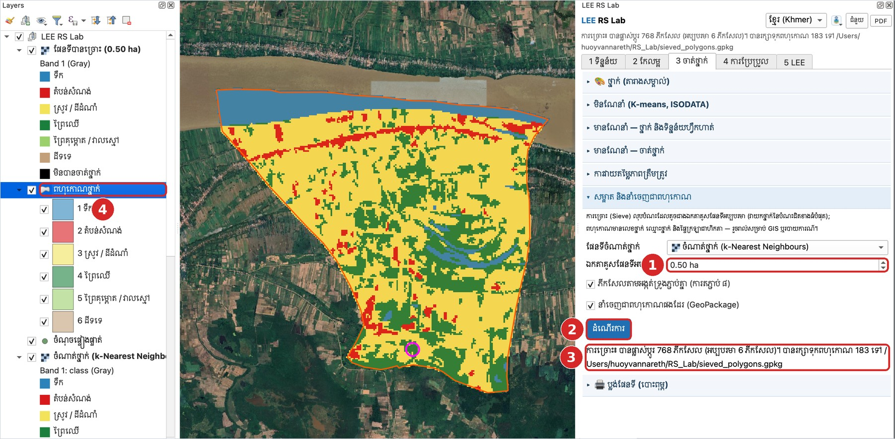
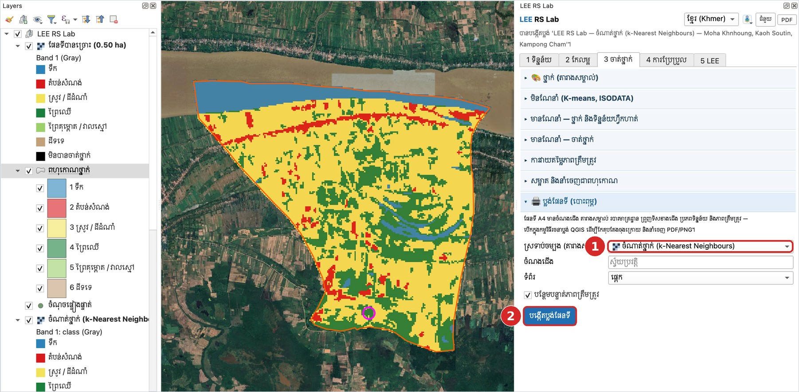
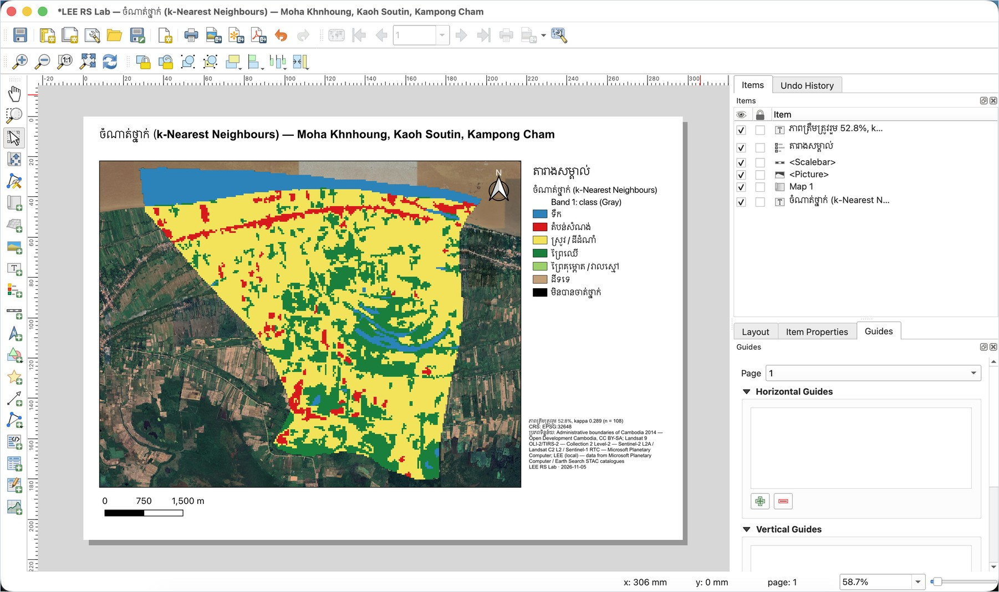

# មេរៀនទី 12 — សម្អាតផែនទី នាំចេញពហុកោណ និងប្លង់ផែនទី

ការច្រោះ (sieve) លុបបំណះតូចជាង **0.5 ហិកតា** (6 ភីកសែល Landsat) — ក្នុងឧទាហរណ៍នេះ 768 ភីកសែលត្រូវបានប្ដូរ ហើយបានពហុកោណ **183** សម្រាប់ GIS។ បន្ទាប់មកបង្កើតផែនទី A4 សម្រាប់បោះពុម្ពដោយចុចតែម្ដង។

## ជំហានទី 1 — ច្រោះ និងនាំចេញជាពហុកោណ

1. បើកផ្នែក **សម្អាត និងនាំចេញជាពហុកោណ**។ **ផែនទីចំណាត់ថ្នាក់**៖ ចំណាត់ថ្នាក់ (k-Nearest Neighbours)។
2. ① **ឯកតាគូសផែនទីអប្បបរមា** 0.50 ha។ ទុកធីក **ភីកសែលតាមអង្កត់ទ្រូងភ្ជាប់គ្នា** និង **នាំចេញជាពហុកោណផងដែរ (GeoPackage)**។
3. ② ចុច **ដំណើរការ**។
4. ③ លទ្ធផល៖ បានផ្លាស់ប្ដូរ 768 ភីកសែល (អប្បបរមា 6 ភីកសែល) និងរក្សាទុកពហុកោណ 183 ទៅ `sieved_polygons.gpkg`។
5. ④ ស្រទាប់ **ពហុកោណថ្នាក់** មានវាល class\_id, class\_name និង area\_ha — បើកតារាងលក្ខណៈដើម្បីគណនាផ្ទៃក្រឡាតាមខ្សែនីមួយៗ។

MMU (ភីកសែល) = 0.5 ha × 10 000 m² / (30 m × 30 m) = 5.6 ≈ 6

{ loading=lazy }

*រូបទី 29 — ការច្រោះ 0.5 ហិកតា និងពហុកោណថ្នាក់*

## ជំហានទី 2 — ប្លង់ផែនទី (បោះពុម្ព)

1. បើកផ្នែក **🖨 ប្លង់ផែនទី (បោះពុម្ព)**។
2. ① **ស្រទាប់ចម្បង (តារាងសម្គាល់)**៖ ស្រទាប់ដែលចង់ឲ្យចូលតារាងសម្គាល់។ **ចំណងជើង** ទុកទទេ = ស្វ័យប្រវត្តិ (ឈ្មោះស្រទាប់ + តំបន់សិក្សា)។ **ទំព័រ**៖ ផ្ដេក ឬបញ្ឈរ។ ទុកធីក **បន្ថែមបន្ទាត់ភាពត្រឹមត្រូវ**។
3. ② ចុច **បង្កើតប្លង់ផែនទី**។ កម្មវិធីរចនាប្លង់ QGIS បើកឡើង។

{ loading=lazy }

*រូបទី 30 — ផ្នែកប្លង់ផែនទី*

ប្លង់ A4 មាន៖ ចំណងជើង · ផែនទី · តារាងសម្គាល់ · ព្រួញទិសខាងជើង · របារមាត្រដ្ឋាន (0–1,500 ម៉ែត្រ) · កំណត់ចំណាំ (ភាពត្រឹមត្រូវ CRS EPSG:32648 ប្រភពទិន្នន័យ កាលបរិច្ឆេទ)។ អ្នកអាចអូសផ្ទៃក្រឡាផ្សេងៗ កែអក្សរ រួចនាំចេញតាម **Layout › Export as PDF…** ឬ **Export as Image…**។

{ loading=lazy }

*រូបទី 31 — ប្លង់ផែនទីចំណាត់ថ្នាក់ឃុំមហាខ្ញូងក្នុងកម្មវិធីរចនាប្លង់ QGIS*

> ចំណាំ៖ ប្រើផែនទីដែលបានធ្វើឲ្យប្រសើរឡើងតាមមេរៀនទី 11 មុនបោះពុម្ព ហើយរាយការណ៍ភាពត្រឹមត្រូវនៅលើផែនទីជានិច្ច។

---

[← មេរៀនទី 11](lesson-11.md) · [មេរៀនទី 13 →](lesson-13.md)
