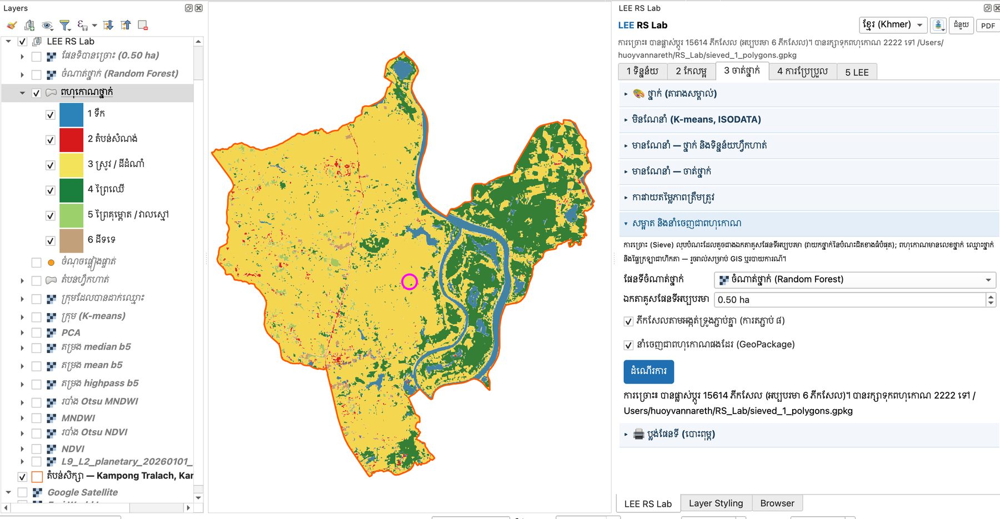
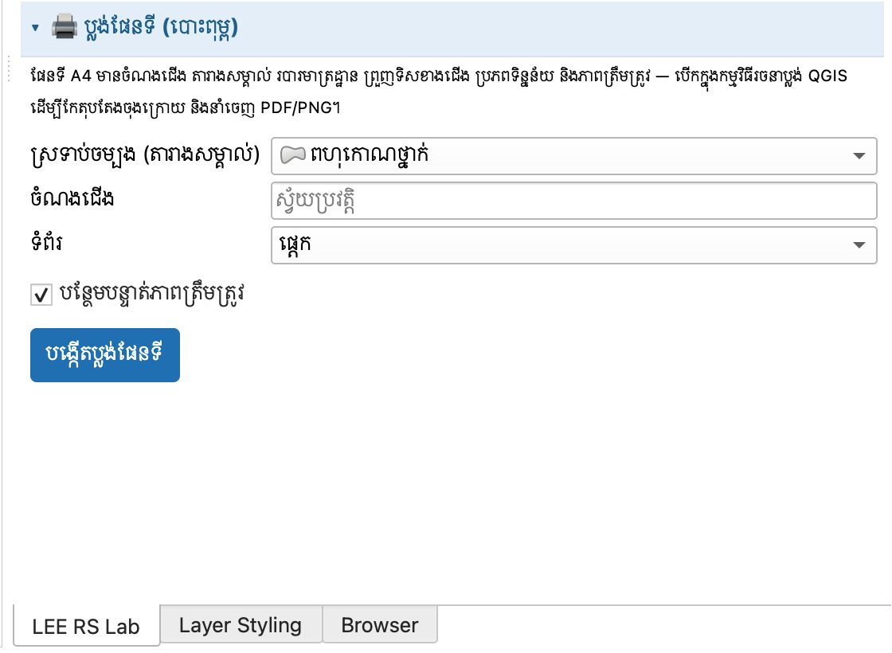
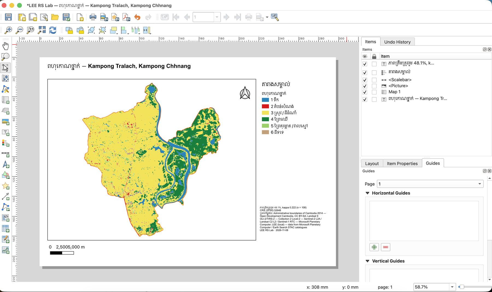

# មេរៀនទី 12 — សម្អាតផែនទី នាំចេញពហុកោណ និងប្លង់ផែនទី

ការច្រោះ (sieve) លុបបំណះតូចជាង **0.5 ហិកតា** (6 ភីកសែល Landsat) — ក្នុងស្រុកកំពង់ត្រឡាច **15,614 ភីកសែល** ត្រូវបានប្ដូរ ហើយបានពហុកោណ **2,222** សម្រាប់ GIS។ បន្ទាប់មកបង្កើតផែនទី A4 សម្រាប់បោះពុម្ពដោយចុចតែម្ដង។

## ជំហានទី 1 — ច្រោះ និងនាំចេញជាពហុកោណ

1. បើកផ្នែក **សម្អាត និងនាំចេញជាពហុកោណ**។ **ផែនទីចំណាត់ថ្នាក់**៖ ចំណាត់ថ្នាក់ (Random Forest)។
2. **ឯកតាគូសផែនទីអប្បបរមា** 0.50 ha។ ទុកធីក **ភីកសែលតាមអង្កត់ទ្រូងភ្ជាប់គ្នា (ការតភ្ជាប់ 8)** និង **នាំចេញជាពហុកោណផងដែរ (GeoPackage)**។
3. ចុច **ដំណើរការ**។
4. លទ្ធផល៖ «ការច្រោះ៖ បានផ្លាស់ប្ដូរ 15614 ភីកសែល (អប្បបរមា 6 ភីកសែល)។ បានរក្សាទុកពហុកោណ 2222 ទៅ `sieved_1_polygons.gpkg`»។ ស្រទាប់ពីរលេចឡើង៖ **ផែនទីបានច្រោះ (0.50 ha)** និង **ពហុកោណថ្នាក់**។
5. ស្រទាប់ **ពហុកោណថ្នាក់** មានវាល class\_id, class\_name និង area\_ha — បើកតារាងលក្ខណៈដើម្បីមើលផ្ទៃក្រឡានៃពហុកោណនីមួយៗ។

MMU (ភីកសែល) = 0.5 ha × 10 000 m² / (30 m × 30 m) = 5.6 ≈ 6

{ loading=lazy }

*រូបទី 47 — ការច្រោះ 0.5 ហិកតា និងពហុកោណថ្នាក់ 2,222*

## ជំហានទី 2 — ប្លង់ផែនទី (បោះពុម្ព)

1. បើកផ្នែក **🖨 ប្លង់ផែនទី (បោះពុម្ព)**។
2. **ស្រទាប់ចម្បង (តារាងសម្គាល់)**៖ ពហុកោណថ្នាក់។ **ចំណងជើង** ទុកទទេ = ស្វ័យប្រវត្តិ (ឈ្មោះស្រទាប់ + តំបន់សិក្សា)។ **ទំព័រ**៖ ផ្ដេក ឬបញ្ឈរ។ ទុកធីក **បន្ថែមបន្ទាត់ភាពត្រឹមត្រូវ**។
3. ចុច **បង្កើតប្លង់ផែនទី**។ កម្មវិធីរចនាប្លង់ QGIS បើកឡើង។

{ loading=lazy }

*រូបទី 48 — ផ្នែកប្លង់ផែនទី*

ប្លង់ A4 មាន៖ ចំណងជើង «ពហុកោណថ្នាក់ — Kampong Tralach, Kampong Chhnang» · ផែនទី · តារាងសម្គាល់ · ព្រួញទិសខាងជើង · របារមាត្រដ្ឋាន · កំណត់ចំណាំ (ភាពត្រឹមត្រូវ 48.1% kappa 0.222 n = 108 · CRS EPSG:32648 · ប្រភពទិន្នន័យ · កាលបរិច្ឆេទ)។ អ្នកអាចអូសធាតុផ្សេងៗ កែអក្សរ រួចនាំចេញតាម **Layout › Export as PDF…** ឬ **Export as Image…**។

{ loading=lazy }

*រូបទី 49 — ប្លង់ផែនទីស្រុកកំពង់ត្រឡាចក្នុងកម្មវិធីរចនាប្លង់ QGIS*

!!! tip "អក្សររបារមាត្រដ្ឋានជាន់គ្នា"
    ប្រសិនបើលេខលើរបារមាត្រដ្ឋានជាន់គ្នា (ឧ. «2,5005,000 m») ជ្រើសរបារមាត្រដ្ឋាន → **Item Properties** → ប្ដូរ **Units** ទៅ Kilometers ឬបន្ថយ **Segments** ទៅ 2។

> ចំណាំ៖ ផែនទីនេះមានភាពត្រឹមត្រូវតែ 48% (មេរៀនទី 11)។ ធ្វើឲ្យប្រសើរឡើងជាមុនសិនមុនបោះពុម្ពផ្លូវការ ហើយរាយការណ៍ភាពត្រឹមត្រូវនៅលើផែនទីជានិច្ច — ប្លង់នេះធ្វើវាដោយស្វ័យប្រវត្តិ។

---

[← មេរៀនទី 11](lesson-11.md) · [មេរៀនទី 13 →](lesson-13.md)
