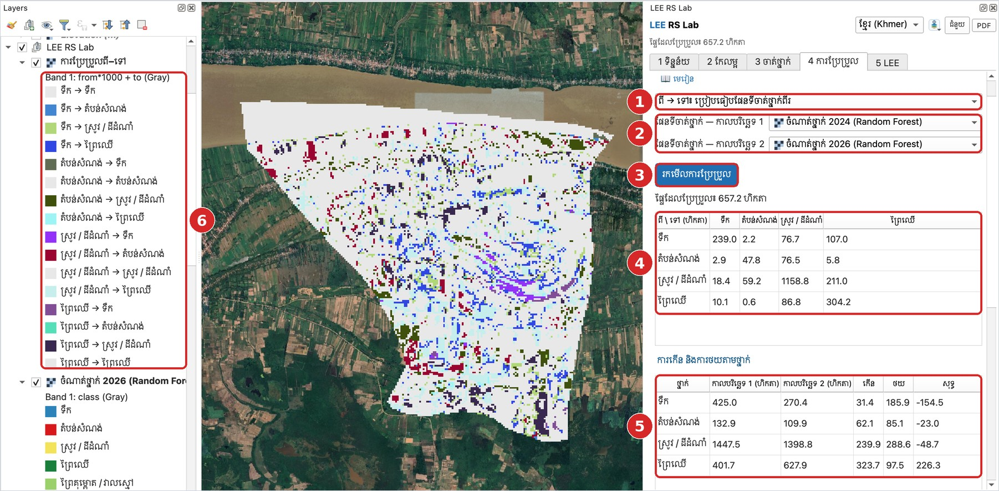
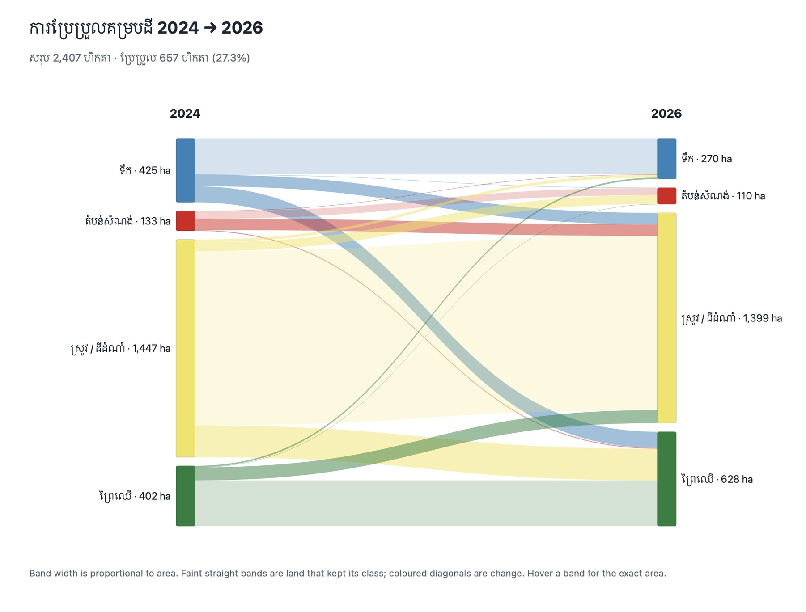
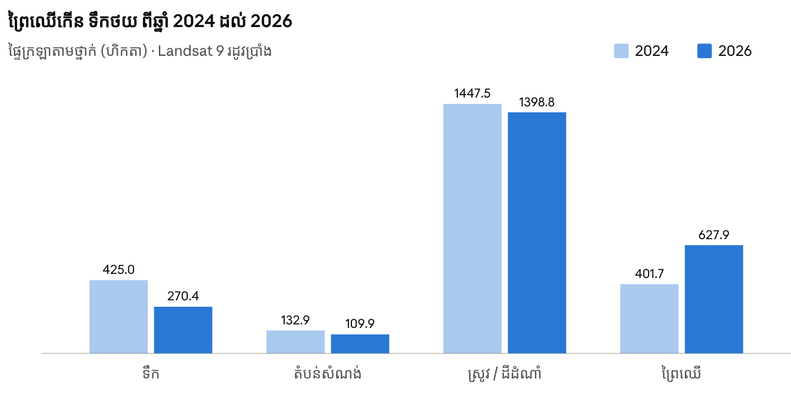
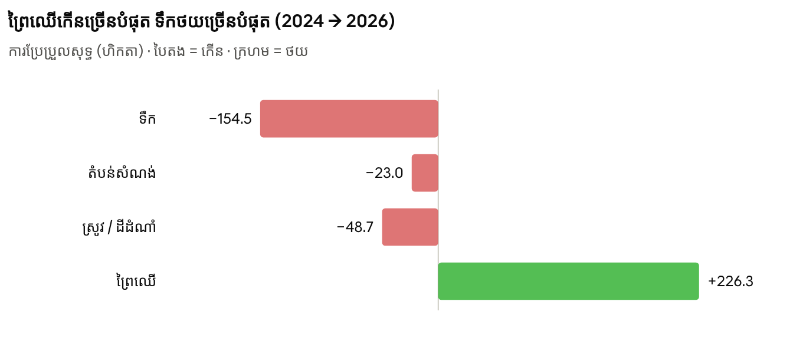

# មេរៀនទី 13 — ការប្រែប្រួល ពី → ទៅ (2024 → 2026) និងដ្យាក្រាម Sankey

ការរកមើលការប្រែប្រួលក្រោយចំណាត់ថ្នាក់ (post-classification) ប្រៀបធៀបផែនទីចាត់ថ្នាក់ពីរ ភីកសែលម្ដងៗ ហើយប្រាប់ថាថ្នាក់ណាប្ដូរទៅថ្នាក់ណា។ ក្នុងឃុំមហាខ្ញូង ពីឆ្នាំ 2024 ដល់ 2026 ផ្ទៃសរុប **2,407 ហិកតា** មាន **657.2 ហិកតា (27.3%)** ត្រូវបានចាត់ថ្នាក់ខុសគ្នា។ មេរៀននេះបង្ហាញពីរបៀបធ្វើ និងរបៀបអានលទ្ធផលដោយប្រុងប្រយ័ត្ន។

## ជំហានទី 1 — ចាត់ថ្នាក់កាលបរិច្ឆេទទាំងពីរដោយម៉ូដែលដដែល

1. ទាញយករូបភាព Landsat 9 មធ្យម ខែមករា–មេសា 2024 (មេរៀនទី 3) ឲ្យមានរដូវដូចរូបភាព 2026។ រដូវខុសគ្នា (ឧ. ប្រាំង និងវស្សា) នឹងបង្កើត «ការប្រែប្រួល» ក្លែងក្លាយ។
2. ក្នុង **3 ចាត់ថ្នាក់ › ចំណាត់ថ្នាក់ដោយមានការណែនាំ** ជ្រើសរូបភាព 2026 ជារូបភាពចម្បង ហើយជ្រើសរូបភាព 2024 ក្នុង **ចាត់ថ្នាក់កាលបរិច្ឆេទផ្សេងទៀតផង**។
3. ជ្រើស Random Forest ហើយចុច **ចាត់ថ្នាក់**។ ស្រទាប់ពីរលេចឡើង៖ ចំណាត់ថ្នាក់ 2024 (Random Forest) និង ចំណាត់ថ្នាក់ 2026 (Random Forest)។

ហេតុអ្វីម៉ូដែលដដែល? ប្រសិនបើយើងបង្វឹកម៉ូដែលពីរផ្សេងគ្នា ភាពខុសគ្នារវាងផែនទីអាចមកពីម៉ូដែល មិនមែនពីដីទេ។ ម៉ូដែលតែមួយធ្វើឲ្យការប្រៀបធៀបយុត្តិធម៌ជាង។

> កុំប្រើរូបភាពដើមពីរដោយផ្ទាល់ក្នុងរបៀប ពី → ទៅ។ រូបភាពមានតម្លៃការចាំងផ្លាតរាប់ពាន់ មិនមែនលេខថ្នាក់ទេ ដូច្នេះលទ្ធផលគ្មានន័យ។ កម្មវិធីនឹងបដិសេធ ហើយប្រាប់ឲ្យចាត់ថ្នាក់ជាមុនសិន។

## ជំហានទី 2 — រកមើលការប្រែប្រួល

1. ① បើក **4 ការប្រែប្រួល** ហើយជ្រើស **ពី → ទៅ៖ ប្រៀបធៀបផែនទីចាត់ថ្នាក់ពីរ**។
2. ② ផែនទីចាត់ថ្នាក់ — កាលបរិច្ឆេទ 1 = 2024 និង កាលបរិច្ឆេទ 2 = 2026 (បំពេញដោយស្វ័យប្រវត្តិ តាមកាលបរិច្ឆេទរូបភាព)។
3. ③ ចុច **រកមើលការប្រែប្រួល**។
4. ④ តារាង ពី → ទៅ៖ ជួរដេក = ថ្នាក់ឆ្នាំ 2024 ជួរឈរ = ថ្នាក់ឆ្នាំ 2026 (ហិកតា)។ អង្កត់ទ្រូង = មិនប្រែប្រួល។
5. ⑤ តារាង ការកើន និងការថយតាមថ្នាក់៖ កើន ថយ និងសុទ្ធ សម្រាប់ថ្នាក់នីមួយៗ។
6. ⑥ ស្រទាប់ ការប្រែប្រួលពី–ទៅ ក្នុងបញ្ជីស្រទាប់។ លេខកូដនីមួយៗ = ពី × 1000 + ទៅ ឧ. 3004 = ស្រូវ → ព្រៃឈើ។ ផ្ទៃមិនប្រែប្រួលមានពណ៌ប្រផេះស្រាល ដើម្បីឲ្យការប្រែប្រួលលេចធ្លោ។

{ loading=lazy }

*រូបទី 34 — លទ្ធផលការប្រែប្រួល ពី → ទៅ 2024 → 2026៖ ① របៀប ② ផែនទីពីរ ③ ប៊ូតុង ④ តារាង ពី → ទៅ ⑤ កើន/ថយ ⑥ ពន្យល់ពណ៌*

## ការអានតារាង ពី → ទៅ

| ពី \\ ទៅ (ហិកតា) | ទឹក | តំបន់សំណង់ | ស្រូវ / ដីដំណាំ | ព្រៃឈើ | សរុប 2024 |
| --- | --- | --- | --- | --- | --- |
| ទឹក | **239.0** | 2.2 | 76.7 | 107.0 | 425.0 |
| តំបន់សំណង់ | 2.9 | **47.8** | 76.5 | 5.8 | 132.9 |
| ស្រូវ / ដីដំណាំ | 18.4 | 59.2 | **1158.8** | 211.0 | 1447.5 |
| ព្រៃឈើ | 10.1 | 0.6 | 86.8 | **304.2** | 401.7 |
| សរុប 2026 | 270.4 | 109.9 | 1398.8 | 627.9 | 2407.0 |

អានជួរដេកម្ដងមួយ៖ ក្នុង 425 ហិកតាជាទឹកឆ្នាំ 2024 មាន 239 ហិកតានៅតែជាទឹក ហើយ 107 ហិកតាក្លាយជា «ព្រៃឈើ» ឆ្នាំ 2026។ ការប្ដូរធំបំផុតគឺ ស្រូវ → ព្រៃឈើ (211 ហិកតា) ទឹក → ព្រៃឈើ (107 ហិកតា) និង ព្រៃឈើ → ស្រូវ (86.8 ហិកតា)។ សុទ្ធ៖ ព្រៃឈើ +226.3 ហិកតា ទឹក −154.5 ស្រូវ −48.7 និងតំបន់សំណង់ −23.0 ហិកតា។

## ជំហានទី 3 — ដ្យាក្រាម Sankey

ចុច **🌊 ដ្យាក្រាម Sankey**។ ឯកសារ HTML បើកក្នុងកម្មវិធីរុករក (ដំណើរការដោយគ្មានអ៊ីនធឺណិត)។ ជួរខាងឆ្វេង = ឆ្នាំ 2024 ជួរខាងស្ដាំ = ឆ្នាំ 2026។ ទទឹងខ្សែនីមួយៗសមាមាត្រនឹងផ្ទៃក្រឡា។ ខ្សែត្រង់ស្រាល = ដីដែលរក្សាថ្នាក់ដដែល ខ្សែកោងពណ៌ = ការប្រែប្រួល។ ដាក់កណ្ដុរលើខ្សែដើម្បីមើលហិកតាពិតប្រាកដ។ គូស **Sankey៖ តែផ្ទៃដែលប្រែប្រួល** ដើម្បីលាក់ខ្សែ «មិនប្រែប្រួល» ហើយមើលការប្ដូរតូចៗឲ្យច្បាស់។

{ loading=lazy }

*រូបទី 35 — ដ្យាក្រាម Sankey នៃការប្រែប្រួលគម្របដី 2024 → 2026*

## ជំហានទី 4 — ក្រាហ្វ CSV និងផែនទីការប្ដូរមួយ

- **ផ្ទៃក្រឡា៖ កាលបរិច្ឆេទ 1 និង 2** — ក្រាហ្វរបារពីរសម្រាប់ថ្នាក់នីមួយៗ។
- **ក្រាហ្វកើន / ថយ** — ការប្រែប្រួលសុទ្ធ៖ បៃតង = កើន ក្រហម = ថយ។
- **នាំចេញ CSV** — រក្សាទុកតារាង ពី → ទៅ សម្រាប់ Excel។
- **គូសផែនទីការប្ដូរមួយ** — ជ្រើស ពី និង ទៅ (ឧ. ស្រូវ → តំបន់សំណង់) រួចចុច **គូសផែនទីការប្រែប្រួលនេះ** ដើម្បីបង្ហាញតែការប្ដូរនោះ ព្រមទាំងផ្ទៃក្រឡាគិតជាហិកតា។

{ loading=lazy }

*រូបទី 36 — ផ្ទៃក្រឡាថ្នាក់ឆ្នាំ 2024 (ខៀវស្រាល) និង 2026 (ខៀវចាស់)*

{ loading=lazy }

*រូបទី 37 — ការប្រែប្រួលសុទ្ធតាមថ្នាក់ (ហិកតា)៖ ព្រៃឈើកើន ទឹកថយ*

## តើការប្រែប្រួលនេះពិតឬ?

មិនមែនគ្រប់ «ការប្រែប្រួល» ទាំងអស់ជាការប្រែប្រួលពិតនៅលើដីទេ។ កំហុសនៃផែនទីទាំងពីរបូកចូលគ្នា៖ ប្រសិនបើផែនទីនីមួយៗត្រឹមត្រូវ 85% ផែនទីការប្រែប្រួលអាចត្រឹមត្រូវត្រឹមប្រហែល 0.85 × 0.85 ≈ 72% ប៉ុណ្ណោះ។ ក្នុងឧទាហរណ៍នេះ ភាពត្រឹមត្រូវ (មេរៀនទី 11) មានតែ 52.8% ដូច្នេះត្រូវពិនិត្យដោយប្រុងប្រយ័ត្ន៖

- **តំបន់សំណង់ → ស្រូវ (76.5 ហិកតា)** — ភូមិកម្រត្រឡប់ទៅជាស្រែវិញណាស់។ ទំនងជាដើមឈើក្នុងភូមិ ឬដីទទេត្រូវបានចាត់ថ្នាក់ខុស។
- **ទឹក → ព្រៃឈើ (107 ហិកតា)** — ភាគច្រើននៅមាត់ទន្លេ៖ កម្រិតទឹកទន្លេមេគង្គខុសគ្នារវាងឆ្នាំ ហើយរុក្ខជាតិដុះលើដីល្បាប់។ ពិនិត្យលើផែនទីផ្ទៃខាងក្រោយ។
- **ស្រូវ ↔ ព្រៃឈើ** — ចម្ការ ស្វាយ និងដើមឈើលើភ្លឺស្រែ ងាយច្រឡំជាមួយព្រៃឈើ។ ការបន្ថែមថ្នាក់ «ព្រៃគុម្ពោត / ចម្ការ» (មេរៀនទី 11 › ធ្វើឲ្យប្រសើរ) នឹងកាត់បន្ថយបញ្ហានេះ។

វិធីពិនិត្យ៖ ប្រើ **គូសផែនទីការប្ដូរមួយ** សម្រាប់ការប្ដូរនីមួយៗ ហើយប្រៀបធៀបជាមួយ Google Satellite ឬរូបភាពពណ៌ពិតនៃឆ្នាំទាំងពីរ។ សម្រាប់របាយការណ៍ផ្លូវការ សូមធ្វើការវាយតម្លៃភាពត្រឹមត្រូវនៃផែនទីការប្រែប្រួលផ្ទាល់ (ចំណុចគំរូលើផ្ទៃ «ប្រែប្រួល» និង «មិនប្រែប្រួល»)។

> សរុប៖ ផែនទីការប្រែប្រួលល្អ ចាប់ផ្ដើមពីផែនទីចាត់ថ្នាក់ល្អ។ ធ្វើឲ្យភាពត្រឹមត្រូវលើសពី 85% ជាមុនសិន ទើបរាយការណ៍ការប្រែប្រួលជាហិកតា។

---

[← មេរៀនទី 12](lesson-12.md) · [មេរៀនទី 14 →](lesson-14.md)
