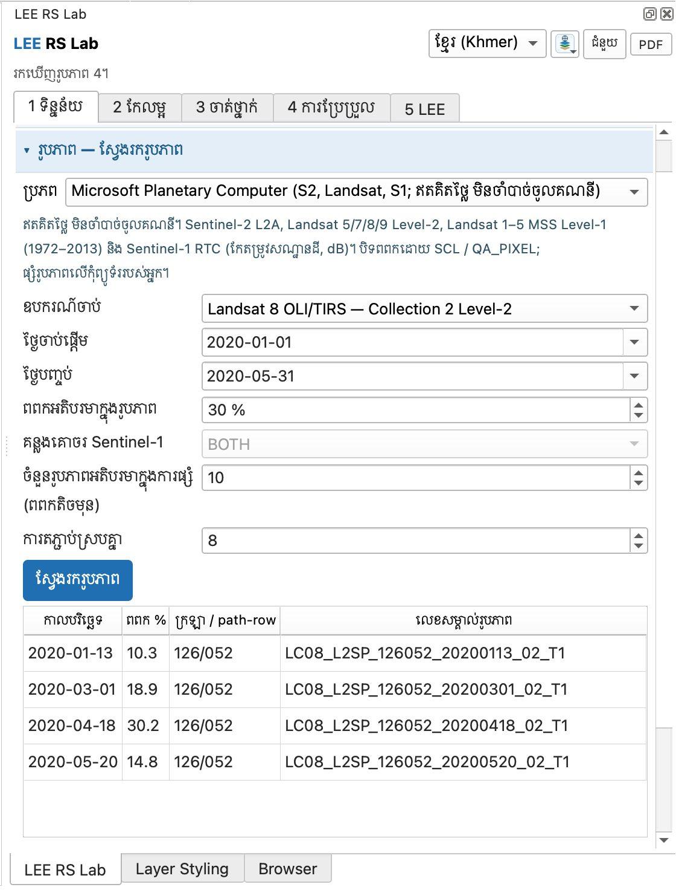
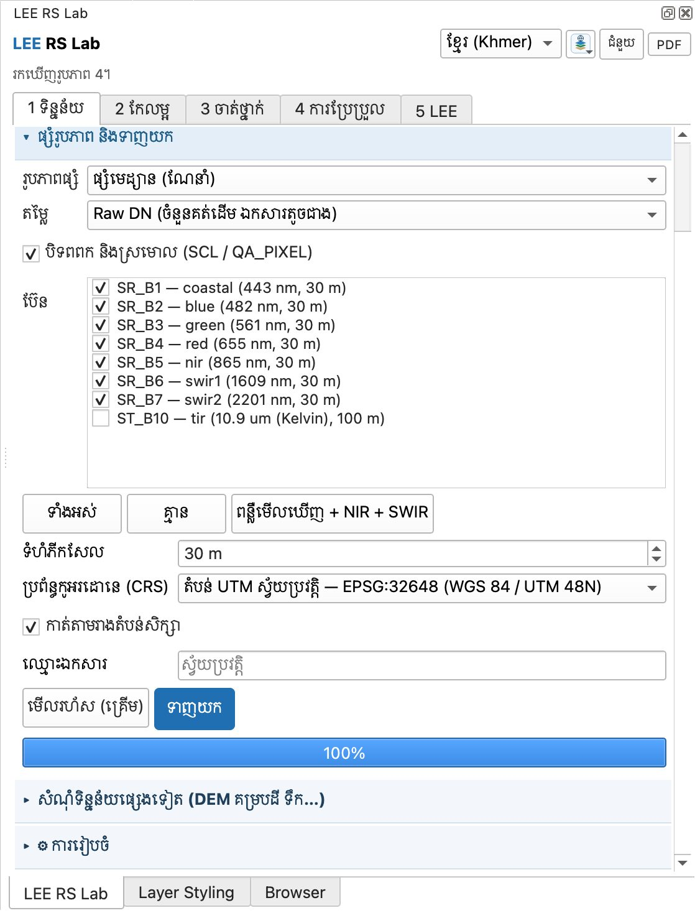
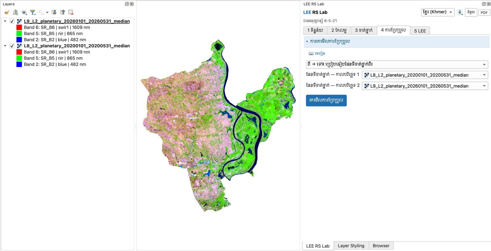
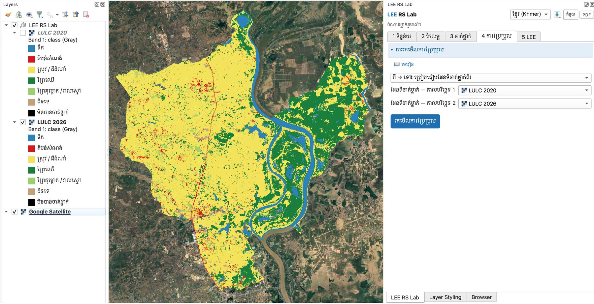
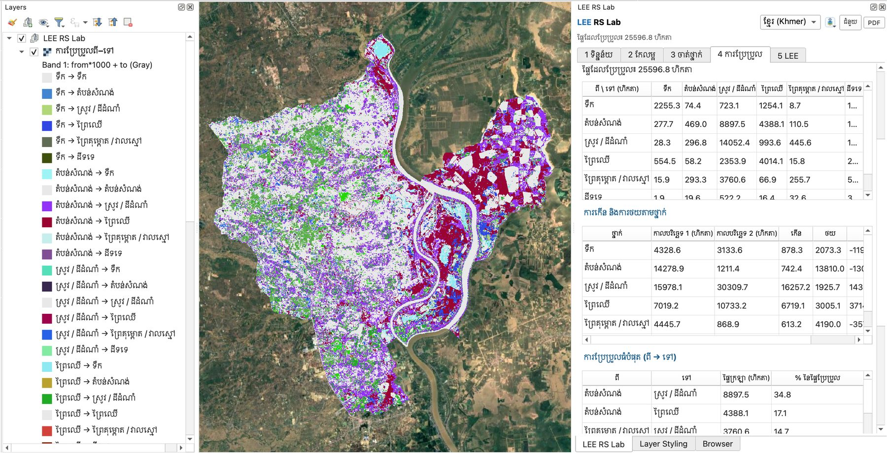
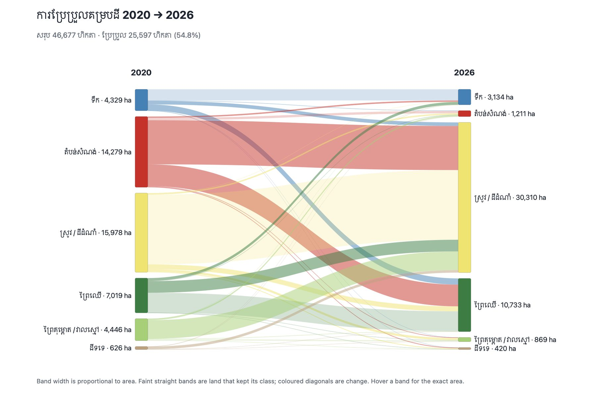
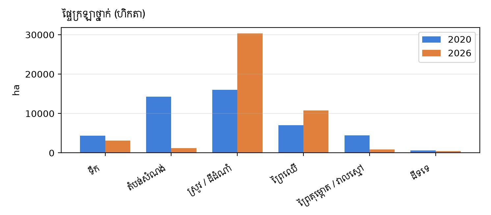
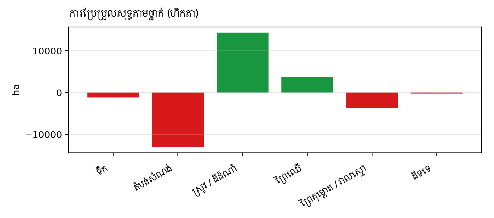
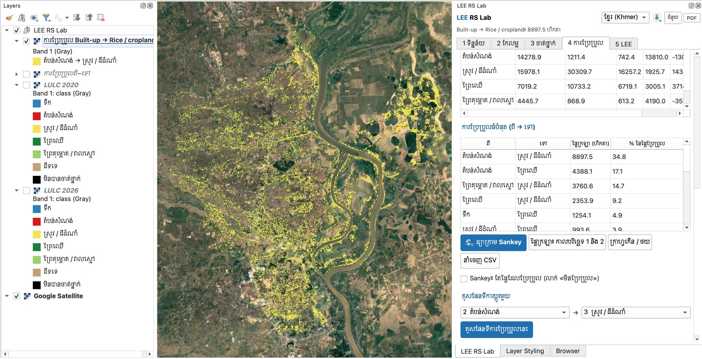

# មេរៀនទី 13 — ការប្រែប្រួល ពី → ទៅ (2020 → 2026) និងដ្យាក្រាម Sankey

ការរកមើលការប្រែប្រួលក្រោយចំណាត់ថ្នាក់ (post-classification) ប្រៀបធៀបផែនទីចាត់ថ្នាក់ពីរ ភីកសែលម្ដងៗ ហើយប្រាប់ថាថ្នាក់ណាប្ដូរទៅថ្នាក់ណា។ ក្នុងស្រុកកំពង់ត្រឡាច ពីឆ្នាំ 2020 ដល់ 2026 ផ្ទៃសរុប **46,677 ហិកតា** មាន **25,597 ហិកតា (54.8%)** ត្រូវបានចាត់ថ្នាក់ខុសគ្នា។ ប៉ុន្តែការប្រែប្រួលភាគច្រើននេះមិនពិតទេ — មេរៀននេះបង្ហាញពីរបៀបធ្វើ និង **របៀបរកឃើញការប្រែប្រួលក្លែងក្លាយ**។

## ជំហានទី 1 — ទាញយករូបភាពឆ្នាំ 2020

1. ក្នុង **1 ទិន្នន័យ › រូបភាព — ស្វែងរករូបភាព** ជ្រើស **Landsat 8 OLI/TIRS — Collection 2 Level-2** (Landsat 9 មិនទាន់មានឆ្នាំ 2020 ទេ)។
2. **ថ្ងៃចាប់ផ្តើម** 2020-01-01 · **ថ្ងៃបញ្ចប់** 2020-05-31 — **ខែដូចគ្នា** នឹងរូបភាព 2026។ រដូវខុសគ្នា (ឧ. ប្រាំង និងវស្សា) នឹងបង្កើត «ការប្រែប្រួល» ក្លែងក្លាយ។
3. ចុច **ស្វែងរករូបភាព**៖ បាន **4 រូបភាព** (path/row 126/052)។

    { loading=lazy }

    *រូបទី 50 — Landsat 8 ខែមករា–ឧសភា 2020៖ 4 រូបភាព*

4. **ផ្សំរូបភាព និងទាញយក** ដោយការកំណត់ដូចមេរៀនទី 3 (មេដ្យាន Raw DN បិទពពក SR\_B1–SR\_B7 30 m EPSG:32648)។ Landsat 8 និង 9 មានប៊ែនដូចគ្នា ដូច្នេះម៉ូដែលដដែលអាចប្រើបាន។

    { loading=lazy }

    *រូបទី 51 — ការកំណត់ផ្សំរូបភាព Landsat 8 ឆ្នាំ 2020*

!!! warning "កុំប្រើរូបភាពដើមក្នុងរបៀប ពី → ទៅ"
    រូបទី 52 បង្ហាញកំហុសញឹកញាប់៖ ជ្រើសរូបភាពផ្សំ `L8_..._2020...` និង `L9_..._2026...` ដោយផ្ទាល់។ រូបភាពមានតម្លៃការចាំងផ្លាតរាប់ពាន់ មិនមែនលេខថ្នាក់ទេ ដូច្នេះលទ្ធផលគ្មានន័យ — កម្មវិធីជំនួយ (Plugin) បដិសេធ ហើយប្រាប់ឲ្យចាត់ថ្នាក់ជាមុនសិន។

{ loading=lazy }

*រូបទី 52 — កំហុស៖ រូបភាពដើមពីរ (មិនទាន់ចាត់ថ្នាក់) ក្នុងប្រអប់ការប្រែប្រួល*

## ជំហានទី 2 — ចាត់ថ្នាក់កាលបរិច្ឆេទទាំងពីរដោយម៉ូដែលដដែល

1. ក្នុង **3 ចាត់ថ្នាក់ › មានណែនាំ — ចាត់ថ្នាក់** រូបភាពចម្បង = រូបភាព 2026 ហើយជ្រើសរូបភាព 2020 ក្នុង **ចាត់ថ្នាក់កាលបរិច្ឆេទផ្សេងទៀតផង**។
2. ជ្រើស Random Forest ហើយចុច **ចាត់ថ្នាក់**។ ស្រទាប់ពីរលេចឡើង។ ប្ដូរឈ្មោះជា **LULC 2020** និង **LULC 2026** ដើម្បីងាយស្រួល។

ហេតុអ្វីម៉ូដែលដដែល? ប្រសិនបើយើងបង្វឹកម៉ូដែលពីរផ្សេងគ្នា ភាពខុសគ្នារវាងផែនទីអាចមកពីម៉ូដែល មិនមែនពីដីទេ។ ប៉ុន្តែម៉ូដែលដែលរៀនពីរូបភាព 2026 អាចខុសលើរូបភាព 2020 ដែរ — យើងនឹងឃើញខាងក្រោម។

{ loading=lazy }

*រូបទី 53 — ផែនទី LULC 2020 និង LULC 2026 ត្រៀមសម្រាប់ការប្រៀបធៀប*

## ជំហានទី 3 — រកមើលការប្រែប្រួល

1. បើក **4 ការប្រែប្រួល** ហើយជ្រើស **ពី → ទៅ៖ ប្រៀបធៀបផែនទីចាត់ថ្នាក់ពីរ**។
2. **ផែនទីចាត់ថ្នាក់ — កាលបរិច្ឆេទ 1** = LULC 2020 និង **កាលបរិច្ឆេទ 2** = LULC 2026។
3. ចុច **រកមើលការប្រែប្រួល**។ ស្ថានភាព៖ «ផ្ទៃដែលប្រែប្រួល៖ 25596.8 ហិកតា»។
4. តារាង **ពី → ទៅ**៖ ជួរដេក = ថ្នាក់ឆ្នាំ 2020 ជួរឈរ = ថ្នាក់ឆ្នាំ 2026 (ហិកតា)។ អង្កត់ទ្រូង = មិនប្រែប្រួល។
5. តារាង **ការកើន និងការថយតាមថ្នាក់** និង **ការប្រែប្រួលធំបំផុត (ពី → ទៅ)**។
6. ស្រទាប់ **ការប្រែប្រួលពី–ទៅ** ក្នុងបញ្ជីស្រទាប់។ លេខកូដនីមួយៗ = ពី × 1000 + ទៅ ឧ. 2003 = តំបន់សំណង់ → ស្រូវ។ ផ្ទៃមិនប្រែប្រួលមានពណ៌ប្រផេះស្រាល ដើម្បីឲ្យការប្រែប្រួលលេចធ្លោ។

{ loading=lazy }

*រូបទី 54 — លទ្ធផលការប្រែប្រួល ពី → ទៅ 2020 → 2026*

## ការអានតារាង ពី → ទៅ

| ពី \\ ទៅ (ហិកតា) | ទឹក | តំបន់សំណង់ | ស្រូវ / ដីដំណាំ | ព្រៃឈើ | ព្រៃគុម្ពោត / វាលស្មៅ | ដីទទេ | សរុប 2020 |
| --- | --- | --- | --- | --- | --- | --- | --- |
| ទឹក | **2,255.3** | 74.4 | 723.2 | 1,254.2 | 8.7 | 12.9 | 4,328.6 |
| តំបន់សំណង់ | 277.7 | **469.0** | 8,897.5 | 4,388.1 | 110.5 | 136.1 | 14,279.0 |
| ស្រូវ / ដីដំណាំ | 28.3 | 296.8 | **14,052.4** | 993.6 | 445.6 | 161.5 | 15,978.2 |
| ព្រៃឈើ | 554.5 | 58.2 | 2,353.9 | **4,014.1** | 15.8 | 22.8 | 7,019.2 |
| ព្រៃគុម្ពោត / វាលស្មៅ | 15.9 | 293.3 | 3,760.6 | 66.9 | **255.7** | 53.4 | 4,445.7 |
| ដីទទេ | 1.9 | 19.6 | 522.2 | 16.4 | 32.6 | **33.8** | 626.5 |
| សរុប 2026 | 3,133.6 | 1,211.4 | 30,309.7 | 10,733.2 | 868.9 | 420.4 | 46,677.2 |

| ថ្នាក់ | 2020 (ហិកតា) | 2026 (ហិកតា) | កើន | ថយ | សុទ្ធ |
| --- | --- | --- | --- | --- | --- |
| ទឹក | 4,328.6 | 3,133.6 | 878.3 | 2,073.3 | −1,195.0 |
| តំបន់សំណង់ | 14,279.0 | 1,211.4 | 742.4 | 13,810.0 | −13,067.6 |
| ស្រូវ / ដីដំណាំ | 15,978.2 | 30,309.7 | 16,257.2 | 1,925.7 | +14,331.5 |
| ព្រៃឈើ | 7,019.2 | 10,733.2 | 6,719.1 | 3,005.1 | +3,714.0 |
| ព្រៃគុម្ពោត / វាលស្មៅ | 4,445.7 | 868.9 | 613.2 | 4,190.0 | −3,576.9 |
| ដីទទេ | 626.5 | 420.4 | 386.6 | 592.7 | −206.1 |

ការប្ដូរធំបំផុត៖ តំបន់សំណង់ → ស្រូវ **8,897.5 ហិកតា (34.8% នៃផ្ទៃប្រែប្រួល)** · តំបន់សំណង់ → ព្រៃឈើ 4,388.1 (17.1%) · ព្រៃគុម្ពោត → ស្រូវ 3,760.6 (14.7%) · ព្រៃឈើ → ស្រូវ 2,353.9 (9.2%) · ទឹក → ព្រៃឈើ 1,254.1 (4.9%)។

## ជំហានទី 4 — ដ្យាក្រាម Sankey និងក្រាហ្វ

ចុច **🌊 ដ្យាក្រាម Sankey**។ ឯកសារ HTML បើកក្នុងកម្មវិធីរុករក (ដំណើរការដោយគ្មានអ៊ីនធឺណិត)។ ជួរខាងឆ្វេង = ឆ្នាំ 2020 ជួរខាងស្ដាំ = ឆ្នាំ 2026។ ទទឹងខ្សែនីមួយៗសមាមាត្រនឹងផ្ទៃក្រឡា។ ខ្សែត្រង់ស្រាល = ដីដែលរក្សាថ្នាក់ដដែល ខ្សែកោងពណ៌ = ការប្រែប្រួល។ ដាក់កណ្ដុរលើខ្សែដើម្បីមើលហិកតាពិតប្រាកដ។ ធីក **Sankey៖ តែផ្ទៃដែលប្រែប្រួល** ដើម្បីលាក់ខ្សែ «មិនប្រែប្រួល»។

{ loading=lazy }

*រូបទី 55 — ដ្យាក្រាម Sankey៖ សរុប 46,677 ហិកតា · ប្រែប្រួល 25,597 ហិកតា (54.8%)*

- **ផ្ទៃក្រឡា៖ កាលបរិច្ឆេទ 1 និង 2** — ក្រាហ្វរបារពីរសម្រាប់ថ្នាក់នីមួយៗ។
- **ក្រាហ្វកើន / ថយ** — ការប្រែប្រួលសុទ្ធ៖ បៃតង = កើន ក្រហម = ថយ។
- **នាំចេញ CSV** — រក្សាទុកតារាង ពី → ទៅ និង កើន/ថយ សម្រាប់ Excel។

{ loading=lazy }

*រូបទី 56 — ផ្ទៃក្រឡាថ្នាក់ឆ្នាំ 2020 (ខៀវ) និង 2026 (ទឹកក្រូច)*

{ loading=lazy }

*រូបទី 57 — ការប្រែប្រួលសុទ្ធតាមថ្នាក់ (ហិកតា)*

## ជំហានទី 5 — គូសផែនទីការប្ដូរមួយ

នៅ **គូសផែនទីការប្ដូរមួយ** ជ្រើស **2 តំបន់សំណង់** → **3 ស្រូវ / ដីដំណាំ** រួចចុច **គូសផែនទីការប្រែប្រួលនេះ**។ ស្រទាប់ថ្មីបង្ហាញតែការប្ដូរនោះ (ពណ៌លឿង) ជាមួយផ្ទៃក្រឡា 8,897.5 ហិកតា។

{ loading=lazy }

*រូបទី 58 — ផែនទីការប្ដូរ តំបន់សំណង់ → ស្រូវ (8,897.5 ហិកតា) លើ Google Satellite*

## តើការប្រែប្រួលនេះពិតឬ?

មើលរូបទី 58៖ ផ្ទៃពណ៌លឿងរាយប៉ាយពេញស្រែទាំងអស់ — មិនមែនភូមិដែលប្រែជាស្រែទេ។ **តំបន់សំណង់ 14,279 ហិកតា (31% នៃស្រុក) ក្នុងឆ្នាំ 2020 គឺមិនអាចទៅរួចទេ** សម្រាប់ស្រុកជនបទនេះ។ ផែនទី LULC 2020 ខុស៖ ទំនងជាម៉ូដែលដែលរៀនពីរូបភាព 2026 បានចាត់ស្រែស្ងួតទំនេរក្នុងរូបភាព 2020 (ភ្លឺ SWIR ខ្ពស់) ទៅជា «តំបន់សំណង់» និង «ព្រៃគុម្ពោត»។

កំហុសនៃផែនទីទាំងពីរបូកចូលគ្នា៖ ប្រសិនបើផែនទីនីមួយៗត្រឹមត្រូវ 85% ផែនទីការប្រែប្រួលអាចត្រឹមត្រូវត្រឹមប្រហែល 0.85 × 0.85 ≈ 72% ប៉ុណ្ណោះ។ ក្នុងឧទាហរណ៍នេះ ផែនទី 2026 ត្រឹមត្រូវតែ 48% (មេរៀនទី 11) ហើយផែនទី 2020 មិនទាន់វាយតម្លៃនៅឡើយ។ ដូច្នេះការប្រែប្រួល 54.8% ភាគច្រើនគឺជា **កំហុសចំណាត់ថ្នាក់** មិនមែនការប្រែប្រួលនៅលើដីទេ។

- **តំបន់សំណង់ → ស្រូវ / ព្រៃឈើ** — ភូមិកម្រត្រឡប់ទៅជាស្រែ ឬព្រៃវិញណាស់។ នេះជាសញ្ញាច្បាស់នៃកំហុសផែនទី 2020។
- **ទឹក → ព្រៃឈើ (1,254 ហិកតា)** — ភាគច្រើននៅដីលិចទឹកខាងកើត៖ កម្រិតទឹកទន្លេសាបខុសគ្នារវាងឆ្នាំ។ ពិនិត្យជាមួយ JRC (មេរៀនទី 4)។
- **ស្រូវ ↔ ព្រៃឈើ** — ផែនទី 2026 ហៅស្រែជាច្រើនថាព្រៃឈើ (មេរៀនទី 11) ដូច្នេះការ «កើន» ព្រៃឈើ 3,714 ហិកតា មិនគួរឲ្យទុកចិត្តទេ។

**របៀបធ្វើឲ្យប្រសើរ៖**

1. វាយតម្លៃភាពត្រឹមត្រូវ **ផែនទី 2020** ផងដែរ (មេរៀនទី 11 ជាមួយ Google Earth Historical Imagery ឆ្នាំ 2020)។
2. បន្ថែមតំបន់ហ្វឹកហាត់ដែលត្រឹមត្រូវ **ក្នុងឆ្នាំទាំងពីរ** (ដីដែលមិនបានប្ដូរ ឧ. ទន្លេ ភូមិចាស់ ព្រៃចាស់) ឬបង្វឹកម៉ូដែលដាច់ដោយឡែកសម្រាប់ឆ្នាំនីមួយៗ ដោយតំបន់ហ្វឹកហាត់ពីរូបភាពឆ្នាំនោះ។
3. ប្រើបន្សំប៊ែនដូចគ្នា (6-5-2) ដើម្បីពិនិត្យរូបភាព 2020 និង 2026 ក្បែរគ្នា មុនជឿលើការប្ដូរណាមួយ។
4. ប្រើ **គូសផែនទីការប្ដូរមួយ** សម្រាប់ការប្ដូរនីមួយៗ ហើយប្រៀបធៀបជាមួយ Google Satellite។

> សរុប៖ ផែនទីការប្រែប្រួលល្អ ចាប់ផ្ដើមពីផែនទីចាត់ថ្នាក់ល្អទាំងពីរ។ ធ្វើឲ្យភាពត្រឹមត្រូវនៃផែនទីនីមួយៗលើសពី 85% ជាមុនសិន ទើបរាយការណ៍ការប្រែប្រួលជាហិកតា។ ក្នុងថ្នាក់រៀន ឧទាហរណ៍នេះល្អណាស់ ដើម្បីបង្រៀនឲ្យនិស្សិតសួរថា «តើនេះពិតឬ?»

> សំណួរសម្រាប់និស្សិត៖ ក្រៅពីកំហុសផែនទី តើមានហេតុផលអ្វីខ្លះទៀតដែលធ្វើឲ្យរូបភាព Landsat 8 ឆ្នាំ 2020 និង Landsat 9 ឆ្នាំ 2026 ខុសគ្នា ទោះបីជាដីមិនប្ដូរក៏ដោយ? (គិតពីភ្លៀង ការច្រូតកាត់ និងកម្រិតទឹកទន្លេសាប)

---

[← មេរៀនទី 12](lesson-12.md) · [មេរៀនទី 14 →](lesson-14.md)
