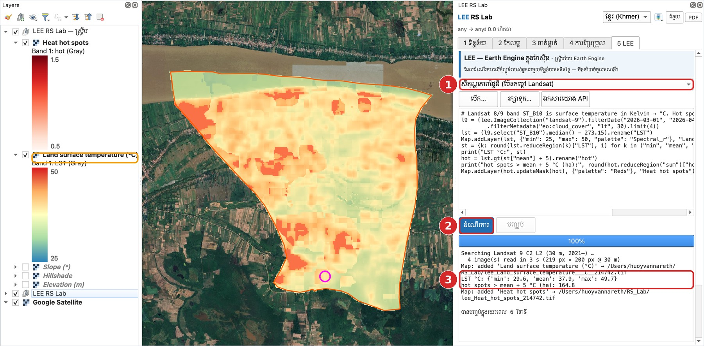
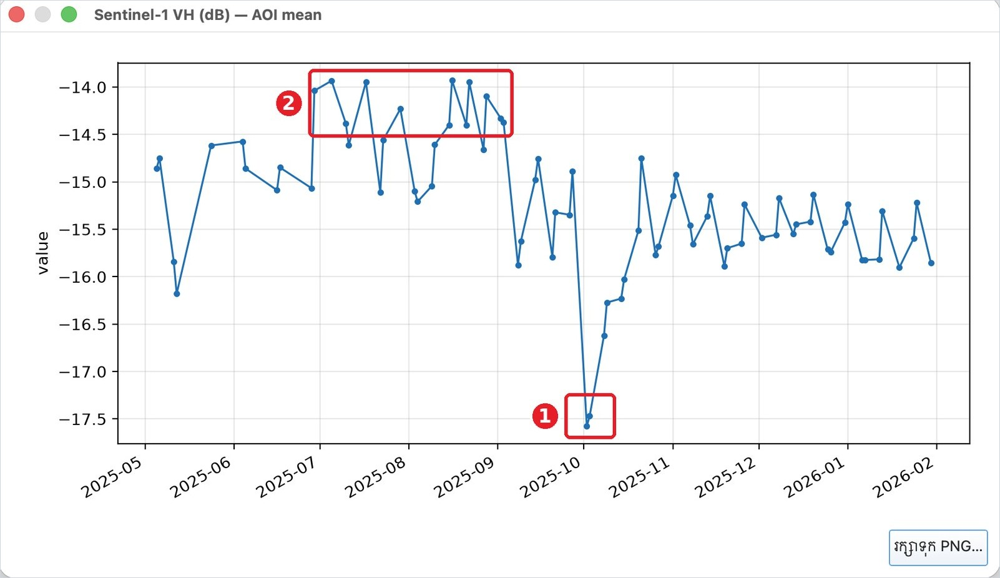

# មេរៀនទី 14 — ស្គ្រីប LEE (Local Earth Engine)

ផ្ទាំង **5 LEE** ដំណើរការស្គ្រីបបែប Google Earth Engine នៅលើកុំព្យូទ័ររបស់អ្នក ដោយមិនចាំបាច់មានគណនី។ មានឧទាហរណ៍ 32 ដែលរួចរាល់។ សីតុណ្ហភាពផ្ទៃដីនៃឃុំមហាខ្ញូងគណនារួចក្នុង **6 វិនាទី**៖ ទាបបំផុត 29.6 °C មធ្យម 37.9 °C ខ្ពស់បំផុត 49.7 °C។

## ឧទាហរណ៍ទី 1 — សីតុណ្ហភាពផ្ទៃដី (Landsat thermal)

1. ① ជ្រើសឧទាហរណ៍ **សីតុណ្ហភាពផ្ទៃដី (ប៊ែនកម្ដៅ Landsat)**។ កូដលេចឡើងក្នុងប្រអប់កែ។ អ្នកអាចប្ដូរថ្ងៃ ឬពពកដោយផ្ទាល់។
2. ② ចុច **ដំណើរការ**។
3. ③ អានលទ្ធផលក្នុងប្រអប់ខាងក្រោម៖ ស្ថិតិ LST និងផ្ទៃក្រឡា «ចំណុចក្ដៅ» (ក្ដៅជាងមធ្យម 5 °C) = **164.8 ហិកតា**។
4. ស្រទាប់ពីរបន្ថែមក្នុងក្រុម **LEE RS Lab — ស្គ្រីប**៖ Land surface temperature (°C) និង Heat hot spots។

{ loading=lazy }

*រូបទី 59 — ស្គ្រីបសីតុណ្ហភាពផ្ទៃដី*

អានផែនទី៖ ពណ៌ក្រហមជាដីទទេ ឬស្រែស្ងួតបន្ទាប់ពីច្រូត (កម្ដៅខ្ពស់ក្នុងខែមីនា–មេសា)។ ពណ៌បៃតង/ខៀវជាព្រៃ ទឹក និងភូមិមានដើមឈើ (ត្រជាក់ជាង)។ ជួរភូមិតាមមាត់ទន្លេត្រជាក់ជាងស្រែ។

## ឧទាហរណ៍ទី 2 — ប្រតិទិនស្រូវពី Sentinel-1 VH

រ៉ាដារ Sentinel-1 មើលឃើញឆ្លងកាត់ពពក ដូច្នេះអាចតាមដានរដូវវស្សាបាន។ ក្រាបបង្ហាញ VH (dB) មធ្យមនៃតំបន់សិក្សា ពីខែឧសភា 2025 ដល់ខែមករា 2026៖

- ① **ចុងខែកញ្ញា–ដើមខែតុលា 2025** VH ធ្លាក់ដល់ **−17.6 dB** — ទឹកជំនន់ ឬស្រែលិចទឹក (ទឹករលោងចាំងផ្លាតរ៉ាដាចេញ)។
- ② **ខែកក្កដា–សីហា** VH ខ្ពស់ (−14 dB) — ដំណាំលូតលាស់ពេញ (ស្លឹក និងដើមចាំងផ្លាតខ្លាំង)។
- ពីខែវិច្ឆិកា VH ស្ថិតនៅប្រហែល −15.5 dB — ក្រោយច្រូត។

{ loading=lazy }

*រូបទី 60 — ពេលវេលាស៊េរី Sentinel-1 VH៖ ① ទឹកជំនន់ ② ដំណាំលូតលាស់*

> គន្លឹះ៖ គូសតំបន់សិក្សាតូចលើស្រែតែមួយ (មេរៀនទី 1 › គូសចតុកោណ) ដើម្បីទទួលបានខ្សែកោងស្អាតជាង។ តំបន់ធំលាយទឹក ភូមិ និងស្រែ។

## ប្រើលទ្ធផល LEE ក្នុងផ្ទាំងផ្សេងទៀត

បន្ទាប់ពីស្គ្រីបដំណើរការរួច ជួរ **ប្រើលទ្ធផលក្នុងផ្ទាំងផ្សេងទៀត** លេចឡើង៖ ផ្ញើស្រទាប់ទៅ 2 កែលម្អ 3 ចាត់ថ្នាក់ ភាពត្រឹមត្រូវ ឬការប្រែប្រួល (កាលបរិច្ឆេទ 1/2)។ ផ្ទុយមកវិញ `lee.Image.open("ឈ្មោះស្រទាប់")` អានស្រទាប់ណាមួយពីគម្រោងចូលក្នុងស្គ្រីប។

---

[← មេរៀនទី 13](lesson-13.md) · [មេរៀនទី 15 →](lesson-15.md)
