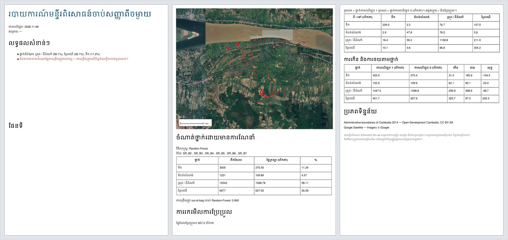

# មេរៀនទី 15 — របាយការណ៍ PDF

ប៊ូតុង **PDF** នៅខាងលើផ្ទាំង (ក្បែរ **ជំនួយ**) បង្កើតរបាយការណ៍ A4 ពីការងារទាំងអស់ដែលបានធ្វើក្នុងវគ្គនេះ។ ភាសារបាយការណ៍តាមភាសាផ្ទាំង៖ ជ្រើស **ខ្មែរ (Khmer)** ដើម្បីទទួលបានរបាយការណ៍ខ្មែរ ឬ **English** ដើម្បីទទួលបានរបាយការណ៍អង់គ្លេស។

## ជំហាន

1. រៀបចំផ្ទាំងផែនទីឲ្យបង្ហាញស្រទាប់ដែលចង់ដាក់ក្នុងរបាយការណ៍ (ឧ. ចំណាត់ថ្នាក់ 2026 លើ Google Satellite)។ របាយការណ៍ថតរូបផែនទីដែលកំពុងបង្ហាញ ហើយបន្ថែមព្រួញខាងជើង និងរង្វាស់ដោយស្វ័យប្រវត្តិ។
2. ធ្វើការវាយតម្លៃភាពត្រឹមត្រូវ (មេរៀនទី 11) ក្នុងវគ្គដដែល បើចង់ឲ្យរបាយការណ៍មានតារាងភាពច្រឡំ និងផ្ទៃក្រឡាកែសម្រួល (Olofsson)។
3. ជ្រើសភាសា រួចចុច **PDF** ហើយរក្សាទុក ឧ. RS\_lab\_report\_km.pdf។

## មាតិការបាយការណ៍

| ផ្នែក | អ្វីដែលមាន (ឧទាហរណ៍ឃុំមហាខ្ញូង) |
| --- | --- |
| លទ្ធផលសំខាន់ៗ | ថ្នាក់ធំបំផុត៖ ស្រូវ / ដីដំណាំ 58.1% ព្រៃឈើ 26.1% ទឹក 11.2% និងការព្រមានពណ៌ក្រហម បើមិនទាន់វាយតម្លៃភាពត្រឹមត្រូវ |
| ផែនទី | រូបផ្ទាំងផែនទី + ព្រួញខាងជើង + រង្វាស់ |
| ចំណាត់ថ្នាក់ដោយមានការណែនាំ | វិធីសាស្ត្រ Random Forest ប៊ែន SR\_B2–SR\_B7 តារាងផ្ទៃក្រឡាតាមថ្នាក់ និង out-of-bag 0.993 |
| ភាពត្រឹមត្រូវ | តារាងភាពច្រឡំ Kappa និងផ្ទៃក្រឡាកែសម្រួល (បើបានធ្វើមេរៀនទី 11) |
| ការរកមើលការប្រែប្រួល | ផ្ទៃដែលប្រែប្រួល 657.2 ហិកតា តារាង ពី → ទៅ និងការកើន / ថយ |
| ប្រភពទិន្នន័យ | ព្រំដែនរដ្ឋបាល ODC រូបភាព Google Satellite និងសេចក្ដីបដិសេធ |

{ loading=lazy }

*រូបទី 38 — របាយការណ៍ PDF ភាសាខ្មែរ (3 ទំព័រ)*

> ចំណាំ៖ out-of-bag 0.993 ខ្ពស់ពេក ព្រោះវាប្រើភីកសែលពីពហុកោណហ្វឹកហាត់ដដែល (ភីកសែលជិតគ្នាស្រដៀងគ្នា)។ ភាពត្រឹមត្រូវពិតគឺ 52.8% ពីចំណុចឯករាជ្យ (មេរៀនទី 11)។ ក្នុងកំណែថ្មីនៃកម្មវិធី ផែនទីនៅលើទំព័រទី 1 ជាមួយលទ្ធផលសំខាន់ៗ (កំណែចាស់ទុកទំព័រទី 1 ស្ទើរតែទទេ)។

# សេចក្ដីសន្និដ្ឋាន

មេរៀនទាំង 15 នេះនាំអ្នកឆ្លងកាត់លំហូរការងារយកព័ត៌មានពីចម្ងាយពេញលេញ៖ កំណត់តំបន់ → ទាញយករូបភាព → កែលម្អ និងសន្ទស្សន៍ → ចាត់ថ្នាក់ → វាយតម្លៃភាពត្រឹមត្រូវ → ផែនទី → ការប្រែប្រួល → របាយការណ៍ ដោយមិនចាំបាច់មានគណនី ឬកម្មវិធីបង់ថ្លៃ។ ជំហានបន្ទាប់ល្អបំផុតសម្រាប់និស្សិត៖ បន្ថែមទិន្នន័យហ្វឹកហាត់សម្រាប់ថ្នាក់ដែលខ្វះ រួចធ្វើមេរៀនទី 10, 11 និង 13 ម្ដងទៀត ហើយប្រៀបធៀបភាពត្រឹមត្រូវ និងការប្រែប្រួលមុន និងក្រោយ។

---

[← មេរៀនទី 14](lesson-14.md) · [ទំព័រដើម →](../index.md)
