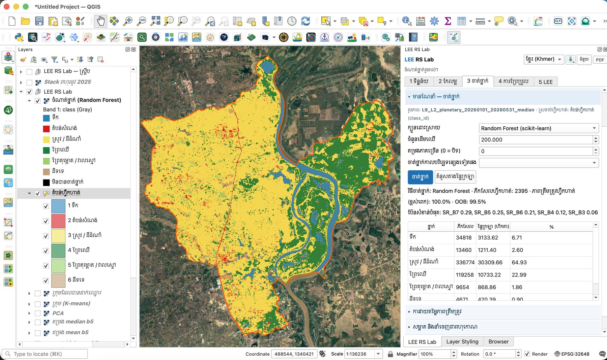

# Summary

LEE RS Lab is an open-source plugin for QGIS [@qgis] that teaches the complete remote sensing workflow in one guided panel, from choosing a study area to a validated land cover map and a change analysis. Students need no account, API key or cloud project. They pick a province, district or commune from built-in administrative boundaries, and the plugin downloads cloud-masked Sentinel-2 [@drusch2012], Landsat, Sentinel-1, MODIS, elevation and land cover data from the Microsoft Planetary Computer [@planetarycomputer] and Earth Search. Only the pixels inside the study area are read, and every step is computed on the student's own computer with NumPy and GDAL.

The panel follows the order of a typical course: (1) data; (2) enhancement (band combinations, spectral indices, filters, principal components); (3) classification, with K-means and ISODATA clustering, a multi-season Sentinel-2 + Sentinel-1 feature stack with a cluster-labelling table, and supervised classification by Maximum Likelihood, Minimum Distance, Spectral Angle Mapper, Parallelepiped, Random Forest [@breiman2001], SVM and k-nearest neighbours through scikit-learn [@pedregosa2011], followed by accuracy assessment with Cochran sample sizes [@cochran1977] and area-adjusted estimates with 95 % confidence intervals [@olofsson2014]; and (4) from–to change detection with a Sankey diagram. A fifth tab, LEE (*Local Earth Engine*), runs Earth-Engine-style scripts such as `lee.ImageCollection(...).filterDate(...).median()` locally, with 32 ready examples, so that students see the code behind the buttons and are prepared for Google Earth Engine [@gorelick2017].

The whole interface switches between English and Khmer, and every section contains a short built-in lesson. A *Basic / Advanced* switch hides advanced tools from beginners, and a click-to-grow "magic wand" turns a single click into a training polygon of spectrally similar, connected pixels. A 15-lesson Khmer manual with annotated screenshots, built on one real example (Kampong Tralach district, Kampong Chhnang province), is published with the code as a website and a PDF (\autoref{fig:panel}).

# Statement of need

The author has taught the third-year undergraduate course in basic remote sensing at the Royal University of Phnom Penh for about five years, with around 250 students each year, using the Semi-Automatic Classification Plugin (SCP) [@congedo2021]. SCP is powerful and widely used, but in this setting the practical work is slow: an unsupervised classification exercise takes students about three hours and a supervised classification about six hours. Most of this time is not spent on remote sensing concepts. Students must first create an account on USGS EarthExplorer [@earthexplorer], download complete scenes of several hundred megabytes each over a shared network, obtain an administrative boundary layer and clip the scenes to their study area. In addition, the plugin occasionally fails on some student computers, and the interface and learning material are in English, while many students learn best in Khmer.

Other free tools solve parts of this problem. Cloud platforms such as Google Earth Engine [@gorelick2017] and its QGIS and Python front ends [@wu2020] remove the downloads but require a personal account and cloud project for each student. The EnMAP-Box [@jakimow2023] is designed for imaging spectroscopy research. Narrow plugins cover single steps, such as classification or accuracy sampling. None of them offers an introductory course path in Khmer that works without registration.

LEE RS Lab addresses these needs for an introductory or intermediate course (Table 1). The study area, download, clipping and compositing become one step: the six-band Landsat composite of the 465 km² example district is about ten megabytes, instead of several full scenes. The software also teaches good practice that is often skipped in introductory courses. It separates training accuracy from independent accuracy, reports user's and producer's accuracy, and replaces pixel-counting areas with the stratified estimator of @olofsson2014. The manual reports the real, imperfect results of its example (overall accuracy 48 %, kappa 0.22) and uses them to discuss why a 100 % training accuracy or a large apparent change between two dates can be misleading. Because only QGIS and free data are needed, other teachers can adopt the tool by installing it from the official QGIS plugin repository and following the manual. Translating one JSON file (`rs_lab/i18n/km.json`) and the manual is enough to localise it to another language.

: Steps of the practical work with the current workflow (SCP) and with LEE RS Lab.

| Step | Current course workflow (SCP) | LEE RS Lab |
|---|---|---|
| Account | USGS EarthExplorer account for every student | None |
| Imagery | Download complete scenes (hundreds of MB each) | Only the pixels of the study area, cloud-masked composite |
| Study area | Find and load an administrative boundary layer, clip each scene | Choose province / district / commune from built-in Cambodian boundaries (Khmer names) |
| Language | English interface and documents | English or Khmer interface, 15 Khmer lessons |
| Training data | Draw polygons by hand | Draw by hand, magic wand (one click), or automatic points from ESA WorldCover |
| Accuracy and area | Confusion matrix | Cochran sample size, labelling tool, confusion matrix, area-adjusted areas with 95 % confidence intervals |
| Reported time | About 3 h (unsupervised) and 6 h (supervised) per exercise | **[TODO: to be measured in the first classroom use]** |

# Features for teaching and learning

- **Guided workflow**: one dock panel with five tabs and collapsible sections; each section has a built-in lesson, and the output of one step is pre-selected in the next.
- **Basic / Advanced modes**: Basic shows only the main steps and chooses sensible defaults (for example Random Forest); Advanced shows every tool.
- **Training data**: hand-drawn polygons, the click-to-grow magic wand, or automatic training points from ESA WorldCover [@zanaga2022].
- **Unsupervised labelling**: a multi-season feature stack with a hint for each cluster, a click on a cluster to fly to example pixels, and splitting of mixed clusters.
- **Accuracy**: Cochran sample size with proportional or equal allocation, a point-labelling tool with class buttons and a blind mode, the confusion matrix, kappa, and area-adjusted areas with confidence intervals.
- **Code bridge**: every dataset can be opened as a LEE script, and LEE results can be sent back to the other tabs.
- **Outputs**: an A4 map layout and a PDF lab report of each student's results.

An automated test suite (47 tests, run on GitHub Actions) covers the numerical core without QGIS. It checks, among other things, that the area-adjusted estimator reproduces the worked example of @olofsson2014, that clustering and classifiers recover known classes, that the magic wand follows field boundaries, and that every interface string has a Khmer translation.

# Experience of use

LEE RS Lab was developed in 2026 and has not yet been used in a full course. The design is based on the author's five years of teaching the same course with SCP, summarised in Table 1. Each version addressed a difficulty observed in that course: the removal of accounts and full-scene downloads, built-in Khmer boundaries for clipping, a Khmer interface and manual, and, in version 2.4, a simpler Basic mode and the magic wand after the author's own testing showed that the panel was too complicated for beginners and that drawing training polygons was slow. The manual was produced by working through every lesson in the plugin on real data.

**[TODO: The plugin will be used in the third-year basic remote sensing course (semester 1, about 250 students). Add here the semester of first use, the lessons used, the time students needed for the unsupervised and supervised exercises compared with the SCP figures above, the main problems they met, and any survey results. Reviewers are likely to ask for this information.]**

# Story of the project

The project started in 2026, when the author began rebuilding the practical exercises of his remote sensing course so that students could work in Khmer, on their own laptops, without creating accounts or downloading full scenes. The exercises were built around free STAC catalogues and a small local engine, LEE, which keeps the Earth Engine way of writing scripts but runs on the student's computer. Later versions added Khmer administrative boundaries, a manual based on one real district, area-adjusted accuracy estimates, a multi-season feature stack for vegetation types, the Basic mode and the magic wand. The plugin and manual are developed openly at https://github.com/khgeo/lee-rs-lab under the GPL-2.0-or-later licence (code) and CC BY-SA 4.0 (manual).

# Software availability

- Source code: https://github.com/khgeo/lee-rs-lab (version 2.4.1)
- Installation: QGIS 3.22–3.44, Plugins › Manage and Install Plugins › LEE RS Lab
- Manual (Khmer): https://khgeo.github.io/lee-rs-lab/
- Licence: GPL-2.0-or-later (code), CC BY-SA 4.0 (manual and figures)
- Archive: **[TODO: Zenodo DOI, added after acceptance]**

# AI usage disclosure

Generative AI was used in this project. Claude (Anthropic; model Claude Opus 5.5, accessed through the Claude app in 2026) helped to write and refactor parts of the plugin code, the automated tests, the documentation and manual text, and to draft this manuscript. The author defined the requirements, made the design and teaching decisions, tested the software in QGIS, checked and corrected all AI-generated code and text, and takes responsibility for the content.

# Acknowledgements

Imagery is provided by the Copernicus programme of the European Union and ESA, by USGS/NASA (Landsat) and through the Microsoft Planetary Computer and Earth Search. Administrative boundaries for Cambodia are from Open Development Cambodia. **[TODO: thank colleagues or students who tested the lessons, and any funding.]**

# References
